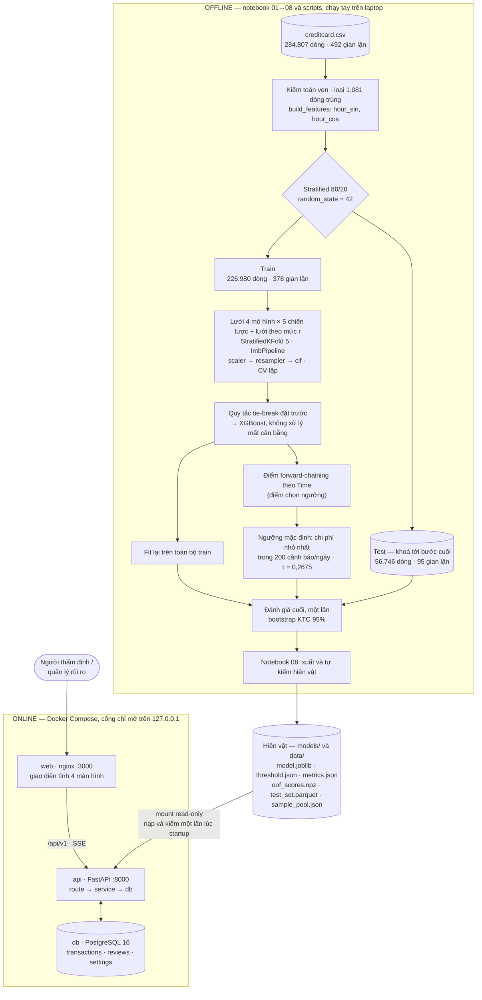
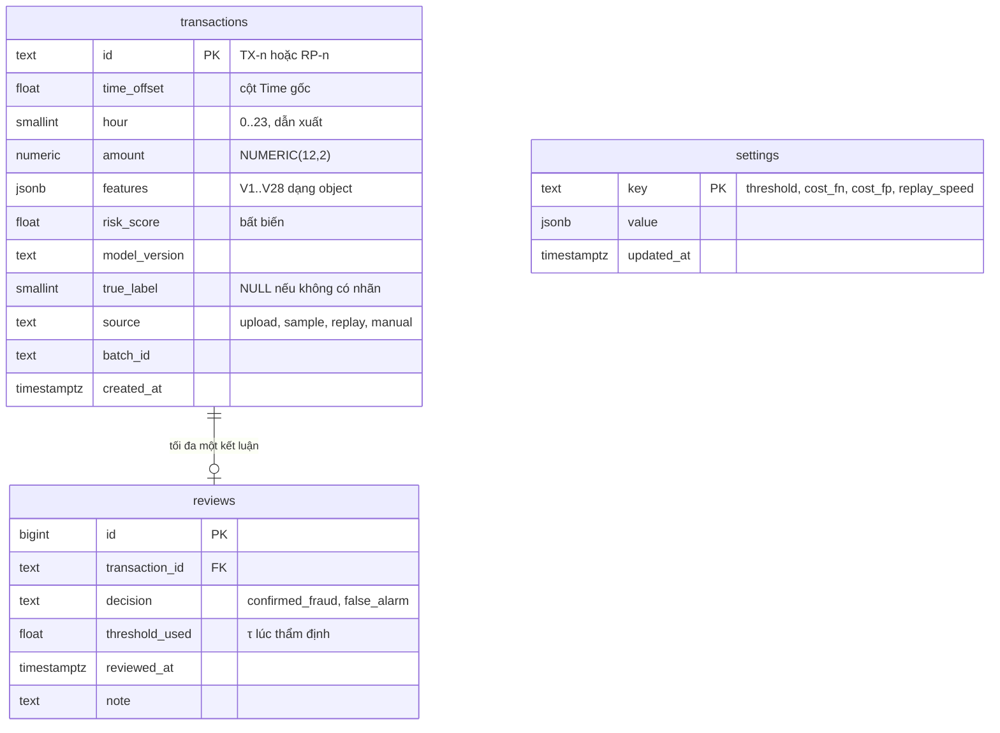
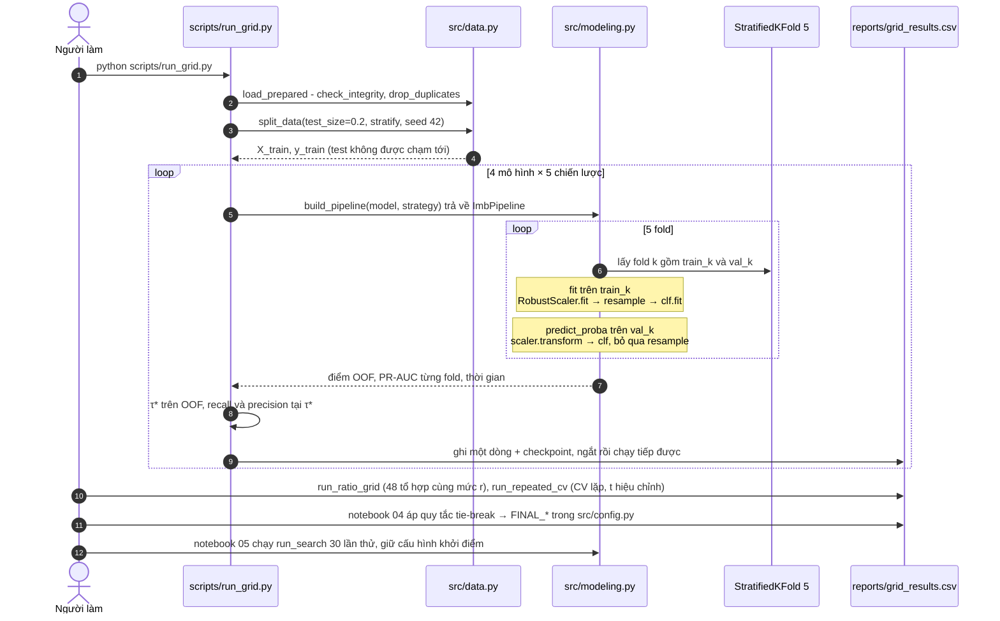
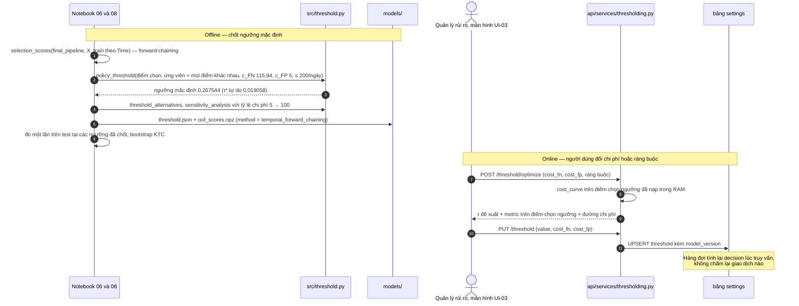
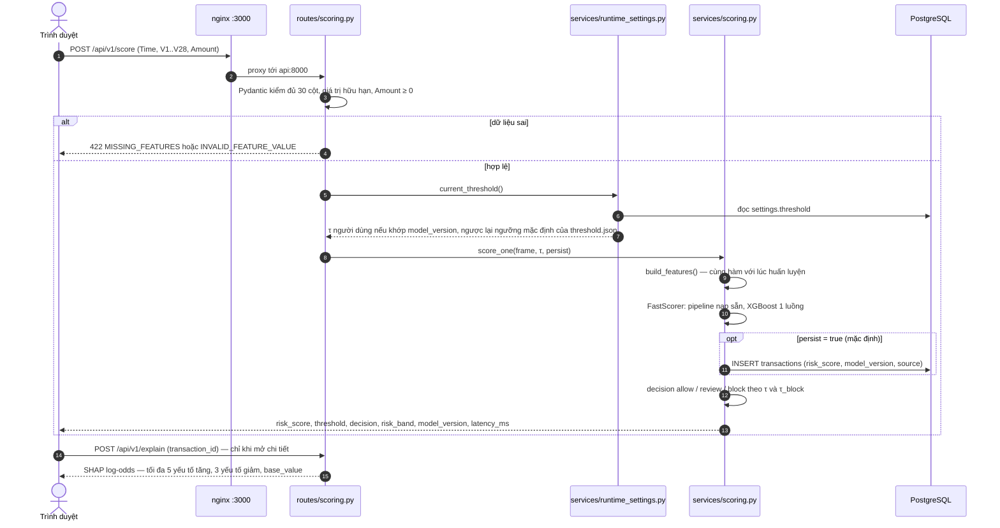

# System Architecture — Fraud Detection

Phát hiện gian lận thẻ tín dụng: phân loại nhị phân cực kỳ mất cân bằng. Tài liệu này gom kiến trúc
toàn hệ thống vào một chỗ. Chi tiết từng phần nằm trong [docs/](docs/README.md); mỗi mục bên dưới trỏ
tới tài liệu gốc.

| | |
|---|---|
| **Dữ liệu** | Credit Card Fraud Detection — ULB, Kaggle `mlg-ulb`, tệp `creditcard.csv`, giấy phép DbCL v1.0. 284.807 giao dịch, 492 gian lận (0,172%), hai ngày của tháng 9/2013 |
| **Chi phí nghiệp vụ** | `c_FN` = 115,94 EUR cho một vụ bỏ lọt, `c_FP` = 5 EUR cho một cảnh báo giả, ngân sách thẩm định 200 cảnh báo/ngày. Cả ba là **giả định** chưa được nghiệp vụ xác nhận, đổi được lúc chạy (§8) |
| **Tech stack** | Python 3.12, pandas, scikit-learn, imbalanced-learn, XGBoost, SHAP · FastAPI, SQLAlchemy 2 + Alembic, PostgreSQL 16 · Next.js (static export) hoặc Alpine.js, nginx · Docker Compose · pytest |
| **Phạm vi** | Đồ án môn học: 21 ngày, một người làm. Demo chạy cục bộ, không phải production |
| **Hạ tầng** | Laptop cá nhân, CPU 12 lõi, không GPU. Huấn luyện trên Windows, phục vụ trong container Linux |
| **Nguồn số liệu** | Lần xuất `xgb_none_v2` (2026-10-11, sau review phần ML — [docs/11](docs/11-review-ml-va-ke-hoach-sua.md)): `models/*.json`, `reports/*.csv`, [reports/bao-cao.md](reports/bao-cao.md) |

Quy ước trong tài liệu:
- **Giả định:** điều dự án tự quy ước vì dữ liệu không cho biết.
- **Chưa làm:** thiết kế đề xuất, chưa có trong mã.

---

## 1. Overview

### 1.1 Mục tiêu

Bài toán không dừng ở chỗ đạt PR-AUC cao. Nó chỉ xong khi **biến được điểm rủi ro thành quyết định**
(cho qua / thẩm định / chặn), với ngưỡng chọn theo chi phí và năng lực thẩm định, và giải thích được vì
sao chọn ngưỡng đó.

Dự án có hai sản phẩm:
1. **Pipeline nghiên cứu tái lập được** (notebook 01 → 08): so sánh các chiến lược xử lý mất cân bằng,
   chọn metric, chọn ngưỡng theo chi phí.
2. **Bảng điều khiển thẩm định** (API + giao diện 4 màn hình). Nó tồn tại để luận điểm "ngưỡng là một
   quyết định đánh đổi, không phải hằng số 0,5" nhìn thấy được.

### 1.2 Goals

| Mã | Goal | Tiêu chí nghiệm thu | Kết quả |
|---|---|---|---|
| G-1 | So sánh các chiến lược mất cân bằng bằng số liệu | Đủ lưới 4 × 5, cùng một CV (AC-M3) | 20/20 tổ hợp — `reports/grid_results.csv`; thêm 48 tổ hợp ở cùng mức cân bằng (`ratio_grid.csv`) và CV lặp (`repeated_cv_tests.csv`) |
| G-2 | Chọn metric đúng cho tỷ lệ 1:600 | PR-AUC trên test ≥ 0,75 (AC-M1) | 0,828 [0,747 – 0,900] |
| G-3 | Không rò rỉ dữ liệu | ML-01…ML-08, `tests/test_no_leakage.py` (AC-M4) | Đạt |
| G-4 | Ngưỡng theo chi phí | Recall ≥ 0,75 tại ngưỡng mặc định (AC-M2), có phân tích độ nhạy (AC-M8) | 0,758 [0,674 – 0,842] tại τ = 0,2675, 187 cảnh báo/ngày — đạt theo ước lượng điểm, sát nút, có điều kiện (§8.3) |
| G-5 | Giải thích từng giao dịch | 5 yếu tố tăng + 3 yếu tố giảm (FR-24) | SHAP qua `POST /explain` — đủ 5 + 3 khi mô hình có đủ đóng góp cùng dấu |
| — | Tái lập | PR-AUC lệch < 0,001 giữa hai lần chạy (AC-M5) | Lệch 0 trên lần xuất `xgb_none_v2` (2026-10-11, 9 notebook, 46,5 phút); lần trước lệch 0 (2026-09-27) |
| — | Chạy bằng một lệnh | `docker compose up` (AC-A8) | Khởi động 11–15 giây |

### 1.3 Non-goals

| Không làm | Lý do |
|---|---|
| Huấn luyện online, tự động huấn luyện lại | Dữ liệu tĩnh, chỉ hai ngày, không có luồng thật |
| Đặc trưng hành vi theo thẻ (tần suất, lịch sử chủ thẻ) | Dữ liệu đã qua PCA, không có mã thẻ |
| Xác thực, phân quyền | Demo cục bộ một người dùng; cổng chỉ mở trên `127.0.0.1` |
| Cloud, CI/CD, giám sát drift tự động (cảnh báo, tự chọn lại ngưỡng) | Vượt quỹ 21 ngày. Đã có bảng theo dõi tối thiểu (API-16, §11.3); thiết kế khi mở rộng: §10.4, §11.3 |
| Thông lượng production (hàng nghìn TPS) | Không phải mục tiêu học thuật |
| Điểm rủi ro là xác suất đã hiệu chỉnh | Quyết định chỉ dựa trên thứ hạng và ngưỡng — §8.5 |
| Diễn giải nghiệp vụ của V1–V28 | Là thành phần PCA, không diễn giải được |

---

## 2. Architecture Diagram



Ba nguyên tắc kiến trúc ([docs/03 §2](docs/03-thiet-ke-kien-truc.md)):

- **AR-01 — Offline và online chỉ nối với nhau qua hiện vật.** API không huấn luyện và không đọc
  `creditcard.csv`. Nó chỉ nạp `models/` và `data/` (mount read-only). Nhờ vậy số trong demo trùng số
  trong báo cáo.
- **AR-02 — Mô hình được lưu dưới dạng pipeline đầy đủ.** `model.joblib` chứa cả preprocessor lẫn
  classifier. Đặc trưng sinh bằng đúng một hàm `src/features.build_features` cho cả train lẫn serve.
- **AR-03 — Ngưỡng là cấu hình, không thuộc mô hình.** Mô hình chỉ trả điểm. Quyết định được suy ra
  lúc truy vấn, từ ngưỡng lưu trong bảng `settings`. Đổi ngưỡng không phải chấm lại giao dịch nào.

---

## 3. Components

| # | Thành phần | Trách nhiệm | Công nghệ / mã | Input | Output |
|---|---|---|---|---|---|
| C1 | Data loader & validator | Tải dữ liệu, kiểm toàn vẹn, loại trùng, chia tập | `scripts/download_data.py`, `src/data.py` | Kaggle API hoặc mirror | DataFrame sạch, train/test, `data/test_set.parquet` |
| C2 | Feature builder | Sinh `hour_sin`/`hour_cos` từ `Time`, cố định thứ tự cột; preprocessor `RobustScaler` cho `Amount` | `src/features.py` | 30 cột thô | 31 đặc trưng theo `FEATURE_ORDER` |
| C3 | Experiment runner | Dựng `ImbPipeline` cho từng cặp (mô hình, chiến lược, mức cân bằng), chạy CV và CV lặp, lưu checkpoint có dấu vân tay cấu hình; chọn cấu hình cuối bằng quy tắc đặt trước; sinh điểm chọn ngưỡng forward-chaining | `src/modeling.py`, `scripts/run_grid.py`, `run_ratio_grid.py`, `run_repeated_cv.py`, `run_search.py` | Train, lưới cấu hình | `reports/grid_results.csv`, `ratio_grid.csv`, `repeated_cv*.csv`, `search_results.csv`, điểm OOF |
| C4 | Evaluator | Tính metric, bootstrap KTC, bootstrap hiệu theo cặp, kiểm định t hiệu chỉnh cho CV lặp, KTC Wilson | `src/evaluate.py` | `(y, score)` | Bảng metric kèm KTC 95% |
| C5 | Threshold optimizer | Quét ngưỡng, dựng cost curve, các tiêu chí chọn (mặc định: chi phí nhỏ nhất trong ngân sách thẩm định), phân tích độ nhạy, năng lực cần cho một mức recall | `src/threshold.py` | Điểm chọn ngưỡng, `c_FN`, `c_FP`, ràng buộc | Ngưỡng mặc định, các phương án, bảng độ nhạy |
| C6 | Explainer | SHAP toàn cục (báo cáo) và cục bộ (API) | SHAP `TreeExplainer` (notebook 07); `pred_contribs` của XGBoost (`api/serving.py`) | Mô hình + giao dịch | Đóng góp từng đặc trưng, thang log-odds |
| C7 | Artifact exporter | Xuất hiện vật, tự kiểm, đối chiếu với `reports/*.csv` | Notebook 08, `src/artifacts.py` | Mô hình cuối, τ\*, metric | 7 tệp (§10.3) |
| C8 | Scoring API | Nạp và kiểm hiện vật lúc startup; chấm điểm, ngưỡng, hàng đợi, thẩm định, replay | FastAPI, Pydantic v2, `api/` (route → service → db) | JSON hoặc CSV giao dịch | Điểm, quyết định, SHAP, metric |
| C9 | App storage | Lưu giao dịch đã chấm, kết luận thẩm định, cấu hình lúc chạy | PostgreSQL 16, SQLAlchemy 2 + psycopg 3, Alembic | Lệnh từ C8 | Bảng `transactions`, `reviews`, `settings` |
| C10 | Web UI | Hàng đợi, ngưỡng, hiệu năng mô hình, phát lại | `frontend/` Next.js (mặc định) hoặc `web/` Alpine.js, sau nginx | `/api/v1` | 4 màn hình |
| C11 | Fallback demo | Phương án A khi Docker không chạy được | Streamlit, `app.py` | `model.joblib`, `threshold.json`, `sample_pool.json` | Demo chấm điểm |
| C12 | Test suite | Đơn vị, tích hợp, chống rò rỉ (quét mã + canary), đối chiếu client/server, đóng gói | pytest, `tests/` | Mã, hiện vật, PostgreSQL test | 406 ca xanh (2026-10-11) |

Ràng buộc phụ thuộc: `src/` không import `fastapi` hay `streamlit`. Đây là lớp thấp nhất, được dùng
chung cho notebook và API.

---

## 4. Project Structure

```
fraud-detection/
├── SYSTEM_ARCHITECTURE.md       # tài liệu này
├── README.md · TASKS.md
├── data/                        # ngoài git: creditcard.csv, test_set.parquet, sample_pool.json
├── notebooks/                   # chạy theo thứ tự
│   ├── 01_eda · 02_statistics · 03_baseline · 04_imbalance_strategies
│   ├── 05_advanced_models · 06_threshold_and_cost · 06b_autoencoder (tùy chọn)
│   └── 07_explainability · 08_export_artifacts
├── src/                         # dùng chung cho notebook + API
│   ├── config.py                # RANDOM_STATE=42, TEST_SIZE=0.2, CV_FOLDS=5, chi phí mặc định
│   ├── data.py                  # load_data, check_integrity, drop_duplicates, split_data, temporal_split
│   ├── features.py              # build_features, FEATURE_ORDER, make_preprocessor ← ranh giới train/serve
│   ├── modeling.py              # build_pipeline, run_grid, run_ratio_grid, repeated_cv_scores,
│   │                            # select_configuration, final_pipeline, selection_scores
│   ├── evaluate.py              # bootstrap_ci, bootstrap_diff, corrected_resampled_ttest, wilson_interval
│   ├── threshold.py             # cost_curve, pick_threshold, policy_threshold, sensitivity_analysis
│   ├── artifacts.py             # payload + validate_* cho hiện vật, fingerprint điểm
│   └── stats.py · plots.py · anomaly.py
├── scripts/                     # download_data, run_grid, run_ratio_grid, run_repeated_cv, run_search,
│                                # check_reproducibility, demo_db
├── models/                      # hiện vật; trong git chỉ có threshold.json và metrics.json
├── reports/                     # bao-cao.md, *.csv, figures/
├── api/
│   ├── main.py · config.py · loader.py · serving.py · schemas.py · errors.py · deps.py
│   ├── routes/                  # vỏ HTTP mỏng: scoring, transactions, threshold, metrics, replay, monitoring
│   ├── services/                # scoring, explaining, thresholding, transactions, runtime_settings, replay,
│   │                            # monitoring
│   ├── db.py · models_orm.py · migrations/      # Alembic
│   ├── entrypoint.py            # alembic upgrade head → uvicorn
│   └── Dockerfile · requirements.txt
├── frontend/                    # Next.js + TypeScript + Tailwind + Recharts (bản đóng gói mặc định)
├── web/                         # cùng giao diện, HTML + Alpine.js + Chart.js (dự phòng)
├── deploy/nginx.conf            # phục vụ tệp tĩnh + proxy /api
├── tests/                       # pytest, gồm golden test đặc trưng và test chống rò rỉ
├── docs/                        # đặc tả và thiết kế chi tiết, 00–11 (11: review ML và kế hoạch sửa)
├── app.py                       # Streamlit — phương án A
├── docker-compose.yml           # db + api + web
└── requirements.txt             # ghim đúng phiên bản của lần xuất hiện vật
```

---

## 5. Data Pipeline & Data Model

### 5.1 Schema đầu vào

| Cột | Kiểu | Ghi chú |
|---|---|---|
| `Time` | float | Số giây kể từ giao dịch đầu tiên, 0 … 172.792. **Không** dùng trực tiếp làm đặc trưng |
| `V1` … `V28` | float | Thành phần PCA, đã ẩn danh, không diễn giải được |
| `Amount` | float | 0 … 25.691,16, lệch phải rất mạnh. **Giả định:** đơn vị là EUR |
| `Class` | int | 1 = gian lận. Không bắt buộc khi chấm điểm |

**Giả định:** giao dịch có `Time = 0` xảy ra lúc 00:00. Bằng chứng gián tiếp: các giờ 1h–6h vắng nhất,
khớp với ban đêm. Nếu giả định sai, `hour_sin`/`hour_cos` chỉ lệch pha một hằng số và mô hình vẫn học
được chu kỳ 24 giờ. Điều bị ảnh hưởng chỉ là cách đọc, ví dụ "lúc 2h tỷ lệ gian lận cao".

### 5.2 Làm sạch và sinh đặc trưng

| Bước | Quy tắc | Số liệu |
|---|---|---|
| Kiểm toàn vẹn | Dừng nếu sai số dòng, số cột, số mẫu dương, hoặc có NaN | 284.807 × 31, 0 ô thiếu, 492 mẫu dương |
| Trùng lặp | Loại các dòng trùng hoàn toàn **trước** khi chia tập (DS-20, ML-06), nếu không cùng một dòng có thể nằm ở cả train lẫn test | 1.081 dòng trùng (19 là gian lận) → còn 283.726 dòng, 473 gian lận (0,167%, ~1:600) |
| `Amount = 0` | Giữ lại vì là tín hiệu thật (giao dịch thử thẻ) | 25 vụ gian lận có `Amount = 0` |
| `Time` | Bỏ giá trị thô (ML-07). Thay bằng `hour_sin`, `hour_cos` tính từ `floor(Time/3600) mod 24` | Ra 31 đặc trưng |
| Chuẩn hoá | Chỉ chuẩn hoá `Amount`, bằng `RobustScaler` đặt **trong pipeline**, nên scaler fit theo từng fold (ML-04). V1–V28 giữ nguyên | — |

**Hợp đồng train/serve.** `build_features()` là đường vào duy nhất và `FEATURE_ORDER` là hằng số. Hai
lớp canh giữ: `tests/test_features.py` giữ cặp input/output vàng, và lúc startup API chấm lại 1/50 tập
test rồi so với điểm đã lưu. Hợp đồng dữ liệu vào của API (DS-10…DS-15) nằm ở
[docs/02 §5](docs/02-dac-ta-du-lieu.md).

### 5.3 Chiến lược chia train/val/test

```
283.726 dòng sau khi loại trùng
├── test 20%  — stratified, random_state=42 — 56.746 dòng / 95 gian lận
│     → data/test_set.parquet; chỉ mở cho đánh giá cuối
└── train 80% — 226.980 dòng / 378 gian lận
      ├── StratifiedKFold(5, shuffle=True, random_state=42) → điểm out-of-fold (OOF) ngẫu nhiên
      │     dùng để: so sánh cấu hình, tinh chỉnh                ← vai trò của tập validation
      └── sắp theo Time, TimeSeriesSplit(4) → điểm forward-chaining ("điểm chọn ngưỡng")
            dùng để: chọn ngưỡng, ước lượng cảnh báo/ngày        ← từ review 2026-10-10 (docs/11 M2)
```

| Cách chia | Vai trò | PR-AUC trên test |
|---|---|---|
| Stratified ngẫu nhiên 80/20 | **Chính** — mọi bảng kết quả | 0,828 [0,747 – 0,900] |
| Theo thời gian: ngày 1 → ngày 2 (`Time < 86.400`) | Kiểm tra phụ (FR-10, AC-M7) | 0,773 [0,724 – 0,827] |
| Ngẫu nhiên, nhưng thu train về đúng kích thước ngày 1 | Đối chứng | 0,817 |

**Vì sao chọn stratified làm cách chính:**
1. Dữ liệu chỉ có hai ngày. Chia theo thời gian chỉ cho đúng một cửa sổ test dài một ngày: không tách
   được "drift" khỏi "đặc thù riêng của ngày 2", và không đủ ngày để làm rolling-origin validation.
2. Lưới 20 cấu hình cần các fold có cùng phân bố thì mới so sánh công bằng được. Stratify giữ mỗi fold
   validation ở khoảng 76 mẫu gian lận.
3. Kết quả so sánh được với các tài liệu khác dùng cùng bộ dữ liệu.

**Vì sao vẫn giữ cách chia theo thời gian:** vì nó gần với triển khai thật hơn. Dòng đối chứng cho thấy
−0,044 trong tổng chênh −0,055 PR-AUC là do **lệch thời gian**, phần còn lại do ít dữ liệu hơn. Với ngưỡng
chọn trên CV ngẫu nhiên của ngày 1, precision ở ngày 2 chỉ còn 0,365 (ngẫu nhiên 80/20: 0,862) và tỷ lệ báo
động giả gấp khoảng 10 lần. Kết luận: con số chính **lạc quan** so với triển khai thật (ADR-04), và ngưỡng
phải chọn trên điểm mô phỏng tương lai.

**Vì sao không tách một tập validation riêng:** xem ADR-05.

**Vì sao ngưỡng chọn trên điểm forward-chaining, không trên OOF ngẫu nhiên** (sau review 2026-10-10): ngưỡng
là đại lượng nhạy với độ lệch thời gian hơn PR-AUC nhiều — cùng quy trình chọn trên OOF ngẫu nhiên, sang ngày 2
sinh gần gấp đôi số cảnh báo dự kiến. Forward-chaining cho mỗi khối thời gian được chấm bởi mô hình chỉ học quá
khứ của nó, đúng hoàn cảnh triển khai; khối đầu (1/5 tập huấn luyện) không có điểm. Đối chứng ngày 1 → ngày 2:
§8.2.

### 5.4 Data model lúc chạy



- **Không có cột `decision`** (ST-01). Quyết định là hàm của `risk_score` và τ hiện hành, nên được tính
  lúc truy vấn. Nếu lưu, mọi bản ghi cũ sẽ sai ngay khi ai đó kéo thanh trượt.
- **`reviews.threshold_used`** (ST-02). Chính sách tại thời điểm thẩm định là dữ kiện lịch sử, cần giữ
  lại.
- **`settings.threshold` mang theo `model_version`.** Sau khi huấn luyện lại, ngưỡng đặt cho mô hình cũ
  tự bị bỏ qua và hệ thống quay về τ\* của `threshold.json`.
- **`features` lưu dạng object có tên khóa**, không phải mảng, để không thể lệch thứ tự cột.

Chi tiết lược đồ: [docs/06 §2–3](docs/06-thiet-ke-luu-tru.md).

---

## 6. Imbalance Handling

### 6.1 So sánh các chiến lược

| # | Chiến lược | Cấu hình | Cơ chế | Ưu | Nhược | Trạng thái |
|---|---|---|---|---|---|---|
| S1 | none | — | Mốc tham chiếu | Rẻ, không méo điểm, Brier tốt nhất với XGBoost | Mô hình đơn giản nghiêng hẳn về lớp 0 | Đã chạy — **được chọn** cùng XGBoost (quy tắc §6.3) |
| S2 | Class weight | `class_weight='balanced'` (LR, DT, RF); `scale_pos_weight=599,5` cho XGBoost (tỷ lệ âm/dương của train sau khi loại trùng); lưới theo mức: trọng số lớp dương r × N_âm/N_dương | Tăng trọng số loss của lớp dương | Không đổi dữ liệu, không tốn thêm thời gian | Đẩy điểm lên, điểm xa xác suất hơn; cân bằng hoàn toàn làm Decision Tree sụp | Đã chạy, cả ở 4 mức r — được chọn ở bản trước, thay sau review |
| S3 | Random undersampling | `RandomUnderSampler(sampling_strategy=0.1)`; lưới theo mức: `sampling_strategy = r` | Bỏ bớt lớp 0 tới tỷ lệ 1:10 | Nhanh nhất, khoảng 1 giây/fold | Vứt khoảng 98% lớp 0 của mỗi fold; kém nhất ở mọi mô hình và mọi r | Đã chạy |
| S4 | SMOTE | `SMOTE(0.1, k_neighbors=5)`; lưới theo mức: `sampling_strategy = r` | Nội suy mẫu dương mới giữa các láng giềng | Hơn class weight cân bằng hoàn toàn ở LR, RF, DT trong bảng chuẩn — nhưng ở cùng mức r thì chỉ còn RF, và CV lặp không xác nhận | Chậm hơn; sinh mẫu cả ở vùng chồng lấn | Đã chạy |
| S5 | SMOTE-Tomek | `SMOTETomek(0.1)` | Chạy SMOTE, sau đó xoá các cặp Tomek | Lý thuyết là dọn được vùng biên | Thực đo: xoá **0 cặp**, điểm OOF giống hệt S4, tốn 40% thời gian lưới | Đã chạy — kết quả âm tính |
| S6 | ADASYN | — | Như SMOTE, nhưng sinh nhiều mẫu hơn quanh các mẫu dương "khó" | Dồn mẫu vào vùng biên | 67% số FN nằm lẫn trong vùng hợp lệ trên cả 5 đặc trưng chính. Sinh mẫu dương ở đó nhiều khả năng làm tăng FP (dự đoán, chưa kiểm) | **Chưa chạy** |

Ghi chú:
- **`sampling_strategy=0.1`, không đưa về 1:1.** Cân bằng hoàn toàn làm méo prior rất mạnh và làm
  precision sụp. Sau review, lưới theo mức chạy mọi chiến lược ở r ∈ {0,02; 0,1; 0,3; 1}: so ở **cùng** mức,
  khác biệt giữa `class_weight` và SMOTE của Decision Tree và Logistic Regression biến mất — nó đến từ mức
  cân bằng chứ không từ kỹ thuật ([docs/04 §3.6](docs/04-thiet-ke-mo-hinh-ml.md)).
- **Vì sao S5 = S4.** Dữ liệu gốc của fold 1 có 21 cặp Tomek, nhưng sau SMOTE thì không còn cặp nào:
  láng giềng gần nhất của mỗi vụ gian lận giờ là một điểm tổng hợp cùng lớp. Muốn Tomek có tác dụng thì
  phải dọn **trước** khi sinh mẫu. Còn chi tiết ở [docs/04 §3.5](docs/04-thiet-ke-mo-hinh-ml.md).
- **Thêm ADASYN hoặc chiến lược khác:** thêm một nhánh vào `_make_resampler` và `STRATEGY_NAMES` trong
  `src/modeling.py`. CV, OOF và test chống rò rỉ dùng lại nguyên.
- **Các hướng khác đã cân nhắc:** `sample_weight` theo `Amount` (học theo chi phí trực tiếp) — chưa làm;
  autoencoder chỉ học lớp hợp lệ (notebook 06b) — PR-AUC 0,329, thua rõ học có giám sát.

### 6.2 Chống rò rỉ khi resample

```python
pipe = ImbPipeline([                      # imblearn, KHÔNG phải sklearn.pipeline
    ("preprocess", make_preprocessor()),  # RobustScaler(Amount) — fit trên phần train của fold
    ("resample",   SMOTE(sampling_strategy=0.1, random_state=42)),
    ("clf",        XGBClassifier(...)),
])
cross_val_predict(pipe, X_train, y_train, cv=StratifiedKFold(5, shuffle=True, random_state=42),
                  method="predict_proba")
```

- Bước resample chỉ chạy trong `fit`. Khi `predict`, `ImbPipeline` tự bỏ qua nó. Vì vậy trong mỗi fold
  chỉ phần train bị resample; fold validation và tập test luôn giữ phân bố thật.
- `build_pipeline()` luôn trả `ImbPipeline`, kể cả khi không có bước resample. Nhờ vậy
  `tests/test_no_leakage.py` kiểm được toàn lưới bằng một điều kiện duy nhất.
- Dấu hiệu báo động: PR-AUC > 0,95 gần như chắc chắn là rò rỉ. Cao nhất đo được là 0,855.

### 6.3 Ma trận thí nghiệm: mô hình × chiến lược

Cùng `StratifiedKFold(5)` trên train, `scoring='average_precision'`. Mỗi dòng còn ghi τ\* tối ưu chi phí
trên OOF, recall/precision tại τ\* đó, Brier và thời gian chạy. Cả lưới mất 45,7 phút (lần chạy lại có tải
nền: 66,1 phút, cùng điểm OOF).

PR-AUC trên CV (trung bình ± độ lệch chuẩn giữa các fold):

| Mô hình \ Chiến lược | none | class weight | undersample | SMOTE | SMOTE-Tomek |
|---|---|---|---|---|---|
| XGBoost | 0,851 ± 0,030 | **0,855 ± 0,030** | 0,781 ± 0,069 | 0,853 ± 0,030 | 0,853 ± 0,030 |
| Random Forest | 0,841 ± 0,033 | 0,840 ± 0,029 | 0,759 ± 0,045 | **0,855 ± 0,031** | 0,855 ± 0,031 |
| Logistic Regression | 0,758 ± 0,031 | 0,742 ± 0,029 | 0,719 ± 0,021 | 0,757 ± 0,023 | 0,757 ± 0,023 |
| Decision Tree | 0,695 ± 0,037 | 0,359 ± 0,117 | 0,241 ± 0,053 | 0,640 ± 0,040 | 0,640 ± 0,040 |

Mốc so sánh: một bộ phân loại ngẫu nhiên có PR-AUC bằng tỷ lệ dương, ≈ 0,0017.

Đọc kết quả:
1. **Mô hình quyết định nhiều hơn chiến lược.** Nhóm dẫn đầu — XGBoost với none, class weight hoặc
   SMOTE, và Random Forest + SMOTE — nằm trong khoảng 0,851–0,855. Chênh lệch giữa chúng nhỏ hơn độ lệch
   chuẩn giữa các fold (~0,03).
2. **Phần lớn khác biệt class weight / SMOTE là của mức cân bằng.** Ở cùng r = 0,1, Decision Tree cho 0,642
   và 0,640; Logistic Regression 0,760 và 0,757. "Class weight làm Decision Tree sụp từ 0,695 xuống 0,359" là
   hiệu ứng của trọng số gấp 600 lần: SMOTE đưa về 1 : 1 cũng sụp (0,459).
3. **Không còn khác biệt "thật" nào trong nhóm dẫn đầu.** CV lặp (XGBoost 5 × 5, Random Forest 3 × 5 fold)
   với kiểm định t hiệu chỉnh Nadeau–Bengio: RF + SMOTE − RF + class weight +0,0106 [−0,0063; +0,0275];
   XGBoost + class weight − RF + class weight +0,0143 [−0,0070; +0,0357] — cả hai KTC chứa 0, trong khi
   bootstrap trên OOF gộp của bản trước cho cả hai là "khác biệt thật". Random Forest còn chỉ phát ra 200–269
   mức điểm (300 cây → các giá trị k/300), nên không dùng được cho thanh trượt ngưỡng.
4. Undersampling kém nhất ở mọi mô hình và mọi mức r.
5. **Chọn XGBoost, không xử lý mất cân bằng** — quy tắc tie-break đặt trước (docs/04 §3.7): ứng viên là mọi
   cấu hình XGBoost trong vòng 0,01 PR-AUC của cấu hình cao nhất (9 cấu hình); cả 9 hoà với cấu hình có trung
   bình CV lặp cao nhất (class weight r = 0,3, 0,8589; `none` −0,0037 [−0,0119; +0,0046]); trong nhóm hoà chọn
   chiến lược đơn giản nhất. Cấu hình khởi điểm: `n_estimators=500`, `learning_rate=0.05`, `max_depth=6`,
   `subsample=0.8`, `colsample_bytree=0.8`, `tree_method="hist"`. `RandomizedSearchCV` 30 lần thử (13,2 phút
   ở lần chạy lại) cho 0,8538 ± 0,0328; quy tắc giữ hay thay cấu hình tinh chỉnh vẫn đặt trước khi nhìn test
   (§7.4).

---

## 7. Evaluation Metrics

### 7.1 Metric và vai trò

| Metric | Vai trò | Lý do |
|---|---|---|
| **PR-AUC** (`average_precision_score`) | **Chính** — chọn mô hình, scoring trong CV | Chỉ nhìn lớp dương. Mốc là 0,00167, nên 0,828 cao gấp khoảng 495 lần mốc |
| **Chi phí kỳ vọng** tại τ | **Chính** — chọn ngưỡng | Là ngôn ngữ của người ra quyết định (§8) |
| Recall@τ, Precision@τ | Chính — báo cáo vận hành | Recall là độ phủ gian lận; precision quyết định tải thẩm định |
| Cảnh báo/ngày | Ràng buộc vận hành | `alerts / tỷ lệ mẫu / số ngày` — quy về toàn luồng |
| Ma trận nhầm lẫn | Bắt buộc trình bày | Bốn con số tuyệt đối, không che được gì |
| F1 | Phụ | Ngầm coi FN và FP tốn như nhau — sai ở bài này |
| ROC-AUC | Phụ, để đối chiếu | Lạc quan khi TN khổng lồ |
| Accuracy | **Không dùng** | Mô hình "luôn đoán hợp lệ" đã đạt 99,83% |

### 7.2 Vì sao không dùng accuracy, và vì sao ROC-AUC không làm metric chính

- **Accuracy** thưởng cho việc đoán lớp đa số. Ở notebook 03, accuracy còn xếp hạng **ngược** hai mô
  hình cơ sở so với PR-AUC (`reports/figures/03_accuracy_vs_prauc.png`).
- **ROC-AUC** dùng `FPR = FP / (FP + TN)`, mà TN trên tập test vào khoảng 56.600. Ví dụ: tăng FP từ 38
  lên 380 chỉ đẩy FPR từ 0,07% lên 0,67%, trong khi precision rơi từ 0,67 xuống khoảng 0,17.
- **Bằng chứng ngay trong dự án:** autoencoder có ROC-AUC 0,949 so với 0,975 của XGBoost — trông gần như
  ngang nhau. Nhưng PR-AUC là 0,329 so với 0,828.

### 7.3 Xử lý độ dao động khi có ít mẫu dương

Tập test chỉ có 95 mẫu dương, nên mỗi FN kéo recall xuống 1,05 điểm phần trăm.

| Kỹ thuật | Áp dụng ở đâu |
|---|---|
| Stratified CV; báo cáo trung bình ± độ lệch chuẩn | Lưới thí nghiệm. Độ lệch chuẩn PR-AUC giữa các fold ~0,03 |
| Bootstrap phân tầng 1.000 lần trên test → KTC 95% | Mọi metric chính của mô hình cuối |
| Bootstrap **theo cặp** cho hiệu (hai mô hình hoặc hai ngưỡng dùng cùng một mẫu resample) | So cấu hình, so ngưỡng. Chỉ kết luận "hơn" khi KTC không chứa 0 |
| Quy tắc chọn đặt trước khi nhìn test | Cấu hình tinh chỉnh so với cấu hình khởi điểm |
| KTC Wilson cho tỷ lệ theo từng dải điểm | Bảng calibration (§8.5) |
| Báo cáo cả cận dưới | Cận dưới PR-AUC 0,747 và recall tại ngưỡng mặc định 0,674 dưới 0,75 → ghi "đạt theo ước lượng điểm" |
| CV lặp + kiểm định t **hiệu chỉnh** Nadeau–Bengio cho các cặp cấu hình cần kết luận | t-test thường trên các fold sai vì các fold dùng chung dữ liệu huấn luyện; bản hiệu chỉnh nhân phương sai với `1/k + n_test/n_train` |

### 7.4 Kết quả cuối trên test

Mô hình `xgb_none_v2`; chỉ số phụ thuộc ngưỡng đo tại ngưỡng mặc định τ = 0,2675:

| Metric | Giá trị [KTC 95%] |
|---|---|
| PR-AUC | 0,828 [0,747 – 0,900] |
| ROC-AUC | 0,975 [0,958 – 0,991] |
| Recall@τ | 0,758 [0,674 – 0,842] — 72/95 |
| Precision@τ | 0,960 [0,915 – 1,000] |
| F1@τ | 0,847 |
| Ma trận nhầm lẫn | TP 72 · FP 3 · FN 23 · TN 56.648 |
| Cảnh báo/ngày | 187 (ngân sách 200) |

**Kỷ luật với tập test.** Tập test không được dùng để **chọn** bất cứ thứ gì: cấu hình chốt bằng CV và CV lặp
trên tập huấn luyện (notebook 04), quy tắc giữ hay thay cấu hình tinh chỉnh chốt trên OOF (notebook 05),
ngưỡng chốt trên điểm forward-chaining (notebook 06). Nó được **mở để đo** ở nhiều chỗ — notebook 03 (mô hình
cơ sở), 05 (mô hình cuối, bản tinh chỉnh — PR-AUC 0,819 —, chia theo thời gian), 06 (các phương án ngưỡng),
06b, 07 (SHAP, phân tích lỗi), 08 (xuất hiện vật) — và các phân tích đó chỉ để **mô tả**, không đổi mô hình hay
ngưỡng mặc định. Lỗ hổng ở tầng giao diện (R5) đã đóng: preview và thanh trượt tính trên điểm chọn ngưỡng.

---

## 8. Cost-based Threshold Selection

### 8.1 Hàm chi phí

```
Cost(τ) = c_FN · FN(τ) + c_FP · FP(τ)
```

| Tham số | Mặc định | Nguồn | Cấu hình ở đâu |
|---|---|---|---|
| `c_FN` | 115,94 EUR | **Giả định A-01:** bằng `Amount` trung bình của các vụ gian lận **trong tập huấn luyện** (trước review: 122,21, tính trên dữ liệu thô gồm cả test — cho cùng τ\*) | `settings.cost_fn`, API-10/11/12, màn hình UI-03 |
| `c_FP` | 5,00 EUR | **Giả định A-02:** công thẩm định một cảnh báo | `settings.cost_fp` |
| ngân sách | 200 cảnh báo/ngày | **Giả định A-03:** năng lực của đội thẩm định | `threshold.json → constraints.alert_budget_per_day` |

Tỷ lệ hai chi phí khoảng 23:1.

**Phí thẩm định cho cả TP.** Hàm trên không tính phí thẩm định cho cảnh báo đúng. Giả sử mọi cảnh báo,
kể cả TP, đều tốn `c_r`. Gọi P là tổng số mẫu dương (hằng số), ta có:

```
Cost' = c_FN·FN + c_r·(TP + FP) = (c_FN − c_r)·FN + c_r·FP + c_r·P
```

Tức là chỉ cần thay `c_FN` bằng `c_FN − c_r` = 110,94. Tỷ lệ mới là 22,2:1, vẫn nằm trong dải 15:1–75:1 mà
τ\* không đổi (§8.3). Không cần sửa mã: muốn tính kiểu này thì nhập `c_FN` = 110,94 ở UI-03.

**Biến thể: chi phí theo số tiền.** Tham số `fn_costs` của `src/threshold.py` cho phép mỗi vụ bỏ lọt tốn
đúng `Amount` của nó. Với mô hình cuối, ngưỡng cực tiểu chi phí theo số tiền trùng τ\*, nhưng lợi ích của
việc hạ 0,5 → τ\* trên test co từ −722 [−1.347; −238] EUR (chi phí cố định) xuống −169 [−673; +105] EUR (theo
số tiền) — khoảng tin cậy chứa 0. Kết luận về tiền phụ thuộc dạng hàm chi phí; đó là quyết định nghiệp vụ.

### 8.2 Tối ưu ngưỡng trên điểm chọn ngưỡng (forward-chaining)

1. `selection_scores()`: sắp tập huấn luyện theo `Time`, `TimeSeriesSplit(4)` — mỗi khối được chấm bởi mô
   hình (đúng pipeline đã chọn) chỉ học các khối trước nó. Kết quả là 181.584 điểm (249 mẫu dương, khối đầu
   không có điểm), trải 1,45 ngày, lưu vào `models/oof_scores.npz` kèm `method`, `train_fraction`, `days`.
2. Ngưỡng ứng viên là `np.unique(điểm)` — mọi giá trị điểm khác nhau. Không dùng lưới 200 lượng tử vì nó
   quá thô ở phần đuôi: với lưới đó, ngưỡng trong ngân sách ra 0,4255 thay vì 0,2675.
3. `cost_curve()` → τ\* = argmin Cost = **0,0191** (297 cảnh báo/ngày); **ngưỡng mặc định** =
   argmin Cost trong các τ có cảnh báo/ngày ≤ 200 = **0,2675** (`policy_threshold`, `selection_method:
   min_cost_within_budget`).
4. Tính song song các phương án khác (`threshold_alternatives`): τ\* tự do, F1 cao nhất, recall ≥ 0,90,
   τ nhỏ nhất trong ngân sách, và 0,5.
5. Phân tích độ nhạy với tỷ lệ `c_FN : c_FP` từ 5:1 tới 100:1.
6. Chốt kết quả vào `threshold.json`, rồi đo **một lần** trên test.

Lúc chạy, `POST /threshold/optimize` lặp lại bước 2–3 trên `oof_scores.npz` (đã nạp sẵn trong RAM) với chi
phí và ràng buộc người dùng nhập; metric trả về cũng tính trên bộ điểm đó. Với chi phí mặc định và ràng buộc
200 cảnh báo/ngày, nó ra đúng ngưỡng mặc định của `threshold.json`. `GET /threshold/preview` và thanh trượt
UI-D1 (dữ liệu từ `GET /threshold/oof-scores`) cũng tính trên điểm chọn ngưỡng — người dùng không còn chọn
được τ theo số của tập test (R5 đã đóng).

**Vì sao forward-chaining.** Đối chứng chỉ dùng ngày 1 rồi áp ngưỡng cho ngày 2: với τ\*, CV ngẫu nhiên ước
tính 327 cảnh báo/ngày mà thật là 539 (×1,65); forward-chaining ước tính 367, thật 536 (×1,46). Sát hơn,
chưa đủ sát — nên còn §11.3.

### 8.3 Kết quả trên test

Mọi ngưỡng dưới đây đều được chọn trên điểm chọn ngưỡng.

| Ngưỡng | Cảnh báo/ngày | TP | FP | FN | Precision | Recall | Chi phí |
|---|---|---|---|---|---|---|---|
| 0,5 (mặc định của thư viện) | 180 | 71 | 1 | 24 | 0,986 | 0,747 | 2.788 EUR |
| **0,2675 (mặc định: chi phí nhỏ nhất trong ngân sách)** | **187** | **72** | **3** | **23** | **0,960** | **0,758** | **2.682 EUR** |
| 0,0191 (τ\*, chi phí nhỏ nhất không ràng buộc) | 242 | 78 | 19 | 17 | 0,804 | 0,821 | 2.066 EUR |
| 0,6434 (F1 cao nhất) | 177 | 70 | 1 | 25 | 0,986 | 0,737 | 2.904 EUR |
| 0,00011 (recall ≥ 90% trên điểm chọn) | 4.325 | 85 | 1.645 | 10 | 0,049 | 0,895 | 9.384 EUR |

- **τ\* so với 0,5:** τ\* bắt thêm 7 vụ, đổi lại 18 cảnh báo giả, tiết kiệm 722 [238; 1.347] EUR trên test —
  khoảng tin cậy không chứa 0 (bản trước, mô hình có trọng số lớp: 197 EUR, chứa 0). Nhưng τ\* sinh 242–297
  cảnh báo/ngày, vượt ngân sách.
- **Ngưỡng mặc định so với 0,5:** chỉ thêm 1 vụ bắt được (−106 [−343; +20] EUR, chứa 0); so với τ\*: bỏ lọt
  thêm 6 vụ (+616 EUR). Đó là cái giá của ngân sách 200/ngày — mọi ngưỡng rẻ hơn đều vượt ngân sách.
- **AC-M2:** recall 0,758 [0,674; 0,842] = 72/95 tại ngưỡng mặc định — đạt theo ước lượng điểm, sát nút. Năng
  lực cần cho recall 0,75 ước lượng ~185 cảnh báo/ngày. Trên ngày mới (đối chứng ngày 1 → ngày 2) ngưỡng
  trong ngân sách chỉ cho recall ~0,70.
- **Độ nhạy:** τ\* đổi theo bậc: 0,127 (5:1) · 0,046 (7,5:1) · 0,038 (10:1) · **0,0191 (15–75:1)** · 0,0035
  (100:1); hối tiếc ≤ 3,6% từ 7,5:1, cao nhất 9,6% ở 5:1. Ngưỡng trong ngân sách chỉ có hai giá trị trên cả
  dải (0,4986 ở 5:1, 0,2675 còn lại): khi ngân sách là ràng buộc chặt, năng lực thẩm định quyết định ngưỡng.
- **Ràng buộc chọn vừa khít trên điểm chọn ngưỡng hụt nhẹ trên dữ liệu mới:** recall ≥ 0,90 chọn trên điểm chọn
  cho 0,895 trên test. Ràng buộc tuân thủ thật cần có biên an toàn.

### 8.4 Ba mức quyết định

| Quyết định | Điều kiện | Trên test: gian lận / hợp lệ |
|---|---|---|
| `allow` | score < τ | 23 / 56.648 |
| `review` | τ ≤ score < τ_block | 65 / 3 |
| `block` | score ≥ max(τ, τ_block) | 7 / 0 |

τ_block = 0,9995 là ngưỡng nhỏ nhất mà **mọi** ngưỡng từ đó trở lên đều có precision ≥ 95% trên điểm chọn
ngưỡng (`BLOCK_MIN_PRECISION`). API tính nó lúc startup từ `oof_scores.npz`. Với mô hình cuối, điều kiện cho mọi
phần đuôi chỉ thoả rất sát 1, nên chặn tự động hiếm và gần như mọi cảnh báo qua tay người — chấp nhận được khi
tải ~190 cảnh báo/ngày. Mức 90% cho τ_block = 0,6121 (test: chặn 70 gian lận + 1 hợp lệ). Luật 3τ ban đầu
(0,0572) nằm dưới ngưỡng mặc định, tức chặn thẳng mọi cảnh báo.

### 8.5 Có cần calibration sau resampling không?

**Vấn đề.** SMOTE, undersampling và `scale_pos_weight` đều làm thay đổi prior mà mô hình nhìn thấy, nên điểm
bị lệch so với xác suất thật. Công thức Bayes τ = c_FP / (c_FP + c_FN) = 5 / 120,94 ≈ 0,041 chỉ đúng khi điểm
là xác suất đã hiệu chỉnh. Mô hình cuối không resample, không trọng số lớp — nhưng vẫn không hiệu chỉnh.

**Quyết định: không calibrate trong đường ra quyết định** (ADR-08).
- τ được chọn **thực nghiệm** trên phân bố điểm của chính mô hình, nên mọi độ lệch hiệu chỉnh đã nằm sẵn trong
  τ. Đó là lý do τ\* = 0,0191 chứ không phải 0,041.
- Một phép hiệu chỉnh đơn điệu chặt, như Platt/sigmoid, không đổi thứ hạng. Do đó PR-AUC và điểm vận hành
  giữ nguyên nếu chọn lại τ trên điểm đã hiệu chỉnh. Isotonic thì khác: nó là hàm bậc thang, gộp nhiều điểm
  thành một bậc, làm mất độ mịn mà thanh trượt cần — đúng lý do đã loại Random Forest.

**Số đo trên điểm chọn ngưỡng.** Tổng thể điểm sát xác suất: trung bình 0,00122 so với tỷ lệ gian lận 0,00137;
Brier 0,000439, tốt hơn khoảng 3 lần so với đoán hằng số (0,001369). Ở hai đầu vẫn lệch, ít hơn bản trước:
- Dải ≥ 0,9: điểm trung bình 0,986, tỷ lệ thật 0,954 [0,912; 0,977] (bản trước 0,997 so với 0,936).
- Dải 0,5–0,9: 0,709 so với 0,513 — quá tự tin; dải < 0,001: 0,000022 so với 0,00021 — thấp hơn khoảng 10 lần.

**Khi nào phải calibrate:** khi đọc điểm như xác suất; khi tính tổn thất kỳ vọng `p × Amount` cho từng giao
dịch (chi phí theo số tiền); hoặc khi so điểm giữa các `model_version`. **Chưa làm** — cách làm đề xuất:
- Fit calibrator trên điểm out-of-fold, tức dữ liệu mô hình chưa thấy; tuyệt đối không fit trên test.
- Ưu tiên sigmoid: 378 mẫu dương là ít đối với isotonic.
- Đánh giá bằng reliability diagram và Brier trên test.

Vì những lý do trên, giao diện gọi giá trị này là "điểm rủi ro", không phải "xác suất".

---

## 9. Data Flow

### 9.1 Chạy thí nghiệm



### 9.2 Chọn ngưỡng



### 9.3 Chấm điểm một giao dịch



---

## 10. API Design & Deployment

### 10.1 Endpoint chính

Tiền tố `/api/v1`, không có xác thực. Tài liệu tự sinh tại `/docs`. Hợp đồng đầy đủ:
[docs/05](docs/05-thiet-ke-api.md).

| Nhóm | Endpoint | Chức năng |
|---|---|---|
| Hệ thống | `GET /health` | Trạng thái hiện vật và DB, `model_version`. Trả 503 nếu chưa nạp được |
| Chấm điểm | `POST /score` | Chấm một giao dịch — p95 phía máy chủ 18,7–24,1 ms |
| | `POST /score/batch` | Tối đa 50.000 giao dịch, `persist` tùy chọn |
| | `POST /score/upload` | CSV ≤ 100 MB, ghi bằng `COPY` — 10.000 dòng mất 3,1 giây |
| | `POST /explain` | SHAP cho một giao dịch |
| Thẩm định | `GET /transactions`, `GET /transactions/{id}` | Hàng đợi có lọc và phân trang; chi tiết một giao dịch |
| | `POST /reviews` | Ghi kết luận kèm `threshold_used` (UPSERT) |
| Ngưỡng | `GET /threshold` | τ hiện hành, ngưỡng mặc định và chính sách chọn nó, ràng buộc, các phương án, τ_block, mô tả điểm chọn ngưỡng |
| | `PUT /threshold` | Đặt τ, có thể kèm tham số chi phí |
| | `GET /threshold/preview?value=` | Metric tại một τ giả định — **trên điểm chọn ngưỡng**, chỉ vài ms |
| | `GET /threshold/oof-scores` | Điểm chọn ngưỡng đã sắp, nhị phân, cho thanh trượt tính trong trình duyệt |
| | `POST /threshold/optimize` | τ tối ưu theo chi phí và ràng buộc — **chọn trên điểm chọn ngưỡng** |
| Báo cáo | `GET /metrics`, `GET /samples` | Toàn bộ metric; thư viện khoảng 200 giao dịch mẫu |
| Theo dõi | `GET /monitoring?bucket_hours=` | Cảnh báo, precision thẩm định, recall theo từng khoảng thời gian, so với kỳ vọng (§11.3) |
| Demo | `GET /replay/stream` | SSE phát lại ngày 2 theo thời gian mô phỏng |

Ví dụ phản hồi của `POST /score` (giá trị minh hoạ):

```json
{
  "transaction_id": "TX-1042",
  "risk_score": 0.9871,
  "threshold": 0.2675439715385437,
  "decision": "review",
  "risk_band": "high",
  "model_version": "xgb_none_v2",
  "scored_at": "2026-10-10T08:00:00Z",
  "latency_ms": 4.1
}
```

`risk_score` được trả với đầy đủ độ chính xác, không làm tròn. Nếu làm tròn ở máy chủ, một điểm sát
ngưỡng có thể bị trình duyệt và máy chủ quyết định khác nhau. Mọi lỗi dùng chung một dạng
`{code, message, details}`.

### 10.2 Container

| Service | Image | Vai trò | Ghi chú |
|---|---|---|---|
| `db` | `postgres:16-alpine` | Lưu trạng thái | Volume `pgdata`; healthcheck `pg_isready` qua TCP |
| `api` | `api/Dockerfile`, build context là gốc repo (cần `src/`) | FastAPI | Chờ `db` healthy; `entrypoint.py` chạy `alembic upgrade head` rồi mới chạy `uvicorn`; `models/` và `data/` mount `:ro`; healthcheck gọi `/health` |
| `web` | `frontend/Dockerfile` (mặc định) hoặc `web/Dockerfile` (`WEB_UI=web`) | nginx: phục vụ tệp tĩnh + proxy `/api` | Cùng origin nên không cần CORS; SSE chạy với `proxy_buffering off` |

- Cả ba cổng mặc định chỉ bind `127.0.0.1` (biến `BIND_ADDRESS`).
- Khởi động: 11,1–11,5 giây khi volume đã có dữ liệu; 13,7–14,9 giây ở lần đầu.
- Ảnh `api` không chứa thư viện `shap`: SHAP được tính bằng `pred_contribs` của XGBoost, cho kết quả
  trùng từng bit với `explainer.joblib`. Bỏ `shap` giúp ảnh nhẹ đi khoảng 210 MB.

**Cổng kiểm hiện vật lúc startup** (`api/loader.py`). API kiểm lần lượt:
1. Cấu trúc từng tệp (`validate_*`).
2. Các tệp thuộc cùng một lần xuất: điểm trong `test_set.parquet` phải trùng `metrics.json`.
3. Chấm lại 1/50 tập test với dung sai 10⁻⁶.
4. Đường chấm nhanh phải khớp từng bit với pipeline đầy đủ.
5. SHAP phải cộng đúng thành margin của mô hình.

Lệch phiên bản thư viện chỉ sinh cảnh báo. Bất kỳ bước kiểm nào sai thì `/health` trả 503
`MODEL_NOT_LOADED`, nhưng tiến trình không sập.

### 10.3 Phát hành mô hình mới

```
chạy lại notebook 08 → validate_* + đối chiếu reports/*.csv → pytest tests/test_artifacts.py
  → docker compose restart api → cổng kiểm startup → /health 200
```

- Notebook 08 xuất 7 hiện vật: `model.joblib`, `threshold.json`, `metrics.json`, `oof_scores.npz`,
  `explainer.joblib` (chỉ notebook và test dùng), `test_set.parquet`, `sample_pool.json`.
- Không cần build lại ảnh, vì hiện vật được gắn bằng volume. Chỉ build lại khi đổi phiên bản thư viện:
  `api/requirements.txt` phải trùng `metrics.json → environment.packages`, và
  `tests/test_packaging.py` canh điều này.
- Giao dịch cũ giữ `model_version` cũ, và giao diện gắn nhãn cảnh báo cho chúng. Ngưỡng người dùng đã
  đặt cho mô hình cũ bị bỏ qua.

### 10.4 CI/CD

**Hiện trạng: không có CI.** Đây là quyết định có chủ đích ([docs/08 §1](docs/08-ke-hoach-kiem-thu.md)):
một người làm trong ba tuần. Thay vào đó:
- Chạy `pytest` trước mỗi commit: 406 ca, khoảng 2 phút 45 giây (cần PostgreSQL cho 93 ca; thiếu thì các ca
  đó tự bỏ qua). Ca đo hiệu năng chạy riêng bằng `pytest -m perf`.
- Chạy `scripts/check_reproducibility.py` trước khi nộp: chạy lại 01 → 08 trong kernel sạch, mất khoảng
  70 phút.
- "CD" chính là `docker compose up --build -d` trên máy demo.

**Chưa làm — nếu cần CI tối thiểu:** một workflow GitHub Actions gồm (1) service `postgres:16` + `pytest`
cho các ca không cần hiện vật, và (2) `docker compose build`. Chỗ vướng: hiện vật không nằm trong git,
nên các ca cần hiện vật phải có nơi lưu ngoài git, ví dụ release asset (Open Question 6).

---

## 11. Observability

### 11.1 Experiment tracking

Dự án không dùng MLflow (ADR-10). Các nhu cầu tracking được đáp ứng như sau:

| Nhu cầu | Cách làm |
|---|---|
| Kết quả từng cấu hình | `reports/grid_results.csv`, `ratio_grid.csv`, `repeated_cv.csv`, `search_results.csv`: metric trung bình/độ lệch chuẩn, Brier, τ, thời gian, `config_hash` |
| Chạy dài, có thể bị ngắt | Checkpoint trong `run_grid`, `run_ratio_grid`, `run_repeated_cv`; xem tiến độ bằng `--status`. Checkpoint chỉ được dùng lại khi `config_hash` (tham số pipeline, CV, dữ liệu, phiên bản thư viện) khớp |
| Lineage của mô hình đã xuất | `metrics.json`: `model_version`, `trained_at`, tham số huấn luyện, `environment.packages`, `environment.git` (commit, có thay đổi chưa commit không), `fingerprint` của mảng điểm, `selection`, `acceptance` |
| Tái lập | `scripts/check_reproducibility.py` → `reports/reproducibility.csv` |
| Log chạy | `grid_run.log`, `ratio_grid_run.log`, `repeated_cv_run.log`, `search_run.log` |

### 11.2 Ghi log dự đoán

- **Mỗi lần chấm có lưu** (`persist=true`) tạo một dòng `transactions` gồm: đặc trưng đầu vào,
  `risk_score` (bất biến), `model_version`, `source`, `batch_id`, `created_at`. Quyết định không được
  lưu, vì dựng lại được từ điểm và ngưỡng.
- **`reviews`** lưu kết luận của con người kèm `threshold_used`. Đây là nguồn nhãn do người gán.
- **Access log:** mỗi request ghi phương thức, đường dẫn, mã trạng thái và thời gian xử lý (`api/main.py`),
  dạng text ra stdout (`docker compose logs api`).
- **Còn hở:**
  - Lời gọi `persist=false` chỉ có trong access log.
  - Không có bảng lịch sử thay đổi ngưỡng. Muốn biết ngưỡng nào có hiệu lực lúc nào, hiện chỉ suy ra
    được qua `reviews.threshold_used`.

### 11.3 Theo dõi drift

Dự án có bằng chứng rằng drift là vấn đề thật: khi chia theo thời gian, ngưỡng chọn trên CV ngẫu nhiên của
ngày 1 cho precision 0,365 ở ngày 2 (so với 0,862 khi chia ngẫu nhiên), tỷ lệ báo động giả gấp khoảng 10 lần.

**Hiện trạng (từ review 2026-10-10): theo dõi tối thiểu, không có cảnh báo tự động.** `GET /api/v1/monitoring`
(API-16, `api/services/monitoring.py`) gom bảng `transactions` của mô hình đang phục vụ theo khoảng thời gian
của dữ liệu và so với kỳ vọng ở ngưỡng hiện hành, ước lượng trên điểm chọn ngưỡng; thẻ "Theo dõi vận hành" ở
UI-04 hiện bảng này. Mọi tỷ lệ kèm KTC Wilson 95%; một khoảng bị đánh dấu chỉ khi cả KTC nằm về phía xấu.

| Tín hiệu | Tham chiếu | Cần nhãn? | Trạng thái |
|---|---|---|---|
| Tỷ lệ cảnh báo, quy ra cảnh báo/ngày, so ngân sách | Điểm chọn ngưỡng tại τ hiện hành; `alert_budget_per_day` | Không | **Có** (API-16) |
| Tỷ lệ xác nhận gian lận trong các cảnh báo đã thẩm định (proxy cho precision) | Precision trên điểm chọn ngưỡng tại τ | Có — từ `reviews`, có nhanh | **Có** (API-16) |
| Recall | Recall trên điểm chọn ngưỡng | Có — chỉ khi giao dịch mang nhãn (mẫu, phát lại); ngoài đời cần nhãn đến trễ (§11.4) | **Có** cho dữ liệu có nhãn |
| Phân bố `risk_score` (PSI theo decile) | Điểm chọn ngưỡng | Không | Chưa làm |
| Phân bố `Amount`, giờ trong ngày, V14 / V4 / V12 (top SHAP) | Train | Không | Chưa làm |

**Giả định:** báo động khi PSI > 0,25 (quy ước phổ biến, chưa kiểm trên dữ liệu này). Khi phát hiện
drift: chọn lại τ trên dữ liệu mới có nhãn trước, rồi mới tính chuyện huấn luyện lại.

### 11.4 Nhãn đến trễ

Trong bộ dữ liệu, nhãn có sẵn ngay lúc chấm điểm — điều không xảy ra ngoài thực tế. Thực tế nhãn chỉ có
sau điều tra hoặc chargeback. **Giả định:** độ trễ từ vài ngày tới vài tuần; dự án không có số liệu về
điều này.

Hệ quả:
1. **Precision đo được nhanh** (từ `reviews`), còn **recall đo chậm**. Phải đợi qua một cửa sổ "nhãn đã
   chín" rồi mới tính recall hay PR-AUC cho một ngày.
2. **Phản hồi bị kiểm duyệt (censored).** Chỉ giao dịch ≥ τ mới được thẩm định, nên `reviews` chỉ có
   nhãn ở vùng điểm cao, và FN không bao giờ lộ ra qua `reviews`. Nếu huấn luyện lại chỉ trên các nhãn
   này, mô hình sẽ bị lệch chọn mẫu.
3. **Giảm thiểu (Chưa làm):**
   - Lấy mẫu ngẫu nhiên một tỷ lệ nhỏ giao dịch dưới τ để thẩm định.
   - Ghép nhãn chargeback về sau theo `transaction_id`.
   - Dùng `reviews.threshold_used` để tách số liệu theo từng chính sách ngưỡng.

Những gì đã có sẵn: `true_label` cho phép NULL; FR-44 so quyết định của người thẩm định với nhãn thật
(với dữ liệu mẫu và dữ liệu phát lại); màn hình UI-02 chỉ hiện nhãn thật **sau** khi người thẩm định đã
quyết định.

---

## 12. Design Decisions

**ADR-01 — Offline và online chỉ nối qua hiện vật dạng tệp**
- *Bối cảnh:* số trong demo phải trùng số trong báo cáo; một người làm; không có hạ tầng.
- *Lựa chọn:* notebook 08 xuất 7 tệp. API mount chúng read-only, nạp một lần, tự kiểm (fingerprint +
  chấm lại 1/50 tập test).
- *Phương án thay thế:* API tự huấn luyện lúc khởi động (chậm, dễ ra số khác báo cáo); model registry
  như MLflow (thêm một dịch vụ, không thêm giá trị khi chỉ có một mô hình).
- *Đánh đổi:* cập nhật mô hình bằng tay (notebook 08 + restart). Pickle khoá cứng phiên bản thư viện,
  nên phải ghim `==` và có `test_packaging` canh.

**ADR-02 — Lưu pipeline đầy đủ và dùng chung `build_features`**
- *Bối cảnh:* train/serve skew là lỗi phổ biến nhất khi triển khai ML, và nó im lặng.
- *Lựa chọn:* `model.joblib` = `ColumnTransformer(RobustScaler(Amount))` + classifier. `build_features`
  là đường duy nhất; có golden test và bước chấm lại lúc startup.
- *Phương án thay thế:* tầng serve tự dựng lại bước tiền xử lý; feature store.
- *Đánh đổi:* API phải import `src/`, nên build context là gốc repo. Đường chấm nhanh `FastScorer` (để
  đạt NFR-01) là đường thứ hai phải canh, bằng cách đối chiếu từng bit lúc nạp.

**ADR-03 — Ngưỡng là cấu hình lúc chạy; không lưu `decision`**
- *Bối cảnh:* luận điểm chính của đồ án là đánh đổi ngưỡng; thanh trượt phải phản hồi < 200 ms.
- *Lựa chọn:* mô hình chỉ trả điểm. τ nằm trong `settings`, gắn với `model_version`. `decision` được
  tính lúc truy vấn.
- *Phương án thay thế:* nhúng ngưỡng vào `predict` của mô hình; lưu cột `decision`.
- *Đánh đổi:* mỗi truy vấn hàng đợi phải tính lại quyết định (rẻ). Không có lịch sử thay đổi τ.

**ADR-04 — Chia stratified ngẫu nhiên làm cách chính, theo thời gian làm kiểm tra phụ**
- *Bối cảnh:* chỉ có 2 ngày dữ liệu, cần so 20 cấu hình công bằng với nhau.
- *Lựa chọn:* stratified 80/20 cho mọi bảng chính; ngày 1 → ngày 2 làm một bảng đối chiếu riêng.
- *Phương án thay thế:* chia theo thời gian làm cách chính (chỉ có một cửa sổ test, nhiễu); rolling
  origin (không đủ số ngày).
- *Đánh đổi:* con số chính lạc quan hơn triển khai thật (PR-AUC 0,828 so với 0,773). Ngưỡng — đại lượng
  nhạy với thời gian nhất — vì vậy chọn trên điểm forward-chaining, không trên CV ngẫu nhiên (§5.3, §8.2).

**ADR-05 — Dùng điểm out-of-fold thay cho một tập validation riêng**
- *Bối cảnh:* train chỉ có 378 mẫu dương.
- *Lựa chọn:* điểm OOF từ `StratifiedKFold(5)` dùng để chọn cấu hình và hyperparameter; từ review 2026-10-10,
  ngưỡng chọn trên điểm OOF **forward-chaining** theo `Time` (ADR-13).
- *Phương án thay thế:* tách 20% train làm validation. Khi đó chỉ còn khoảng 76 mẫu dương để chọn ngưỡng,
  và chúng bị rút khỏi tập huấn luyện.
- *Đánh đổi:* điểm OOF đến từ nhiều mô hình, mỗi mô hình học một phần train, còn mô hình cuối học 100%. Phân
  bố điểm vì vậy có thể dịch nhẹ: tại ngưỡng mặc định recall 0,759 trên điểm chọn ngưỡng, 0,758 trên test;
  cảnh báo/ngày 198 so với 187.

**ADR-06 — Chọn XGBoost không xử lý mất cân bằng, bằng quy tắc tie-break đặt trước** (sửa sau review 2026-10-10)
- *Bối cảnh:* nhóm dẫn đầu của lưới hoà nhau ở PR-AUC 0,851–0,855; bản trước chọn `scale_pos_weight` "vì
  nhanh nhất và điểm mịn nhất" — sai ở cả hai vế, và không có số liệu cho thấy nó hơn `none`.
- *Lựa chọn:* quy tắc ghi trước: (1) chỉ xét cấu hình hoà với cấu hình tốt nhất theo CV lặp (KTC của hiệu
  chứa 0); (2) chiến lược đơn giản nhất; (3) Brier thấp nhất; (4) ít cảnh báo/ngày nhất. Kết quả: `none`.
  Quy tắc giữ hay thay cấu hình tinh chỉnh vẫn đặt trước khi nhìn test.
- *Phương án thay thế:* XGBoost + `class_weight` hoặc SMOTE ở các mức r (hoà về PR-AUC, Brier kém hơn ở mức
  cân bằng cao, phức tạp hơn); Random Forest + SMOTE (hoà về PR-AUC, chậm hơn khoảng 11× — 484 so với 43
  giây cho 5 fold — và chỉ có ~200 mức điểm).
- *Đánh đổi:* không còn "nút" xử lý mất cân bằng trong mô hình — toàn bộ việc đánh đổi recall/precision dồn
  sang chọn ngưỡng (§8), đúng luận điểm của đồ án. Kết luận chỉ đúng cho XGBoost trên dữ liệu này.

**ADR-07 — PR-AUC để chọn mô hình, chi phí kỳ vọng để chọn ngưỡng**
- *Bối cảnh:* tỷ lệ 1:600; FN và FP tốn kém rất khác nhau.
- *Lựa chọn:* PR-AUC làm scoring trong CV; `Cost(τ)` để chọn điểm vận hành; báo cáo kèm KTC bootstrap.
- *Phương án thay thế:* ROC-AUC (lạc quan), F1 (coi FN = FP), recall tại một precision cố định (cần biết
  trước ràng buộc).
- *Đánh đổi:* PR-AUC tóm tắt cả đường cong, kể cả vùng không bao giờ vận hành. Vì vậy chi phí và các
  metric tại τ phải được báo cáo kèm theo.

**ADR-08 — Chọn τ thực nghiệm trên điểm chọn ngưỡng, không calibrate**
- *Bối cảnh:* điểm không phải xác suất đã hiệu chỉnh ở hai đầu (kể cả khi không có class weight); công thức
  Bayes cần xác suất đã hiệu chỉnh.
- *Lựa chọn:* argmin chi phí (trong ngân sách) trên điểm chọn ngưỡng thô; giao diện gọi là "điểm rủi ro".
- *Phương án thay thế:* calibrate bằng sigmoid hoặc isotonic rồi dùng τ = c_FP/(c_FP + c_FN).
- *Đánh đổi:* điểm không đọc được như xác suất ở hai đầu, nên chưa làm được quyết định theo tổn thất
  kỳ vọng của từng giao dịch.

**ADR-09 — Ba mức quyết định, τ_block chọn theo precision ≥ 95% trên điểm chọn ngưỡng**
- *Bối cảnh:* chặn nhầm một khách hợp lệ đắt hơn nhiều so với một cảnh báo phải thẩm định.
- *Lựa chọn:* `allow` / `review` / `block`; τ_block = 0,9995 với mô hình `xgb_none_v2` (0,9735 với mô hình
  trước, chọn trên OOF ngẫu nhiên).
- *Phương án thay thế:* 3τ (với ngưỡng mặc định 0,2675 thì 3τ\* nằm dưới τ — mọi cảnh báo thành "chặn");
  mức 90% (τ_block 0,6121, test chặn 70 gian lận + 1 hợp lệ); chỉ có hai mức.
- *Đánh đổi:* trên test chặn tự động 7 gian lận, 0 khách hợp lệ — gần như mọi cảnh báo qua tay người, chấp
  nhận được với tải ~190 cảnh báo/ngày. Mức precision là quyết định nghiệp vụ.

**ADR-10 — Không dùng MLflow, không dựng CI**
- *Bối cảnh:* một người, 21 ngày, chỉ một họ thí nghiệm (20 + 30 cấu hình).
- *Lựa chọn:* CSV có checkpoint, `metrics.json` có fingerprint và môi trường, script kiểm tái lập,
  `pytest` cục bộ.
- *Phương án thay thế:* MLflow tracking + registry; GitHub Actions.
- *Đánh đổi:* không có giao diện so sánh các lần chạy; kiểm thử phụ thuộc kỷ luật của người làm.

**ADR-11 — PostgreSQL thay vì SQLite**
- *Bối cảnh:* phát lại SSE, tải CSV và thẩm định có thể ghi cùng lúc; NFR-02 cần nạp hàng loạt nhanh.
- *Lựa chọn:* PostgreSQL 16; nạp bằng `COPY`; lược đồ quản lý bằng Alembic.
- *Phương án thay thế:* SQLite (một khoá ghi cho toàn DB); giữ trạng thái trong RAM (mất khi restart).
- *Đánh đổi:* thêm một dịch vụ, thêm bước migration, khởi động lần đầu lâu hơn.

**ADR-12 — API tính SHAP bằng `pred_contribs` thay vì thư viện `shap`**
- *Bối cảnh:* ảnh `api` nặng; NFR-01 về độ trễ.
- *Lựa chọn:* dùng TreeSHAP có sẵn trong XGBoost, cho kết quả trùng từng bit với `explainer.joblib`.
- *Phương án thay thế:* nạp `shap.TreeExplainer`.
- *Đánh đổi:* chỉ đúng cho mô hình XGBoost; đổi họ mô hình thì phải xem lại.

**ADR-13 — Ngưỡng mặc định: chi phí nhỏ nhất trong ngân sách thẩm định, chọn trên điểm forward-chaining**
(review 2026-10-10, [docs/11](docs/11-review-ml-va-ke-hoach-sua.md) M1–M3)
- *Bối cảnh:* bản trước xuất τ\* tự do (287 cảnh báo/ngày, vượt ngân sách 44%) dù chính phân tích kết luận
  "trong đáy phẳng, chọn theo năng lực thẩm định"; τ\* chọn trên CV ngẫu nhiên đánh giá thấp tải của một ngày
  mới; và thanh trượt UI-03 tính trên tập test.
- *Lựa chọn:* `selection_method: min_cost_within_budget` (ngân sách 200/ngày) trên điểm forward-chaining
  (`TimeSeriesSplit(4)` trên train sắp theo `Time`); preview, thanh trượt và `optimize` cùng tính trên bộ điểm
  đó; `GET /monitoring` theo dõi sau khi áp dụng.
- *Phương án thay thế:* τ\* tự do (rẻ hơn 616 EUR trên test nhưng ~300 cảnh báo/ngày); chọn trên CV ngẫu nhiên
  (đối chứng ngày 1 → ngày 2: ước tính lệch ×1,65 so với ×1,46).
- *Đánh đổi:* ngưỡng mặc định gần 0,5 hơn là gần τ\*, recall test 0,758 sát mức 0,75; trên ngày mới recall
  ~0,70. Ngân sách là giả định nghiệp vụ.

---

## 13. Risks & Open Questions

### 13.1 Rủi ro

| # | Rủi ro | Bằng chứng | Giảm thiểu hiện có | Còn hở |
|---|---|---|---|---|
| R1 | Kết luận về ngưỡng phụ thuộc giả định chi phí | Hạ 0,5 → τ\* tiết kiệm 722 [238; 1.347] EUR trên test với chi phí cố định, nhưng chỉ −169 [−673; +105] (chứa 0) khi tính theo số tiền | Chi phí cấu hình được; có phân tích độ nhạy; ngưỡng mặc định do ngân sách quyết định; báo cáo nêu rõ | Chưa có `c_FN` và ngân sách thật |
| R2 | Ít mẫu dương làm KTC rộng | KTC của PR-AUC trên test rộng 0,15; cận dưới < 0,75 | Bootstrap, so hiệu theo cặp, quy tắc đặt trước | Không khắc phục được bằng phương pháp |
| R3 | Drift theo thời gian | Chia theo thời gian, ngưỡng chọn trên CV ngẫu nhiên của ngày 1: precision 0,862 → 0,365 ở ngày 2 | Ngưỡng chọn trên điểm forward-chaining (§8.2); `GET /monitoring` so cảnh báo, precision thẩm định, recall với kỳ vọng theo từng khoảng thời gian, có KTC Wilson (§11.3) | Không có cảnh báo tự động, không tự chọn lại ngưỡng |
| R4 | Ngưỡng chọn trên điểm chọn ngưỡng lệch khi áp vào mô hình fit trên toàn train | Ràng buộc recall: 0,904 trên điểm chọn → 0,895 trên test | Báo cáo cả hai con số | Ràng buộc tuân thủ cần biên an toàn |
| R5 | Người dùng chỉnh ngưỡng "bằng mắt" trên tập test qua UI-03 | Trước review: `/threshold/preview` và thanh trượt đo trên test | **Đã đóng:** preview, thanh trượt (API-17) và `optimize` tính trên điểm chọn ngưỡng; số test chỉ ở dòng báo cáo chỉ đọc | — |
| R6 | Train/serve skew | — | `build_features` duy nhất, golden test, chấm lại lúc startup | — |
| R7 | Không tái lập được trên máy khác | XGBoost `hist` lệch theo số luồng; Windows → Linux lệch 1 ulp float32 ở 35/56.746 điểm, không quyết định nào bị lật | Ghim phiên bản, serve 1 luồng, dung sai 10⁻⁶ | Huấn luyện lại trên máy có số lõi khác có thể không khớp báo cáo |
| R8 | Điểm bị đọc như xác suất | Dải ≥ 0,9 có tỷ lệ gian lận thật 0,954 (điểm TB 0,986); dải 0,5–0,9: 0,513 so với 0,709 | Giao diện gọi là "điểm rủi ro" | Chưa calibrate |
| R9 | Không có xác thực; `PUT /threshold` đổi ngưỡng của cả hệ thống | — | Cổng chỉ bind `127.0.0.1` | Đặt `BIND_ADDRESS=0.0.0.0` khi trình chiếu là lộ ra mạng |
| R10 | Ngưỡng vượt năng lực thẩm định | Trước review: τ\* mặc định 287 so với 200 cảnh báo/ngày | **Đã xử lý:** ngưỡng mặc định chọn trong ngân sách (187/ngày trên test); `GET /monitoring` đánh dấu khoảng vượt ngân sách | Năng lực thật chưa biết; ngày mới recall ~0,70 |
| R11 | Phản hồi bị kiểm duyệt nếu mở rộng sang huấn luyện lại | Chỉ cảnh báo mới được thẩm định | — | §11.4 |

### 13.2 Câu hỏi mở

1. `c_FN` thật là hằng số hay tỷ lệ với `Amount` (cộng thêm phí chargeback, chi phí mất khách)? Câu trả
   lời quyết định τ\* có rẻ hơn 0,5 hay không.
2. Năng lực thẩm định thật là bao nhiêu cảnh báo mỗi ngày? Với 200/ngày, ngưỡng mặc định 0,2675 cho recall
   test 0,758 nhưng chỉ ~0,70 trên một ngày mới; muốn recall 0,75 ổn định cần năng lực lớn hơn.
3. (Đã trả lời sau review) `/threshold/preview` tính trên điểm chọn ngưỡng; số trên test chỉ hiện ở dòng báo
   cáo chỉ đọc cho ngưỡng đang áp dụng.
4. Có cần xác suất đã hiệu chỉnh để quyết định theo tổn thất kỳ vọng của từng giao dịch không? Nếu có:
   calibrate bằng sigmoid trên OOF (§8.5).
5. ADASYN và "Tomek trước SMOTE" chưa chạy. Lưới theo mức đã trả lời câu hỏi về `sampling_strategy`
   (không mức nào làm XGBoost hơn `none` một cách đo được); có đáng chạy thêm kỹ thuật khác không, khi mô
   hình đã quyết định nhiều hơn chiến lược?
6. Nếu dựng CI, hiện vật (khoảng 150 MB dữ liệu cộng với mô hình) sẽ lưu ở đâu cho các ca kiểm thử cần
   chúng?
7. Có dữ liệu dài hơn hai ngày không? Nếu có, cách đánh giá chính nên chuyển sang out-of-time.
