# Báo cáo đồ án: Phát hiện gian lận thẻ tín dụng

**Đề tài:** Phát hiện gian lận thẻ tín dụng trên dữ liệu cực kỳ mất cân bằng
**Sinh viên thực hiện:** Nguyễn Hoàng Đạt
**Thời điểm:** tháng 10/2026
**Mã nguồn và hiện vật:** repo này — notebook `notebooks/01…08`, mã dùng chung `src/`, ứng dụng `api/` + `frontend/`

---

## Tóm tắt

Bộ dữ liệu gồm 284.807 giao dịch thẻ trong hai ngày, chỉ 492 vụ gian lận (0,172%). Ở tỷ lệ này,
một mô hình luôn trả lời "hợp lệ" đã đạt accuracy 99,83%, nên toàn bộ đồ án đánh giá bằng
**PR-AUC** và chi phí nghiệp vụ, mọi chỉ số đều kèm **khoảng tin cậy bootstrap**.

So sánh 5 chiến lược xử lý mất cân bằng trên 4 mô hình (20 tổ hợp, kiểm định chéo 5 fold), rồi đặt các
chiến lược ở **cùng mức cân bằng** (48 tổ hợp) và kiểm lại bằng **CV lặp** với kiểm định t hiệu chỉnh:
một nhóm cấu hình dẫn đầu hoà nhau ở PR-AUC ≈ 0,855; phần lớn khác biệt giữa trọng số lớp và SMOTE đến từ
*mức* cân bằng chứ không từ kỹ thuật; và với XGBoost không chiến lược nào hơn việc **không xử lý mất cân
bằng** — cấu hình cuối được chọn theo một quy tắc đặt trước. Trên tập kiểm thử, chỉ dùng để đo: **PR-AUC
0,828 [0,747; 0,900]** (gấp gần 500 lần đường cơ sở 0,00167). Ngưỡng mặc định **0,2675** — chi phí nhỏ nhất
trong ngân sách 200 cảnh báo/ngày, chọn trên điểm forward-chaining theo thời gian của tập huấn luyện — cho
**recall 0,758 [0,674; 0,842]** với 187 cảnh báo/ngày: đạt tiêu chí 0,75 theo ước lượng điểm, sát nút.

Các kết quả âm tính hoặc ngược kỳ vọng được báo cáo đầy đủ: tinh chỉnh siêu tham số không hơn cấu hình
mặc định; SMOTE + Tomek cho kết quả giống SMOTE tới từng bit; hai khác biệt "thật" của bản trước không còn
đứng khi tính phương sai huấn luyện; **lợi ích của việc hạ ngưỡng phụ thuộc giả định chi phí** — tính chi
phí bỏ lọt bằng số tiền của từng vụ thì khoản tiết kiệm mất ý nghĩa thống kê; và ngân sách thẩm định, không
phải hàm chi phí, quyết định ngưỡng mặc định. Khi chia theo thời gian (ngày 1 → ngày 2), PR-AUC còn 0,773
và một ngưỡng trong ngân sách chỉ cho recall khoảng 0,70. Mô hình được đóng gói thành một hệ thống chấm
điểm (FastAPI + PostgreSQL + giao diện web), chạy bằng một lệnh `docker compose up`, có bảng theo dõi tỷ lệ
cảnh báo và precision sau khi áp dụng ngưỡng.

Bản này đã sửa theo một lượt review phần học máy ([docs/11](../docs/11-review-ml-va-ke-hoach-sua.md)):
ngưỡng mặc định, cách chọn ngưỡng, cấu hình mô hình và nhiều con số đã thay đổi so với bản trước.

---

## Mục lục

1. [Đặt vấn đề và dữ liệu](#1-đặt-vấn-đề-và-dữ-liệu)
2. [Khám phá dữ liệu](#2-khám-phá-dữ-liệu)
3. [Kiểm định thống kê và xếp hạng đặc trưng](#3-kiểm-định-thống-kê-và-xếp-hạng-đặc-trưng)
4. [Khung đánh giá](#4-khung-đánh-giá)
5. [Mô hình cơ sở](#5-mô-hình-cơ-sở)
6. [So sánh chiến lược xử lý mất cân bằng](#6-so-sánh-chiến-lược-xử-lý-mất-cân-bằng)
7. [Mô hình cuối, tinh chỉnh và khoảng tin cậy](#7-mô-hình-cuối-tinh-chỉnh-và-khoảng-tin-cậy)
8. [Ngưỡng quyết định, đánh đổi Precision–Recall và chi phí](#8-ngưỡng-quyết-định-đánh-đổi-precisionrecall-và-chi-phí)
9. [Giải thích mô hình và phân tích lỗi](#9-giải-thích-mô-hình-và-phân-tích-lỗi)
10. [Ứng dụng demo](#10-ứng-dụng-demo)
11. [Hạn chế và hướng mở rộng](#11-hạn-chế-và-hướng-mở-rộng)
12. [Kết luận](#12-kết-luận)

[Tài liệu tham khảo](#tài-liệu-tham-khảo) · [Phụ lục](#phụ-lục)

---

## 1. Đặt vấn đề và dữ liệu

### 1.1 Bài toán

Cho một giao dịch thẻ tín dụng, hệ thống trả về **điểm rủi ro** trong [0, 1]; giao dịch có điểm vượt
ngưỡng τ được đưa vào hàng đợi để người thẩm định xem. Hai loại lỗi có giá rất khác nhau: bỏ lọt một
vụ gian lận (FN) làm mất tiền của giao dịch, còn một cảnh báo giả (FP) chỉ tốn công thẩm định. Vì vậy
bài toán gồm hai phần tách biệt: **xếp hạng** giao dịch theo rủi ro (việc của mô hình) và **chọn
ngưỡng** biến điểm thành quyết định (việc của nghiệp vụ, thay đổi được lúc chạy).

### 1.2 Nguồn dữ liệu và giấy phép

- **Nguồn:** *Credit Card Fraud Detection*, Machine Learning Group — Université Libre de Bruxelles
  (ULB), phát hành trên Kaggle: <https://www.kaggle.com/datasets/mlg-ulb/creditcardfraud>, tệp
  `creditcard.csv`. Bộ dữ liệu được thu thập trong hợp tác nghiên cứu giữa Worldline và ULB; trang
  dữ liệu yêu cầu trích dẫn Dal Pozzolo và cộng sự (2015) [1].
- **Giấy phép:** Database Contents License (**DbCL**) v1.0 — cho phép sử dụng nội dung cơ sở dữ liệu,
  kèm điều kiện ghi nguồn như trên.
- **Nội dung:** giao dịch của chủ thẻ châu Âu trong hai ngày của tháng 9/2013. 31 cột: `Time` (số giây
  kể từ giao dịch đầu tiên), `V1`–`V28` (thành phần chính sau PCA, đã ẩn danh hoá), `Amount` (số tiền),
  `Class` (1 = gian lận).

### 1.3 Toàn vẹn dữ liệu

`scripts/download_data.py` kiểm đúng 284.807 dòng, 31 cột, 492 vụ gian lận, không ô nào thiếu. Có
**1.081 dòng trùng lặp hoàn toàn** (19 trong số đó là gian lận). Chúng được loại **trước** khi chia
tập — loại sau thì cùng một dòng có thể nằm cả ở tập huấn luyện lẫn tập kiểm thử. Dữ liệu dùng cho mô
hình: **283.726 dòng, 473 gian lận (0,167%)**, tỷ lệ âm/dương khoảng 1 : 600.

Chia phân tầng 80/20 theo nhãn (`random_state = 42`):

| Tập | Số dòng | Gian lận |
|---|---|---|
| Huấn luyện | 226.980 | 378 |
| Kiểm thử | 56.746 | 95 |

Tập kiểm thử được lưu riêng (`data/test_set.parquet`) và chỉ dùng để **đo** — không chọn mô hình,
siêu tham số hay ngưỡng nào trên nó.

### 1.4 Hai quy ước mà bộ dữ liệu không ghi

- **Đơn vị tiền.** Bộ dữ liệu không ghi đơn vị của `Amount`. Vì là giao dịch của chủ thẻ châu Âu, toàn
  đồ án quy ước **EUR**. Đây là quy ước, không phải dữ kiện.
- **Giờ bắt đầu của `Time`.** Giờ trong ngày được suy ra bằng `floor(Time / 3600) mod 24`, tức giả định
  giao dịch đầu tiên xảy ra lúc 00:00. Bằng chứng gián tiếp: sáu giờ vắng nhất là 1h–6h (mỗi giờ 0,8–1,5%
  lượng giao dịch, so với 5–6% vào ban ngày), khớp với ban đêm. Nếu giả định sai, đặc trưng giờ chỉ lệch
  pha mà vẫn lặp chu kỳ 24 giờ; chỉ cách *đọc* "giờ 2h" là phụ thuộc giả định.

`Time` thô **không** đưa vào mô hình: chỉ số giây trong một cửa sổ hai ngày cụ thể không tồn tại khi
triển khai. Thông tin dùng lại được là giờ trong ngày, mã hoá theo vòng tròn (`hour_sin`, `hour_cos`)
để 23h và 0h nằm cạnh nhau. Mô hình dùng **31 đặc trưng**: `V1`–`V28`, `Amount`, `hour_sin`,
`hour_cos`. Một hàm duy nhất `src/features.py → build_features` sinh đặc trưng cho cả notebook lẫn API,
để không có lệch giữa lúc huấn luyện và lúc phục vụ.

---

## 2. Khám phá dữ liệu

Notebook 01 vẽ 8 biểu đồ; mỗi biểu đồ trả lời đúng một câu hỏi. Các số dưới đây tính sau khi loại
trùng lặp.

**Phát hiện 1 — mất cân bằng 1 : 600 loại accuracy khỏi cuộc chơi.** Mô hình rỗng đạt accuracy
99,83% mà không học gì. Đường cơ sở của PR-AUC bằng đúng tỷ lệ lớp dương, 0,00167.

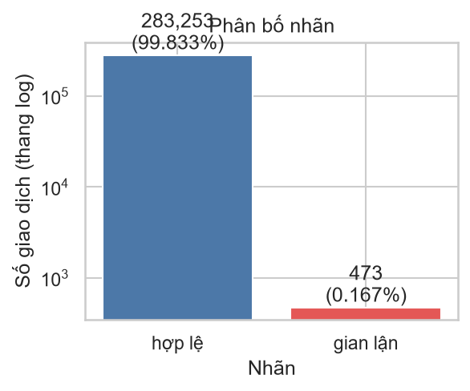

**Phát hiện 2 — `Amount` một mình không phân biệt được, trừ vùng tiền rất nhỏ.** Phân bố số tiền của
hai lớp chồng lấn gần như hoàn toàn. Trung vị của gian lận (9,82 EUR) **thấp hơn** của giao dịch hợp lệ
(22,00 EUR) nhưng trung bình lại **cao hơn** (123,87 so với 88,41): đuôi dày ở cả hai phía. **36% vụ gian
lận có số tiền ≤ 1 EUR** — chi tiết này quay lại ở mục 8.5. Đuôi dày là lý do chuẩn hoá `Amount` bằng
`RobustScaler` (trung vị và IQR) thay vì `StandardScaler`.

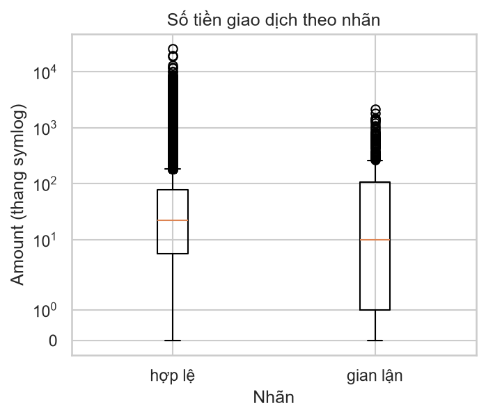

**Phát hiện 3 — gian lận dồn vào giờ vắng.** Lúc 2h tỷ lệ gian lận là 1,451% (48/3.308), lúc 10h
chỉ 0,048% (8/16.548) — chênh 30 lần. Khung 00h–05h chiếm 8,4% lượng giao dịch nhưng 24,3% số vụ gian
lận. Đó là cơ sở thực nghiệm để đưa giờ trong ngày vào mô hình (với giả định ở mục 1.4). Vì đây là một
**quyết định** về mô hình, nó được kiểm lại chỉ trên tập huấn luyện (notebook 01 §4.1, sau review): 1,365%
lúc 2h so với 0,045% lúc 10h, vẫn chênh 30 lần, hai khoảng tin cậy Wilson không giao nhau — quyết định không
dựa vào các dòng của tập kiểm thử.

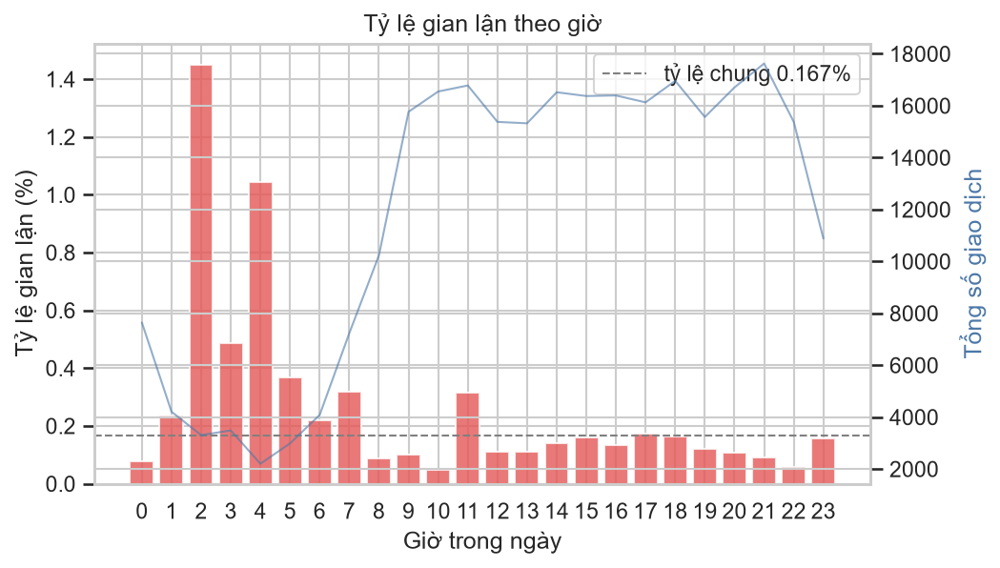

**Phát hiện 4 — V1–V28 trực giao, tương quan với nhãn bị nén.** |r| lớn nhất giữa hai thành phần V chỉ
0,019, nên không cần chạy lại PCA hay lọc đa cộng tuyến. Tương quan điểm–nhị phân với nhãn cao nhất
chỉ −0,313 (V17), dù V17 tách hai lớp rất rõ: với 0,17% lớp dương, độ lớn của tương quan bị tỷ lệ lớp
nén xuống — cùng một cái bẫy như accuracy 99,83%. Chỉ **thứ hạng** của tương quan là đọc được.

**Phát hiện 5 — không đặc trưng đơn nào tách được hai lớp, nhưng bài toán khả thi.** Mọi cặp phân bố
vẫn chồng lấn; lớp gian lận dịch sang phía âm và bè rộng gấp 3–5 lần. Trên hình chiếu t-SNE, 85,8% mẫu
gian lận có đa số láng giềng cùng lớp và tạo thành 2–3 cụm tách hẳn; 4,4% (21 mẫu) nằm lẫn hoàn toàn
giữa giao dịch hợp lệ — loại gian lận mà mô hình khó bắt nhất (mục 9.2; với mô hình của bản trước, cả 21
vụ đều bị bỏ lọt).

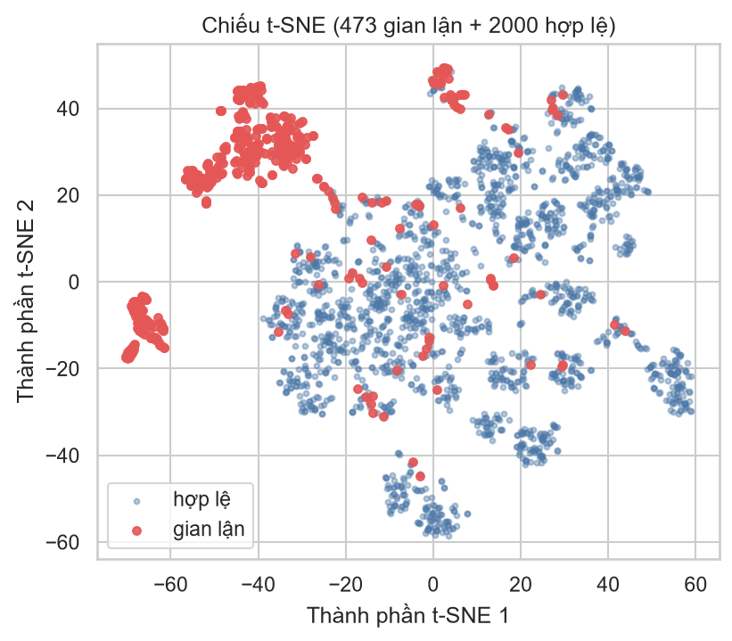

---

## 3. Kiểm định thống kê và xếp hạng đặc trưng

Notebook 02 kiểm định từng đặc trưng trong 30 cột gốc (V1–V28, `Amount`, `Time`):

- **Mann–Whitney U** [7] — không giả định phân phối chuẩn, phù hợp với `Amount` lệch phải và các V
  đuôi dày.
- **Hiệu chỉnh Benjamini–Hochberg** [8] cho 30 kiểm định đồng thời, kiểm soát tỷ lệ phát hiện sai ở 5%.
- **Độ lớn hiệu ứng**: Cohen's d và Cliff's delta [9]. Với 283.000 mẫu, p-value gần như luôn nhỏ;
  độ lớn hiệu ứng mới cho biết khác biệt có đáng kể hay không.

**Kết quả.** 27/30 kiểm định còn ý nghĩa sau hiệu chỉnh BH (Bonferroni chỉ giữ 24). Ba đặc trưng không
có ý nghĩa: V13, V15, V22. 17 đặc trưng có |d| ≥ 0,8 (hiệu ứng lớn).

| Hạng theo d | Đặc trưng | Cohen's d | Cliff's δ | Hạng theo δ | Pearson r |
|---|---|---|---|---|---|
| 1 | V17 | −8,09 | −0,60 | 11 | −0,313 |
| 2 | V14 | −7,52 | −0,89 | 1 | −0,293 |
| 3 | V12 | −6,35 | −0,87 | 3 | −0,251 |
| 4 | V10 | −5,19 | −0,82 | 5 | −0,207 |
| 5 | V16 | −4,67 | −0,68 | 8 | −0,187 |
| 6 | V3 | −4,55 | −0,82 | 6 | −0,182 |

Hai điều đáng giữ:

1. **Cùng một khác biệt, hai thang đo cho hai bức tranh.** V17 có Cohen's d = −8,09 (hiệu ứng khổng lồ)
   nhưng tương quan Pearson chỉ −0,313. Đó không phải mâu thuẫn mà là hệ quả toán học của tỷ lệ lớp
   0,17%.
2. **Cohen's d và Cliff's delta bất đồng về thứ hạng** (Spearman 0,921): V17 hạng 1 theo d nhưng hạng 11
   theo δ. Cohen's d dùng độ lệch chuẩn gộp — bị lớp hợp lệ áp đảo — nên phóng đại đặc trưng mà lớp gian
   lận có phương sai lớn. Câu hỏi "đặc trưng nào thật sự quan trọng" được trả lời lại bằng SHAP ở mục 9.

Phân tích này chỉ phục vụ hiểu dữ liệu, **không** dùng để chọn đặc trưng (mô hình dùng đủ 31 đặc
trưng). Vì thế việc nó được tính trên toàn bộ dữ liệu không gây rò rỉ.

---

## 4. Khung đánh giá

### 4.1 Vì sao PR-AUC, không phải accuracy hay ROC-AUC

- **Accuracy** vô nghĩa: mô hình rỗng đạt 99,83%, và ở mục 5 accuracy còn xếp hạng ngược hai mô hình.
- **ROC-AUC** đo trên trục tỷ lệ dương giả FP / (FP + TN). Với hơn 56.000 giao dịch hợp lệ trong tập
  kiểm thử, mẫu số FP + TN gần như không đổi: hạ ngưỡng từ τ\* xuống mức recall 90% thêm 682 cảnh báo
  giả mà FPR chỉ tăng 1,2 điểm phần trăm, trong khi khối lượng thẩm định tăng 7 lần (mục 8.3). ROC-AUC vì vậy đều cao (0,95–0,98) và che mất
  khác biệt [2].
- **PR-AUC** (average precision) đo trên precision = TP / (TP + FP) — đúng câu hỏi "trong những giao
  dịch bị gắn cờ, bao nhiêu là gian lận thật". Đường cơ sở của nó là tỷ lệ lớp dương (0,00167), nên con
  số có ý nghĩa tuyệt đối: PR-AUC 0,828 nghĩa là gấp khoảng 495 lần đoán ngẫu nhiên.

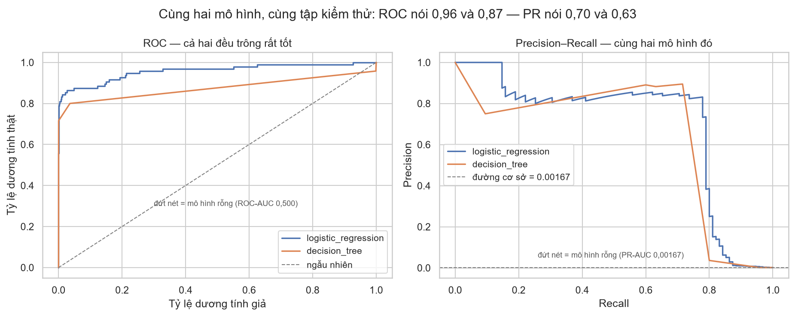

### 4.2 Khoảng tin cậy và quy tắc so sánh

Tập kiểm thử chỉ có **95 vụ gian lận**: mỗi vụ bắt hụt làm recall giảm hơn 1 điểm phần trăm. Vì vậy:

- Mọi chỉ số chính kèm **khoảng tin cậy 95% bằng bootstrap phân tầng** (1.000 lần, lấy mẫu lại riêng
  trong từng lớp để lần lặp nào cũng có đủ 95 mẫu dương) [10].
- So sánh hai mô hình hoặc hai ngưỡng bằng **bootstrap theo cặp**: cùng một mẫu cho cả hai, lấy hiệu.
  So hai khoảng tin cậy riêng lẻ bỏ mất tương quan giữa hai bộ điểm và luôn bảo thủ quá mức.
- **Quy tắc đặt trước:** khoảng tin cậy của hiệu chứa 0 thì **không** tuyên bố bên nào hơn.
- **Phương sai do huấn luyện.** Bootstrap trên điểm out-of-fold gộp chỉ lấy mẫu lại các dòng của một lần
  kiểm định chéo, nên bỏ qua việc học trên fold khác thì ra mô hình khác. Các cặp cấu hình cần kết luận được
  so bằng **CV lặp** (5 × 5 fold, mọi cấu hình gặp cùng các fold) và **kiểm định t hiệu chỉnh** Nadeau–Bengio
  [17], nhân phương sai của hiệu với `1/k + n_test/n_train` để bù cho việc các fold dùng chung dữ liệu huấn
  luyện (mục 6.3).

### 4.3 Chống rò rỉ dữ liệu

Rò rỉ không làm chương trình lỗi; nó chỉ làm mọi con số đẹp lên một cách vô nghĩa. Bảy điểm kiểm được
viết thành kiểm thử tự động (`tests/test_no_leakage.py`), quét mã trong `src/`, `scripts/` và mọi ô
code của notebook:

| # | Quy tắc | Cách bảo đảm |
|---|---|---|
| 1 | Lấy mẫu lại (SMOTE, undersampling) chỉ nằm **trong** pipeline | `imblearn.pipeline.Pipeline` tự bỏ qua bước lấy mẫu khi dự đoán trên fold kiểm định |
| 2 | Loại trùng lặp trước khi chia tập | Notebook chỉ nạp qua `load_prepared()` |
| 3 | Bộ chuẩn hoá chỉ fit trên dữ liệu huấn luyện của từng fold | `RobustScaler` nằm trong pipeline |
| 4 | Mọi kiểm định chéo phân tầng | `StratifiedKFold`, không `KFold` |
| 5 | Ngưỡng chọn trên **out-of-fold**, không trên tập kiểm thử | Mục 8.2 |
| 6 | Không dòng nào nằm ở cả hai tập | Kiểm thử trực tiếp |
| 7 | Mọi bước ngẫu nhiên dùng chung `random_state = 42` | Kiểm thử quét mã |

Bảy điểm trên phần lớn là quét mã, nên có thể vẫn xanh khi có rò rỉ thật. Hai kiểm thử **theo hành vi**
bổ sung sau review: xáo trộn nhãn thì PR-AUC out-of-fold của cả bốn chiến lược phải ở mức may rủi (dưới 3 lần
đường cơ sở), và một đối chứng dương — chạy SMOTE **trước** khi chia fold — phải bị phát hiện (PR-AUC vọt quá
2 lần đường cơ sở). Thêm một phép kiểm trùng gần đúng: 2.218 giao dịch tập kiểm thử có bản sao V1–V28 +
`Amount` ở tập huấn luyện (chỉ khác `Time`), **không vụ nào là gian lận**; bỏ chúng đi PR-AUC gần như không đổi
(notebook 05 §6.1).

Kiểm tra tính hợp lý: PR-AUC cao nhất trong cả đồ án là 0,857 (lưới theo mức; 0,859 theo trung bình CV lặp),
nằm trong dải kỳ vọng 0,80–0,87 của
đặc tả và cách xa ngưỡng báo động 0,95 (gần như chắc chắn có rò rỉ nếu vượt).

---

## 5. Mô hình cơ sở

Ba mô hình, chưa xử lý mất cân bằng, ngưỡng 0,5, trên tập kiểm thử:

| Mô hình | Accuracy | PR-AUC [KTC 95%] | ROC-AUC | Recall | Precision | Bắt được |
|---|---|---|---|---|---|---|
| Mô hình rỗng (luôn "hợp lệ") | 99,8326% | 0,0017 | 0,500 | 0,000 | — | 0/95 |
| Logistic Regression | 99,9154% | 0,696 [0,598; 0,791] | 0,958 | 0,600 | 0,851 | 57/95 |
| Decision Tree (`max_depth = 6`) | 99,9383% | 0,628 [0,522; 0,737] | 0,875 | 0,716 | 0,895 | 68/95 |

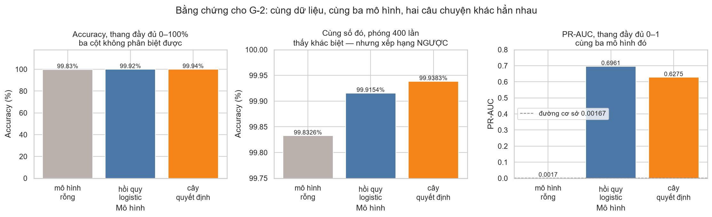

- **Accuracy xếp hạng ngược.** Cây có accuracy cao hơn hồi quy (99,938% so với 99,915%) nhưng PR-AUC
  thấp hơn (0,628 so với 0,696). Ba mô hình chỉ chênh 0,11 điểm phần trăm accuracy, trong khi PR-AUC
  chênh 416 lần giữa mô hình tệ nhất và tốt nhất.
- **Chưa được tuyên bố mô hình nào thắng.** Hiệu PR-AUC hồi quy − cây theo cặp là
  +0,069 [−0,031; +0,158]: khoảng tin cậy chứa 0.
- **Cây chỉ có 8 mức điểm.** Decision Tree sâu 6 tầng chỉ phát ra 8 giá trị điểm khác nhau (hồi quy:
  56.537), nên đường PR của nó là cầu thang 9 bậc và **không thể tối ưu ngưỡng** trên nó. Đây là lý do
  cơ học khiến cây thắng ở τ = 0,5 nhưng thua ở PR-AUC, và là cảnh báo cho mục 6.

---

## 6. So sánh chiến lược xử lý mất cân bằng

Đây là trọng tâm của đề tài: không phải tìm một mô hình thắng, mà hiểu mỗi kỹ thuật xử lý mất cân bằng
đổi được gì và mất gì.

### 6.1 Thiết kế thí nghiệm

**Năm chiến lược** × **bốn mô hình** = 20 tổ hợp:

| Mã | Chiến lược | Cách làm |
|---|---|---|
| S1 | `none` | Không xử lý |
| S2 | `class_weight` | Trọng số lớp: `class_weight="balanced"`; với XGBoost là `scale_pos_weight` = tỷ lệ âm/dương ≈ 599,5 |
| S3 | `undersample` | `RandomUnderSampler`, đưa lớp dương lên 1 : 10 |
| S4 | `smote` | `SMOTE` [3], `k = 5`, sinh mẫu dương tổng hợp tới 1 : 10 |
| S5 | `smote_tomek` | `SMOTETomek`: SMOTE rồi xoá các cặp Tomek [4] |

Mô hình: Logistic Regression, Decision Tree (`max_depth = 6`), Random Forest (300 cây), XGBoost
(500 cây, `max_depth = 6`, `learning_rate = 0,05`) [5].

Ba quyết định thiết kế:

- **Lấy mẫu lại chỉ tới 1 : 10, không 1 : 1.** Cân bằng hoàn toàn làm méo xác suất tiên nghiệm rất
  mạnh: mô hình trả điểm lệch cao và precision sụp. Hệ quả phụ: bảng 20 tổ hợp so `class_weight` cân bằng
  hoàn toàn (≈ 1 : 1) với SMOTE và undersample 1 : 10 — hai chiến lược khác nhau ở cả loại kỹ thuật lẫn mức
  cân bằng. Mục 6.4 tách hai yếu tố đó.
- **Mọi bước nằm trong một pipeline của imbalanced-learn** [6] (`RobustScaler` → lấy mẫu lại → bộ phân
  loại), đánh giá bằng kiểm định chéo phân tầng 5 fold **trên tập huấn luyện**. Lấy mẫu lại ngoài
  pipeline là lỗi rò rỉ phổ biến nhất ở bài toán này: mẫu SMOTE nội suy từ mẫu kiểm định lọt vào tập
  huấn luyện, và mọi chỉ số vọt lên khoảng 0,99.
- **Một lượt huấn luyện mỗi tổ hợp.** `cross_val_predict` cho điểm out-of-fold của cả 226.980 giao
  dịch; từ đó tính PR-AUC từng fold (lấy trung bình và độ lệch chuẩn), Brier, chọn ngưỡng theo chi phí và
  đo recall/precision tại ngưỡng đó. Cả lưới chạy 45,7 phút ở lần đầu; lần chạy lại 2026-10-10 (máy có tải
  nền) mất 66,1 phút và cho đúng từng bit các điểm out-of-fold cũ. Điểm lưu chỉ được dùng lại khi dấu vân
  tay của cấu hình — tham số pipeline, cách chia, dữ liệu, phiên bản thư viện — khớp.

**Hai thí nghiệm bổ sung sau review** ([docs/11](../docs/11-review-ml-va-ke-hoach-sua.md)):

- **Lưới theo mức cân bằng** — ba chiến lược ở **cùng** tỷ lệ dương:âm mục tiêu r ∈ {0,02; 0,1; 0,3; 1}:
  `class_weight` dùng trọng số lớp dương r × N_âm/N_dương, SMOTE và undersample dùng `sampling_strategy = r`.
  48 tổ hợp, 86 phút (mục 6.4).
- **CV lặp** — `RepeatedStratifiedKFold` 5 × 5 fold (Random Forest 3 × 5) cùng `random_state`, so theo cặp
  bằng kiểm định t hiệu chỉnh Nadeau–Bengio [17] cho các cặp cần kết luận (mục 6.3, 6.8). 81 phút.

### 6.2 Bảng kết quả 20 tổ hợp

Sắp theo PR-AUC giảm dần. τ\* là ngưỡng cực tiểu chi phí (FN 115,94 EUR, FP 5 EUR — mục 8.1) chọn trên
điểm out-of-fold **ngẫu nhiên** của chính tổ hợp đó; recall và precision đo tại τ\*. "Brier" là Brier score
của điểm out-of-fold, nhân 10⁴ — thấp hơn là điểm gần xác suất hơn. "Mức điểm" là số giá trị điểm rủi ro khác
nhau trên 226.980 giao dịch. Cột giây là của lần chạy lại.

| # | Mô hình | Chiến lược | PR-AUC (TB ± ĐLC) | ROC-AUC | τ\* | Recall | Precision | Cảnh báo/ngày | Brier ×10⁴ | Mức điểm | Giây |
|---|---|---|---|---|---|---|---|---|---|---|---|
| 1 | XGBoost | class_weight | **0,8549 ± 0,0301** | 0,982 | 0,0232 | 0,852 | 0,702 | 287 | 4,08 | 221.674 | 48 |
| 2 | Random Forest | smote | 0,8549 ± 0,0311 | 0,976 | 0,190 | 0,854 | 0,666 | 303 | 4,83 | 219 | 484 |
| 3 | Random Forest | smote_tomek | 0,8549 ± 0,0311 | 0,976 | 0,190 | 0,854 | 0,666 | 303 | 4,83 | 219 | 884 |
| 4 | XGBoost | smote | 0,8529 ± 0,0297 | 0,980 | 0,0336 | 0,852 | 0,638 | 316 | 3,87 | 222.236 | 53 |
| 5 | XGBoost | smote_tomek | 0,8529 ± 0,0297 | 0,980 | 0,0336 | 0,852 | 0,638 | 316 | 3,87 | 222.236 | 426 |
| 6 | XGBoost | none | 0,8514 ± 0,0302 | 0,983 | 0,0468 | 0,841 | 0,866 | 229 | 3,78 | 221.544 | 43 |
| 7 | Random Forest | none | 0,8406 ± 0,0333 | 0,953 | 0,0767 | 0,852 | 0,687 | 293 | 4,11 | 207 | 603 |
| 8 | Random Forest | class_weight | 0,8404 ± 0,0285 | 0,969 | 0,123 | 0,852 | 0,711 | 283 | 4,21 | 200 | 212 |
| 9 | XGBoost | undersample | 0,7811 ± 0,0691 | 0,982 | 0,868 | 0,836 | 0,688 | 287 | 17,05 | 221.912 | 8 |
| 10 | Random Forest | undersample | 0,7586 ± 0,0446 | 0,976 | 0,586 | 0,852 | 0,697 | 289 | 27,84 | 269 | 9 |
| 11 | Logistic Regression | none | 0,7578 ± 0,0305 | 0,977 | 0,0167 | 0,854 | 0,541 | 373 | 6,81 | 226.318 | 18 |
| 12 | Logistic Regression | smote | 0,7572 ± 0,0235 | 0,978 | 0,614 | 0,860 | 0,544 | 373 | 24,13 | 226.308 | 14 |
| 13 | Logistic Regression | smote_tomek | 0,7572 ± 0,0235 | 0,978 | 0,614 | 0,860 | 0,544 | 373 | 24,13 | 226.308 | 429 |
| 14 | Logistic Regression | class_weight | 0,7416 ± 0,0294 | 0,980 | 0,972 | 0,857 | 0,505 | 401 | 224,49 | 226.109 | 23 |
| 15 | Logistic Regression | undersample | 0,7185 ± 0,0206 | 0,982 | 0,617 | 0,857 | 0,415 | 488 | 32,88 | 226.280 | 1 |
| 16 | Decision Tree | none | 0,6948 ± 0,0374 | 0,870 | 0,500 | 0,780 | 0,886 | 208 | 5,15 | 30 | 49 |
| 17 | Decision Tree | smote | 0,6404 ± 0,0395 | 0,936 | 0,803 | 0,817 | 0,670 | 288 | 21,24 | 97 | 54 |
| 18 | Decision Tree | smote_tomek | 0,6404 ± 0,0395 | 0,936 | 0,803 | 0,817 | 0,670 | 288 | 21,24 | 97 | 555 |
| 19 | Decision Tree | class_weight | 0,3586 ± 0,1167 | 0,878 | 0,994 | 0,796 | 0,368 | 511 | 168,00 | 55 | 47 |
| 20 | Decision Tree | undersample | 0,2405 ± 0,0529 | 0,918 | 0,750 | 0,839 | 0,264 | 749 | 51,16 | 23 | 2 |

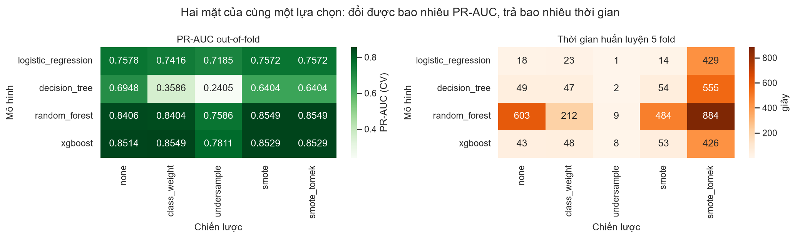

Hai điều đọc được ngay: ROC-AUC của 20 tổ hợp nằm gọn trong 0,87–0,98 trong khi PR-AUC trải từ 0,24
tới 0,85 (mục 4.1); và **mô hình quyết định nhiều hơn chiến lược** — hàng của XGBoost và Random Forest
đều xanh đậm, hàng của Decision Tree nhạt bất kể chiến lược.

### 6.3 Phát hiện 1 — nhóm dẫn đầu hoà nhau, không được xếp hạng

Sáu dòng đầu bảng nằm trong dải 0,8514–0,8549, rộng 0,0035 — chưa tới một phần tám độ lệch chuẩn giữa
các fold (0,030). Bản trước dựa vào bootstrap hiệu PR-AUC theo cặp trên điểm out-of-fold **gộp** và tuyên bố
hai khác biệt "thật". Phép bootstrap đó chỉ lấy mẫu lại các dòng của **một** lần CV nên bỏ qua dao động do
huấn luyện — học trên fold khác thì mô hình khác. Tính cả phần này bằng CV lặp, khoảng tin cậy rộng ra và
chứa 0:

| Cặp | Bootstrap OOF gộp (bản trước) | CV lặp, t hiệu chỉnh [17] |
|---|---|---|
| XGBoost + class_weight − Random Forest + class_weight | +0,0152 [+0,0056; +0,0270] | +0,0143 [−0,0070; +0,0357] |
| Random Forest + SMOTE − Random Forest + class_weight | +0,0146 [+0,0076; +0,0220] | +0,0106 [−0,0063; +0,0275] |
| Chín cấu hình XGBoost so với cấu hình cao nhất (mục 6.8) | — | hiệu từ −0,0077 tới 0, mọi KTC chứa 0 |

Hiệu trung bình gần như giữ cỡ; thứ thay đổi là độ rộng khoảng tin cậy. Báo cáo vì vậy nói "một nhóm dẫn
đầu", không nói "tổ hợp X thắng", và không còn khác biệt nào trong nhóm cao được tuyên bố.

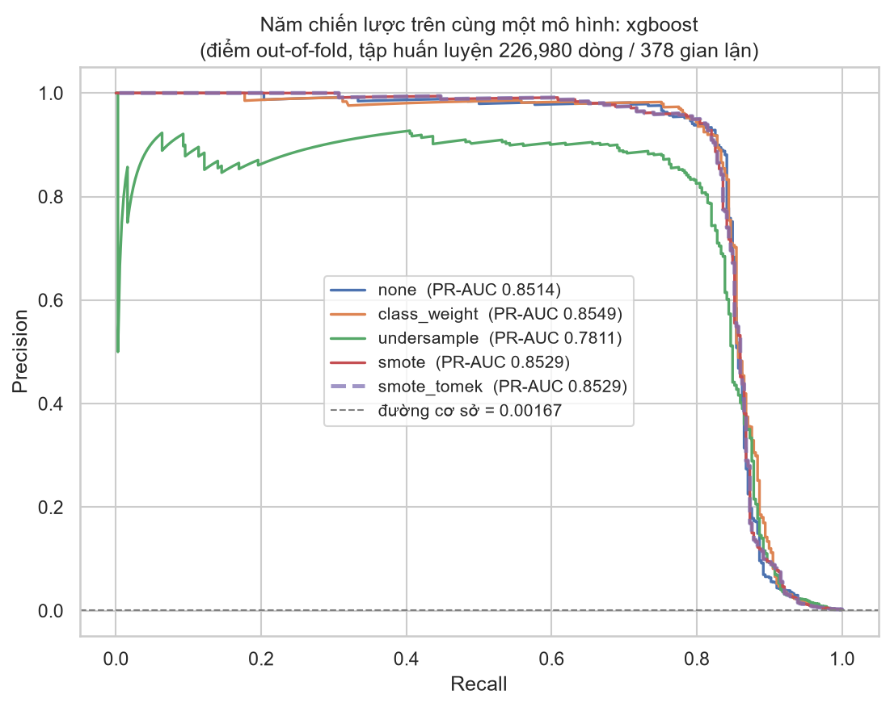

### 6.4 Phát hiện 2 — `class_weight` hay SMOTE: phần lớn là chuyện *mức* cân bằng

Đặc tả dự báo rằng với mô hình cây, trọng số lớp ngang hoặc nhỉnh hơn SMOTE mà rẻ hơn nhiều. Bảng 20 tổ hợp
(cân bằng hoàn toàn so với 1 : 10) cho:

| Mô hình | class_weight | SMOTE | Chênh | Giây cw | Giây SMOTE | SMOTE đắt hơn |
|---|---|---|---|---|---|---|
| XGBoost | **0,8549** | 0,8529 | +0,0020 | 48,1 | 52,8 | 1,10× |
| Random Forest | 0,8404 | **0,8549** | −0,0145 | 212,4 | 484,2 | 2,28× |
| Logistic Regression | 0,7416 | **0,7572** | −0,0156 | 23,1 | 14,3 | 0,62× |
| Decision Tree | 0,3586 | **0,6404** | −0,2818 | 46,8 | 53,7 | 1,15× |

Lưới theo mức đặt hai kỹ thuật ở **cùng** tỷ lệ dương:âm r (PR-AUC out-of-fold; cột đầu lấy từ lưới chuẩn):

| Mô hình | không xử lý | class_weight r = 0,1 | SMOTE r = 0,1 | class_weight r = 1 | SMOTE r = 1 |
|---|---|---|---|---|---|
| Decision Tree | 0,6948 | 0,6416 | 0,6404 | 0,3596 | 0,4585 |
| Logistic Regression | 0,7578 | 0,7595 | 0,7572 | 0,7422 | 0,7454 |
| Random Forest | 0,8406 | 0,8425 | 0,8549 | 0,8396 | 0,8502 |
| XGBoost | 0,8514 | 0,8565 | 0,8529 | 0,8549 | 0,8511 |

- **Decision Tree không "sụp vì class_weight" mà vì cân bằng hoàn toàn.** Ở r = 0,1 hai kỹ thuật bằng nhau
  (0,6416 và 0,6404); ở r = 1 cả hai cùng sụp. Với cây nông, mọi mức cân bằng đều kém không xử lý.
- **Logistic Regression:** ở r = 0,02 và 0,1, `class_weight` nhỉnh hơn SMOTE (0,7627 so với 0,7605; 0,7595 so
  với 0,7572) — ngược với bảng chuẩn, nơi khác biệt đến từ so 1 : 1 với 1 : 10.
- **Random Forest:** SMOTE hơn `class_weight` ở cả bốn mức (+0,010 tới +0,012) trên một lần CV, nhưng CV lặp
  cho +0,0106 [−0,0063; +0,0275] (mục 6.3) — **không kết luận được**. SMOTE đắt gấp khoảng 2,3 lần.
- **XGBoost:** tám biến thể `class_weight`/SMOTE nằm trong 0,8511–0,8565, `none` 0,8514. Dự báo của đặc tả
  đúng ở đây theo nghĩa yếu nhất: không kỹ thuật nào hơn kỹ thuật nào — kể cả hơn không xử lý.

Lấy trung bình gộp cả bốn mô hình (−0,0775) là sai cách trình bày: con số bị Decision Tree kéo lệch, và
chính Decision Tree là chỗ khác biệt đến từ mức cân bằng.

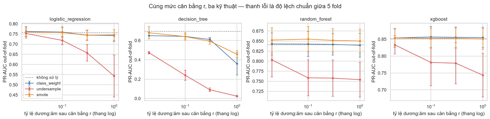

### 6.5 Phát hiện 3 — SMOTE + Tomek giống SMOTE tới từng bit, mà tốn khoảng 40% thời gian lưới

Không chỉ PR-AUC bằng nhau tới bốn chữ số: **mảng điểm out-of-fold của S5 giống hệt S4 tới từng phần
tử** ở cả bốn mô hình. Bước Tomek không xoá một dòng nào, nhưng tốn **1.089 giây = 18,2 phút**, tức 40%
của cả lưới 45,7 phút ở lần chạy đầu (lần chạy lại có tải nền: 28,2 trong 66,1 phút, 42,6%).

Vì sao? Kiểm lại trên fold 1: dữ liệu gốc **có** cặp Tomek — trước SMOTE, `TomekLinks` tìm được 21 cặp
(xoá 42 dòng, trong đó 21 vụ gian lận); sau SMOTE còn 0. Chính SMOTE xoá chúng: mỗi vụ gian lận thật
được dùng làm gốc để sinh khoảng 59 điểm tổng hợp trên các đoạn nối nó với láng giềng cùng lớp, nên
láng giềng gần nhất của nó trở thành một điểm gian lận tổng hợp — không còn cặp khác lớp nào là láng
giềng gần nhất *của nhau*. `SMOTETomek` chạy SMOTE trước, Tomek sau, nên ở tỷ lệ này bước Tomek luôn
vô tác dụng. Kết quả âm tính này được giữ trong bảng vì tự nó là một phát hiện; lưới theo mức đã bỏ S5.

### 6.6 Phát hiện 4 — độ mịn của điểm rủi ro loại Random Forest

Random Forest hoà PR-AUC với XGBoost nhưng chỉ phát ra **200–269 mức điểm** trên 226.980 giao dịch
(300 cây cho tối đa 301 giá trị `k/300`); XGBoost có khoảng 222.000 mức, gấp hơn 1.000 lần. Decision
Tree chỉ có 23–97 mức. Toàn bộ mục 8 dựa trên việc kéo ngưỡng; với 200 bậc thang, một thay đổi nhỏ của
ngưỡng hoặc không đổi gì, hoặc nhảy hàng chục cảnh báo một lúc.

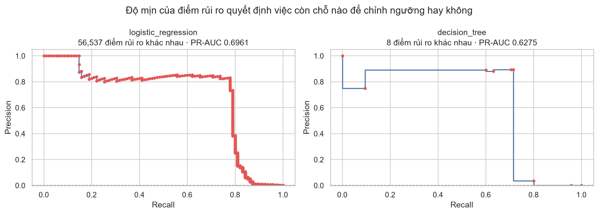

### 6.7 Phát hiện 5 — undersampling nhanh nhất nhưng kém nhất và bất ổn nhất

Đưa lớp dương lên 1 : 10 bằng cách bỏ khoảng 98% giao dịch hợp lệ làm mọi mô hình huấn luyện trong
1–10 giây, nhưng PR-AUC giảm ở cả bốn mô hình, và độ lệch chuẩn giữa các fold của XGBoost tăng gấp đôi
(0,069 so với 0,030): mô hình thấy quá ít ví dụ về giao dịch hợp lệ "khó". Lưới theo mức xác nhận: undersample
kém nhất ở mọi mô hình và mọi mức r, và càng kém khi r tăng — XGBoost từ 0,833 (r = 0,02) xuống 0,744 (r = 1),
Decision Tree từ 0,474 xuống 0,024. Recall tại τ\* vẫn cao (0,84–0,86) nhưng precision thấp nhất ở Logistic
Regression (0,415) và Decision Tree (0,264).

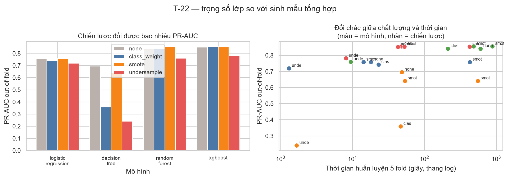

### 6.8 Lựa chọn cho các bước sau: XGBoost, không xử lý mất cân bằng

Bản trước chọn XGBoost + `class_weight` "vì nhanh nhất trong nhóm và cho điểm rủi ro mịn nhất". Cả hai vế
sai so với chính bảng ở mục 6.2 — `none` nhanh hơn (43 so với 48 giây), `smote` có nhiều mức điểm hơn (222.236
so với 221.674) — và không có số liệu nào cho thấy `class_weight` hơn `none`. Sau review, cấu hình cuối được
chọn bằng một **quy tắc đặt trước** (đề xuất sau khi đã thấy bảng 20 tổ hợp, nhưng trước khi chạy CV lặp và
lưới theo mức, và không nhìn tập kiểm thử), áp lên họ XGBoost — Random Forest bị loại vì độ mịn điểm (6.6):

1. **Chất lượng xếp hạng là điều kiện cần.** Ứng viên là mọi cấu hình XGBoost của hai lưới có PR-AUC CV trong
   vòng 0,01 của cấu hình cao nhất; cấu hình nào có hiệu so với cấu hình cao nhất theo CV lặp mà KTC 95% chứa 0
   thì *hoà*.
2. **Trong nhóm hoà, chiến lược đơn giản nhất**: `none` < `class_weight` < `undersample` < `smote`.
3. Rồi Brier thấp nhất trên OOF; 4. rồi ít cảnh báo/ngày nhất tại τ\* của chính nó.

**Kết quả.** Chín cấu hình XGBoost ứng viên; theo CV lặp 5 × 5 fold, cấu hình có trung bình cao nhất là
`class_weight` r = 0,3 (0,8589). **Cả chín hoà với nó** — hiệu xa nhất −0,0077 [−0,0181; +0,0026], của `none`
là −0,0037 [−0,0119; +0,0046]. Bước 2 chọn **`none`**: XGBoost với cấu hình khởi điểm, không trọng số lớp,
không lấy mẫu lại.

Với XGBoost, trọng số lớp và SMOTE chủ yếu **dịch điểm rủi ro** chứ không đổi **thứ tự xếp hạng**, mà PR-AUC
chỉ đo thứ tự. Bỏ chúng đi không mất gì đo được, và được hai thứ: điểm gần xác suất hơn (Brier OOF 3,78·10⁻⁴ so
với 4,08·10⁻⁴) và ít cảnh báo giả hơn tại τ\* (precision OOF 0,866 so với 0,702). Kết luận trung tâm của phần
này vì vậy là: **với mô hình boosting trên dữ liệu này, xử lý mất cân bằng không đem lại lợi ích đo được** — việc
quyết định là chọn ngưỡng (mục 8).

---

## 7. Mô hình cuối, tinh chỉnh và khoảng tin cậy

### 7.1 Tinh chỉnh siêu tham số — một kết quả âm tính

`RandomizedSearchCV`, 30 lần thử × 5 fold, `scoring = "average_precision"`, trên họ XGBoost;
không gian tìm gồm `n_estimators` 200–800, `max_depth` 3–8, `learning_rate` 0,01–0,3 (thang log),
`subsample`, `colsample_bytree` 0,6–1, `min_child_weight` 1–10 và `scale_pos_weight` ∈ {1, 10, 100, 599,5}
— mức 1 chính là không xử lý mất cân bằng. Chạy 19,8 phút (13,2 phút ở lần chạy lại 2026-10-11, cho đúng
các con số cũ).

| Hạng | PR-AUC CV | ĐLC | PR-AUC train | n_estimators | max_depth | learning_rate | scale_pos_weight |
|---|---|---|---|---|---|---|---|
| 1 | 0,8538 | 0,0328 | 1,0000 | 750 | 6 | 0,090 | 10 |
| 2 | 0,8536 | 0,0319 | 1,0000 | 761 | 5 | 0,054 | 599,5 |
| 3 | 0,8532 | 0,0322 | 1,0000 | 602 | 7 | 0,056 | 10 |
| 4 | 0,8531 | 0,0311 | 1,0000 | 330 | 7 | 0,048 | 10 |
| 5 | 0,8530 | 0,0289 | 0,9998 | 676 | 6 | 0,020 | 100 |

- Cấu hình đầu bảng (0,8538) chỉ hơn cấu hình cuối của mục 6.8 (XGBoost + `none`, 0,8514) 0,0024 —
  chưa bằng một phần mười độ lệch chuẩn giữa các fold (0,03). Năm cấu hình đầu cách nhau 0,0008: bề mặt mục
  tiêu phẳng.
- `scale_pos_weight` gần như không ảnh hưởng PR-AUC (trung bình 0,846 / 0,845 / 0,844 / 0,841 ở mức
  1 / 10 / 100 / 599,5): nó dịch điểm rủi ro chứ không đổi thứ tự — cùng kết luận với mục 6.8.
- PR-AUC trên tập huấn luyện bằng 1,0 ở mọi cấu hình tốt — mô hình khớp hoàn toàn tập huấn luyện;
  khoảng cách 0,15 với điểm kiểm định là bình thường với boosting nhiều cây và không làm giảm điểm
  kiểm định.

**Quy tắc đặt trước:** cấu hình tinh chỉnh chỉ thay cấu hình mặc định nếu bootstrap hiệu PR-AUC theo
cặp trên điểm out-of-fold không chứa 0. So với XGBoost + `none`: **+0,0034 [−0,0028; +0,0097]** (tinh chỉnh
thắng 84% số lần lặp, nhưng khoảng tin cậy chứa 0) → **giữ cấu hình mặc định**. Lựa chọn được chốt trên tập
huấn luyện, trước khi nhìn tập kiểm thử; tập kiểm thử sau đó cho −0,0092 [−0,0228; +0,0028], không đảo lại
quyết định. (Bản trước, so với XGBoost + `class_weight`, cho −0,0006 [−0,0087; +0,0072] và cùng kết luận.)

### 7.2 Kết quả trên tập kiểm thử

Huấn luyện lại trên toàn bộ tập huấn luyện, đo **một lần** trên 56.746 giao dịch (95 gian lận). Chỉ số phụ
thuộc ngưỡng đo tại **ngưỡng mặc định 0,2675**, chọn ở mục 8.2 trên điểm forward-chaining của tập huấn luyện:

| Chỉ số | Giá trị [KTC 95%] | Tiêu chí nghiệm thu |
|---|---|---|
| PR-AUC | **0,828** [0,747; 0,900] | AC-M1: ≥ 0,75 — đạt theo ước lượng điểm |
| ROC-AUC | 0,975 [0,958; 0,991] | |
| Recall tại ngưỡng mặc định | **0,758** [0,674; 0,842] — bắt 72/95 vụ | AC-M2: ≥ 0,75 — đạt theo ước lượng điểm, sát nút |
| Precision tại ngưỡng mặc định | 0,960 [0,915; 1,000] — 3 cảnh báo giả | |
| F1 tại ngưỡng mặc định | 0,847 | |
| Cảnh báo/ngày trên toàn luồng | 187 (ngân sách 200) | |
| Đường cơ sở PR-AUC | 0,00167 | |

**Cần nói rõ:** cận dưới của PR-AUC (0,747) nằm ngay dưới 0,75; recall đạt đúng 72/95 — một vụ ít hơn là
trượt — và cận dưới của nó là 0,674. Hai tiêu chí đạt theo ước lượng điểm, không đạt "chắc chắn" theo khoảng
tin cậy — hệ quả trực tiếp của việc chỉ có 95 mẫu dương. AC-M2 còn có điều kiện: nó đứng dưới hai giả định
nghiệp vụ chưa được xác nhận (mỗi vụ lọt tốn 115,94 EUR, ngân sách 200 cảnh báo/ngày) và trên tập kiểm thử
chia ngẫu nhiên; trên một ngày mới, ngưỡng trong ngân sách chỉ cho recall khoảng 0,70 (mục 8.2). Tại τ\*
không ràng buộc (0,0191) recall là 0,821, nhưng tải 242 cảnh báo/ngày vượt ngân sách.

**Tập kiểm thử chỉ để đo.** Nó được mở ở nhiều notebook — 03 (mô hình cơ sở), 05 (mô hình cuối, bản tinh
chỉnh, chia theo thời gian), 06 (các phương án ngưỡng), 06b, 07 (SHAP, phân tích lỗi), 08 (xuất hiện vật) —
nhưng không lần nào để **chọn**: cấu hình chốt bằng CV trên tập huấn luyện (mục 6.8, 7.1), ngưỡng chốt trên
điểm forward-chaining (mục 8.2), và các phân tích trên tập kiểm thử sau đó chỉ để mô tả. Bản trước viết "tập
kiểm thử chưa từng dùng" — câu đó sai và đã bỏ.

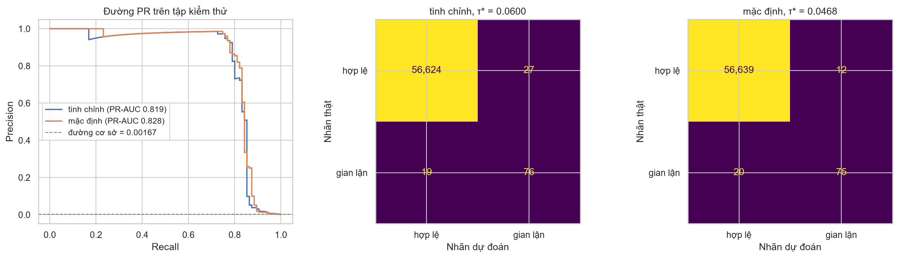

### 7.3 Chia theo thời gian — ước lượng sát với triển khai hơn

Chia ngẫu nhiên trộn giao dịch của cả hai ngày vào cả hai tập. Triển khai thật thì mô hình học từ quá
khứ và chấm tương lai. Bảng đối chiếu (AC-M7), ngưỡng của từng cách chia chọn trên out-of-fold của
chính tập huấn luyện đó:

| Cách chia | Train (gian lận) | Test (gian lận) | PR-AUC test [KTC] | τ\* (OOF ngẫu nhiên) | Recall | Precision | FP |
|---|---|---|---|---|---|---|---|
| Ngẫu nhiên 80/20 | 226.980 (378) | 56.746 (95) | 0,828 [0,747; 0,900] | 0,0468 | 0,789 | 0,862 | 12 |
| Ngẫu nhiên, train thu nhỏ bằng ngày 1 (đối chứng) | 144.236 (240) | 56.746 (95) | 0,817 [0,740; 0,887] | 0,0276 | 0,800 | 0,835 | 15 |
| **Ngày 1 → ngày 2** | 144.236 (272) | 139.490 (201) | **0,773** [0,724; 0,827] | 0,0156 | 0,831 | **0,365** | **291** |

Dòng đối chứng tách được hai nguyên nhân: bớt dữ liệu huấn luyện xuống bằng cỡ ngày 1 làm PR-AUC giảm
0,011; phần còn lại, **−0,044, là do thời gian**. Khoảng tin cậy PR-AUC của hai cách chia chồng lấn nhau,
nhưng tại ngưỡng thì khác biệt rõ: ngưỡng chọn trên CV ngẫu nhiên của ngày 1 (0,0156) thấp gấp ba ngưỡng
của cách chia ngẫu nhiên, và ngày 2 sinh 458 cảnh báo trong một ngày, precision còn 0,365 — tỷ lệ báo động
giả trên giao dịch hợp lệ gấp khoảng 10 lần. Tỷ lệ gian lận cũng đổi từ 0,189% (ngày 1) xuống 0,144% (ngày
2). Kết luận cho triển khai: **ngưỡng phải được chọn theo cách mô phỏng tương lai và theo dõi lại định kỳ**,
không đặt một lần rồi để đó — mục 8.2 chọn ngưỡng trên điểm forward-chaining và kiểm đúng giao thức này trên
ngày 2; API theo dõi tỷ lệ cảnh báo và precision theo thời gian (mục 10).

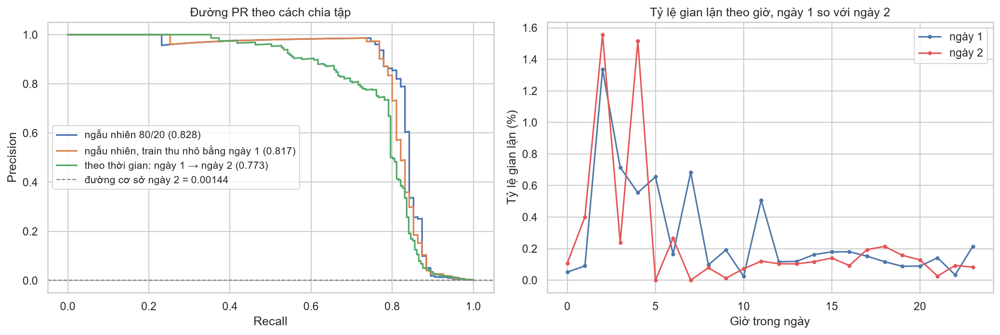

### 7.4 Đối chứng không giám sát: autoencoder

Một autoencoder (mạng `MLPRegressor` của scikit-learn — môi trường không có PyTorch) chỉ học tái tạo
giao dịch hợp lệ; sai số tái tạo dùng làm điểm bất thường.

| Mô hình | PR-AUC | ROC-AUC |
|---|---|---|
| Autoencoder (không dùng nhãn) | 0,329 | 0,949 |
| XGBoost, mô hình cuối | **0,828** | 0,975 |

Hiệu PR-AUC +0,499 [+0,393; +0,588], XGBoost thắng ở 100% số lần lặp. Autoencoder **có** nhận ra gian
lận là bất thường — 93/95 vụ có sai số tái tạo trên trung vị, sai số của V17 ở lớp gian lận gấp gần
1.300 lần lớp hợp lệ — nhưng không phân biệt được giao dịch hợp lệ hiếm gặp với gian lận: trong 1%
giao dịch "bất thường" nhất (568 giao dịch) chỉ 74 là gian lận. Nó thua vì bỏ qua 378 nhãn có sẵn — bài
toán có nhãn thì học có giám sát thắng.

### 7.5 Tái lập

Chạy lại 9 notebook 01 → 08, mỗi notebook một kernel mới, tổng 46,5 phút (2026-10-11, mô hình cuối): PR-AUC
trước và sau **0,8278893033 → 0,8278893033, lệch 0** (dung sai 0,001, AC-M5); 12 con số chính, τ\*, mọi bảng
`reports/*.csv` và mọi hình trùng hoàn toàn. Ba giới hạn: lượt kiểm không chạy lại lưới 20 tổ hợp và
tìm kiếm siêu tham số (notebook đọc điểm lưu); mới kiểm trên một máy 12 lõi — XGBoost `hist` cho điểm
lệch nhẹ theo số luồng **khi huấn luyện**; và trong container Linux, điểm chấm lệch 1 ulp float32 ở
35/56.746 giao dịch so với Windows, không quyết định nào bị lật.

---

## 8. Ngưỡng quyết định, đánh đổi Precision–Recall và chi phí

Mô hình trả về một điểm; biến điểm đó thành quyết định là một lựa chọn riêng, quyết định trực tiếp số
tiền mất và khối lượng việc của đội thẩm định.

### 8.1 Vì sao không dùng 0,5, và mô hình chi phí

Ngưỡng 0,5 ngầm giả định hai loại lỗi tốn như nhau và hai lớp cân bằng — ở bài toán này cả hai đều sai.
Hàm chi phí kỳ vọng (theo Elkan [11]):

  **Chi phí(τ) = c_FN × FN(τ) + c_FP × FP(τ)**

với ba giả định nghiệp vụ, người dùng đổi được lúc chạy:

| Mã | Giả định | Giá trị | Nguồn |
|---|---|---|---|
| A-01 | Bỏ lọt một vụ gian lận mất khoảng số tiền trung bình của một vụ | c_FN = 115,94 EUR | Trung bình `Amount` của gian lận **trên tập huấn luyện** (378 vụ). Bản trước dùng 122,21 — trung bình trên dữ liệu thô, gồm cả tập kiểm thử |
| A-02 | Thẩm định một cảnh báo tốn | c_FP = 5 EUR | Giả định |
| A-03 | Đội thẩm định xử lý tối đa 200 cảnh báo mỗi ngày | ngân sách 200/ngày | Giả định (04 §6.3) |

Tỷ lệ c_FN : c_FP ≈ 23,2 : 1. Mục 8.4 kiểm độ nhạy theo tỷ lệ này; mục 8.5 kiểm chính dạng của hàm chi phí.
**Cả ba giả định chưa được nghiệp vụ xác nhận** — mọi kết luận "rẻ hơn", "đạt" ở mục này đứng dưới chúng.

Số cảnh báo quy về **cảnh báo mỗi ngày trên toàn luồng giao dịch** — con số mà người quản lý vận hành
quan tâm: tập kiểm thử là 20% của hai ngày nên nhân 2,5; điểm chọn ngưỡng (mục 8.2) là 80% luồng trải trong
1,45 ngày.

### 8.2 Chọn ngưỡng ở đâu: điểm forward-chaining, trong ngân sách thẩm định

Ngưỡng là một phép **chọn**, nên không được làm trên tập kiểm thử: chọn rồi đo trên cùng tập làm mọi con số
lạc quan hơn thực tế (ML-08). Bản trước chọn trên điểm out-of-fold của CV **ngẫu nhiên**. Nhưng ngưỡng nhạy
với độ lệch thời gian hơn PR-AUC nhiều (mục 7.3), nên từ review (docs/11 M2) ngưỡng được chọn trên **điểm
forward-chaining**: sắp tập huấn luyện theo `Time`, chia 5 khối liên tiếp; khối k được chấm bởi mô hình chỉ học
các khối 1 … k−1. Kết quả là 181.584 điểm (249 gian lận, khối đầu không có điểm), trải 1,45 ngày, PR-AUC 0,783
— thấp hơn OOF ngẫu nhiên (0,849) đúng bằng cái giá của việc chấm "tương lai".

Ngưỡng ứng viên là **mọi điểm khác nhau** (175.627), không phải lưới 200 điểm của thiết kế ban đầu: lưới thô
trượt qua vùng đuôi, và với ràng buộc ngân sách nó chọn 0,4255 thay vì 0,2675.

| Ngưỡng (chọn trên điểm forward-chaining) | τ | Cảnh báo/ngày | Recall | Chi phí |
|---|---|---|---|---|
| τ\* — cực tiểu chi phí, không ràng buộc | 0,0191 | 297 | 0,827 | 5.675 EUR |
| **Mặc định — chi phí nhỏ nhất trong các ngưỡng ≤ 200 cảnh báo/ngày** | **0,2675** | **198** | **0,759** | **7.156 EUR (+26%)** |
| 0,5 | 0,5 | 184 | 0,747 | 7.439 EUR (+31%) |
| Không chặn gì | — | 0 | 0 | 28.869 EUR |

**Đáy chi phí phẳng** — mọi τ trong [0,0097; 0,0462] nằm trong 5% cực tiểu — nhưng **cả đáy nằm bên kia ngân
sách**: muốn vào đáy phải chấp nhận khoảng 300 cảnh báo/ngày. Bản trước đã kết luận "trong đáy phẳng, chọn theo
năng lực thẩm định" nhưng vẫn xuất τ\* tự do (287 cảnh báo/ngày, vượt ngân sách 44%) làm mặc định. Bản này đưa
kết luận đó vào cấu hình: ngưỡng mặc định của hệ thống là **0,2675** (`selection_method:
min_cost_within_budget`); τ\* vẫn là một phương án hiện trên màn hình UI-03 để người dùng thấy cái giá của ngân
sách.

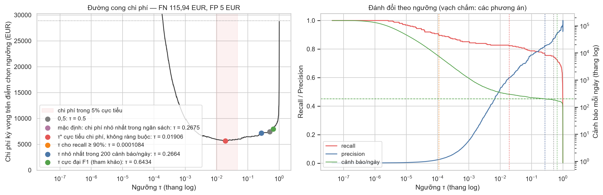

**Đối chứng giao thức trên một ngày thật sự mới.** Chỉ dùng ngày 1 để học và chọn ngưỡng, rồi áp ngưỡng đó cho
ngày 2:

| Giao thức sinh điểm trên ngày 1 | Ngưỡng | Cảnh báo/ngày ước tính → thật | Precision ước tính → thật | Recall ngày 2 |
|---|---|---|---|---|
| CV ngẫu nhiên 5 fold | τ\* | 327 → **539** (×1,65) | 0,734 → 0,312 | 0,836 |
| CV ngẫu nhiên 5 fold | trong ngân sách | 200 → 159 (×0,80) | 0,985 → 0,843 | 0,667 |
| forward-chaining | τ\* | 367 → **536** (×1,46) | 0,687 → 0,313 | 0,836 |
| forward-chaining | trong ngân sách | 199 → 173 (×0,87) | 0,983 → 0,809 | 0,697 |

Forward-chaining ước tính tải sát hơn ở cả hai ngưỡng, nhưng chưa đủ sát; precision ước tính lạc quan ở mọi dòng
vì tỷ lệ gian lận ngày 2 thấp hơn (0,144% so với 0,189%). Và ngưỡng trong ngân sách, dù giữ được tải, chỉ cho
recall 0,67–0,70 ở ngày 2. Vì vậy hệ thống còn **theo dõi** sau khi áp dụng: API-16 so tỷ lệ cảnh báo và
precision theo kết luận thẩm định với kỳ vọng, theo từng khoảng thời gian (mục 10).

### 8.3 Bảng so sánh các phương án ngưỡng

Mỗi ngưỡng chọn trên điểm forward-chaining theo một tiêu chí, đo trên tập kiểm thử (56.746 giao dịch, 95 gian
lận):

| Ngưỡng | τ | Cảnh báo/ngày | TP | FP | FN | Precision [KTC] | Recall [KTC] | Chi phí |
|---|---|---|---|---|---|---|---|---|
| 0,5 | 0,5 | 180 | 71 | 1 | 24 | 0,986 [0,957; 1,000] | 0,747 [0,663; 0,842] | 2.788 EUR |
| **Mặc định: chi phí nhỏ nhất trong ngân sách** | **0,2675** | **187** | **72** | **3** | **23** | **0,960 [0,915; 1,000]** | **0,758 [0,674; 0,842]** | **2.682 EUR** |
| τ\* — cực tiểu chi phí, không ràng buộc | 0,0191 | 242 | 78 | 19 | 17 | 0,804 [0,730; 0,880] | 0,821 [0,747; 0,895] | 2.066 EUR |
| Recall ≥ 90% trên điểm chọn | 0,00011 | 4.325 | 85 | 1.645 | 10 | 0,049 [0,045; 0,053] | 0,895 [0,832; 0,958] | 9.384 EUR |
| Cực đại F1 (tham khảo) | 0,6434 | 177 | 70 | 1 | 25 | 0,986 [0,957; 1,000] | 0,737 [0,653; 0,821] | 2.904 EUR |

(τ nhỏ nhất trong 200 cảnh báo/ngày, 0,2664, cho đúng các con số của ngưỡng mặc định trên tập kiểm thử.)

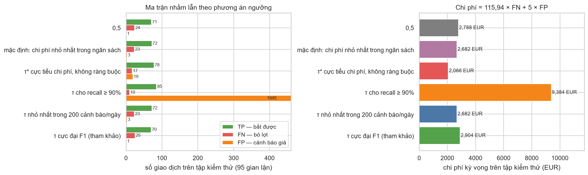

**Diễn giải bằng lời:** *hạ ngưỡng từ 0,5 xuống τ\* = 0,0191 bắt thêm **7** vụ gian lận [+3; +12], đổi lại
**18** cảnh báo giả [+10; +27], tiết kiệm ròng **722 EUR** [238; 1.347] trên tập kiểm thử — khoảng tin cậy không
chứa 0 — dưới giả định chi phí cố định của mục 8.1.* Ngưỡng mặc định thì gần 0,5 hơn là gần τ\*: so với 0,5 nó
chỉ bắt thêm 1 vụ (chi phí −106 [−343; +20] EUR, chứa 0); so với τ\* nó bỏ lọt thêm 6 vụ (+616 [+147; +1.200] EUR).
Đó là cái giá của ngân sách 200 cảnh báo/ngày.

**Nghiệm thu AC-M2 (recall ≥ 0,75 tại ngưỡng đề xuất).** Tại ngưỡng mặc định, recall **0,758** [0,674; 0,842]
= 72/95 với 187 cảnh báo/ngày — **đạt theo ước lượng điểm, sát nút**: một vụ ít hơn là trượt, và cận dưới khoảng
tin cậy xa dưới 0,75. Năng lực thẩm định cần cho recall 0,75, ước lượng trên điểm chọn ngưỡng, là khoảng 185
cảnh báo/ngày — ngân sách 200 vừa đủ. Kết quả có điều kiện: dưới hai giả định nghiệp vụ A-01, A-03, và trên tập
kiểm thử chia ngẫu nhiên; trên một ngày mới (mục 8.2) ngưỡng trong ngân sách chỉ cho recall khoảng 0,70.

Ba điều khác đọc từ bảng:

- **Ngưỡng 0,5 kém hơn bản trước.** Mô hình không có trọng số lớp nên điểm của lớp dương không bị đẩy về sát 1:
  tại 0,5 recall 0,747 (bản trước 0,779). Chọn ngưỡng vì vậy đáng giá hơn — 722 EUR thay vì 197 EUR trên tập
  kiểm thử, và lần này khoảng tin cậy không chứa 0.
- **Ràng buộc chọn vừa khít trên điểm chọn ngưỡng hụt nhẹ trên dữ liệu mới** (recall ≥ 90%: 0,904 → 0,895).
  Ràng buộc tuân thủ thật cần biên an toàn. Cảnh báo/ngày trên tập kiểm thử lại **thấp hơn** ước tính (187 so với
  198; 242 so với 297): ước tính trên điểm forward-chaining là phía thận trọng.
- **Ngân sách là ràng buộc chặt.** Mọi ngưỡng rẻ hơn ngưỡng mặc định đều vượt 200 cảnh báo/ngày; thứ quyết định
  ngưỡng ở đây là năng lực thẩm định, không phải hàm chi phí (mục 8.4).

### 8.4 Độ nhạy theo tỷ lệ chi phí

c_FN và c_FP đều là giả định, nên khuyến nghị chỉ vững nếu ngưỡng tối ưu ổn định trong một dải tỷ lệ rộng
(AC-M8). Giữ c_FP = 5 EUR, đổi c_FN, chọn lại cả τ\* lẫn ngưỡng trong ngân sách trên điểm chọn ngưỡng:

| FN : FP | c_FN (EUR) | τ\* | Cảnh báo/ngày (điểm chọn) | Recall test | Precision test | Hối tiếc khi giữ τ\* mặc định | τ trong ngân sách | Recall test (ngân sách) |
|---|---|---|---|---|---|---|---|---|
| 5 : 1 | 25 | 0,1267 | 218 | 0,768 | 0,948 | 9,6% | 0,4986 | 0,747 |
| 7,5 : 1 | 37,5 | 0,0462 | 254 | 0,789 | 0,862 | 3,6% | 0,2675 | 0,758 |
| 10 : 1 | 50 | 0,0382 | 262 | 0,800 | 0,854 | 1,2% | 0,2675 | 0,758 |
| 15 : 1 – 75 : 1 | 75 – 375 | **0,0191** | 297 | 0,821 | 0,804 | 0% | 0,2675 | 0,758 |
| 100 : 1 | 500 | 0,0035 | 513 | 0,842 | 0,510 | 1,2% | 0,2675 | 0,758 |

"Hối tiếc" là phần chi phí vượt cực tiểu (trên điểm chọn ngưỡng) nếu vẫn giữ τ\* = 0,0191 khi tỷ lệ thật là giá
trị ở cột đầu.

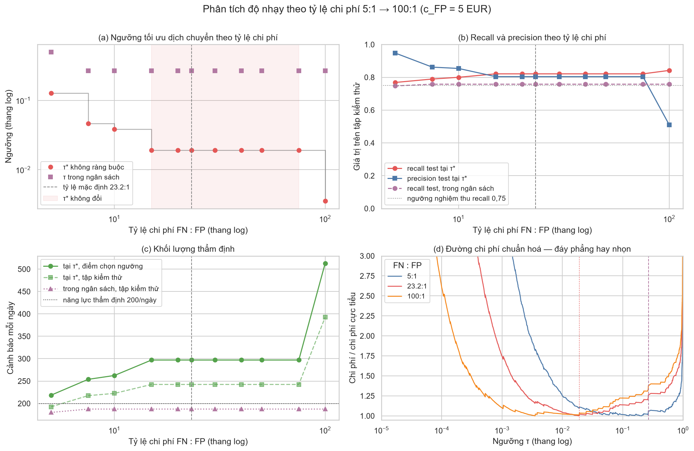

- **τ\* đổi theo bậc, không liên tục**, và **không đổi trên cả dải 15 : 1 → 75 : 1** bao quanh tỷ lệ mặc định
  23,2 : 1. Hối tiếc ≤ 3,6% từ 7,5 : 1 trở lên.
- **Ngưỡng trong ngân sách chỉ có hai giá trị trên cả dải** (0,4986 ở 5 : 1, 0,2675 ở mọi tỷ lệ khác): khi ngân
  sách là ràng buộc chặt, tỷ lệ chi phí gần như hết vai trò.
- **Recall test của τ\* nằm trong 0,77–0,84.** Tỷ lệ chi phí thật sự quyết định **khối lượng thẩm định** (218 →
  513 cảnh báo/ngày), không quyết định recall.

### 8.5 Kiểm tra giả định chi phí: tính theo số tiền của từng vụ

Mục 8.1 tính **mọi** vụ bỏ lọt bằng cùng 115,94 EUR, trong khi 36% vụ gian lận có số tiền ≤ 1 EUR (mục 2).
Hai câu hỏi:

**(a) Nguồn của c_FN có làm lệch ngưỡng không?**

| Nguồn của c_FN | Giá trị | τ\* | Ngưỡng mặc định |
|---|---|---|---|
| Dữ liệu thô (bản trước) | 122,21 EUR | 0,019058 | 0,267544 |
| Sau khi loại trùng lặp | 123,87 EUR | 0,019058 | 0,267544 |
| **Chỉ tập huấn luyện (đang dùng)** | 115,94 EUR | 0,019058 | 0,267544 |

Cả hai ngưỡng không đổi — đáy đủ phẳng, và ngưỡng mặc định do ngân sách quyết định.

**(b) Nếu chi phí bỏ lọt là số tiền của chính vụ bị lọt** (c_FP vẫn 5 EUR): ngưỡng cực tiểu chi phí theo số tiền,
chọn trên điểm chọn ngưỡng, là τ\*ₐ = 0,019058 — **trùng τ\***.

| Tập | Ngưỡng | TP | FP | FN | Tiền gian lận bị lọt | Chi phí — cố định | Chi phí — theo số tiền |
|---|---|---|---|---|---|---|---|
| Điểm chọn | 0,5 | 186 | 27 | 63 | 10.898 EUR | 7.439 | 11.033 |
| Điểm chọn | τ\* = 0,0191 | 206 | 138 | 43 | 8.440 EUR | 5.675 | 9.130 |
| Điểm chọn | mặc định 0,2675 | 189 | 40 | 60 | 10.559 EUR | 7.156 | 10.759 |
| Kiểm thử | 0,5 | 71 | 1 | 24 | 4.052 EUR | 2.788 | 4.057 |
| Kiểm thử | τ\* = 0,0191 | 78 | 19 | 17 | 3.793 EUR | 2.066 | 3.888 |
| Kiểm thử | mặc định 0,2675 | 72 | 3 | 23 | 4.052 EUR | 2.682 | 4.067 |

Hiệu chi phí theo cặp (A − B, âm nghĩa là A rẻ hơn):

| So sánh | Tập | Chi phí cố định | Chi phí theo số tiền |
|---|---|---|---|
| τ\* so với 0,5 | Điểm chọn | −1.764 [−2.752; −821] | −1.903 [−4.749; +84] |
| τ\* so với 0,5 | **Kiểm thử** | **−722 [−1.347; −238]** | **−169 [−673; +105]** |
| Mặc định so với 0,5 | Kiểm thử | −106 [−343; +20] | +9 [−1; +25] |
| Mặc định so với τ\* | Kiểm thử | +616 [+147; +1.200] | +179 [−92; +683] |

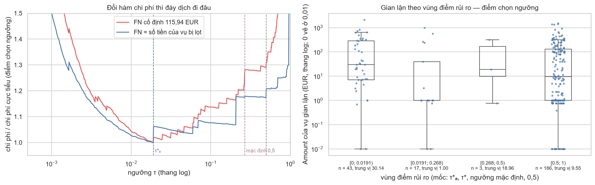

**Khi tính theo số tiền, lợi ích của τ\* so với 0,5 co lại hơn 4 lần và khoảng tin cậy chứa 0.** Bản trước
(XGBoost + `class_weight`) còn thấy τ\* **đắt hơn** 0,5 (+160 [+103; +217] EUR), vì 3 vụ nó bắt thêm chỉ đáng
2–4 EUR; với mô hình không trọng số lớp, các vụ bắt thêm lớn hơn nên dấu không đổi. Tiền mất vẫn tập trung ở vài
vụ lớn mà ngưỡng hợp lý nào cũng bỏ lọt: ở ngưỡng mặc định, 23 vụ lọt trên tập kiểm thử mất 4.052 EUR, ba vụ lớn
nhất (549, 723, 1.097 EUR) chiếm 58%, còn 8 vụ có số tiền ≤ 1 EUR.

**Hệ quả cho kết luận.** "Hạ ngưỡng tiết kiệm tiền" đứng chắc dưới chi phí cố định, chỉ còn là xu hướng dưới chi
phí theo số tiền. Dạng hàm chi phí — cố định, theo số tiền, hay số tiền cộng phí cố định cho vụ thử thẻ — là
quyết định nghiệp vụ, và quyết định cả độ lớn lẫn độ chắc chắn của khoản tiết kiệm.

### 8.6 Từ điểm tới hành động: cho qua, thẩm định, đề xuất chặn

Hệ thống phân ba mức quyết định. Ngưỡng τ tách "cho qua" với "cần thẩm định"; một ngưỡng thứ hai tách "cần thẩm
định" với "đề xuất chặn". Thiết kế ban đầu đặt ngưỡng chặn ở 3τ — một bội số không dựa trên phân tích nào —
nên ngưỡng chặn được chọn lại theo **precision**: ngưỡng nhỏ nhất mà *mọi* ngưỡng từ đó trở lên có precision ≥ p
trên điểm chọn ngưỡng (precision không đơn điệu theo ngưỡng, nên điều kiện đặt cho cả phần đuôi). **Căn cứ là các
dòng "điểm chọn"**; dòng "kiểm thử" chỉ để xác nhận:

| Luật chặn | Ngưỡng chặn | Tập | Thẩm định: gian lận / hợp lệ | Chặn: gian lận / hợp lệ | Precision của "chặn" |
|---|---|---|---|---|---|
| Cũ: 3τ\* | 0,0572 | Điểm chọn | 0 / 0 | 189 / 40 | 0,825 |
| Precision ≥ 90% | 0,6121 | Điểm chọn | 7 / 20 | 182 / 20 | 0,901 |
| **Precision ≥ 95%** | **0,9995** | Điểm chọn | **176 / 40** | **13 / 0** | **1,000** |
| Cũ: 3τ\* | 0,0572 | Kiểm thử | 0 / 0 | 72 / 3 | 0,960 |
| Precision ≥ 90% | 0,6121 | Kiểm thử | 2 / 2 | 70 / 1 | 0,986 |
| **Precision ≥ 95%** | **0,9995** | Kiểm thử | **65 / 3** | **7 / 0** | **1,000** |

Với ngưỡng mặc định 0,2675, luật 3τ\* (0,0572) nằm dưới τ nên biến mọi cảnh báo thành "đề xuất chặn" — 40 khách
hợp lệ trên điểm chọn ngưỡng bị chặn thẳng. Hệ thống dùng mức 95% (`BLOCK_MIN_PRECISION`): trên điểm forward-
chaining, điều kiện cho mọi phần đuôi chỉ thoả từ 0,9995, nên chỉ các vụ gần như chắc chắn bị chặn tự động (7 vụ
gian lận, 0 khách hợp lệ trên tập kiểm thử) và gần như mọi cảnh báo qua tay người thẩm định — chấp nhận được khi
tải chỉ khoảng 190 cảnh báo/ngày. Mức 90% chặn được 70 gian lận đổi lấy 1 khách hợp lệ; chọn mức nào là quyết định
nghiệp vụ (bản trước, với OOF ngẫu nhiên và mô hình có trọng số lớp, mức 95% cho 0,9735).

### 8.7 Điểm rủi ro có phải xác suất không?

Tính gộp thì gần: điểm trung bình trên điểm chọn ngưỡng 0,00122 so với tỷ lệ gian lận 0,00137; Brier 0,000439,
tốt hơn khoảng 3 lần so với đoán hằng số (0,001369). Theo từng dải điểm (khoảng tin cậy Wilson 95% [12] cho tỷ lệ
thật):

| Dải điểm (điểm chọn ngưỡng) | Số giao dịch | Điểm trung bình | Tỷ lệ gian lận thật [KTC] |
|---|---|---|---|
| < 0,001 | 180.250 | 0,000022 | 0,00021 [0,00015; 0,00028] |
| 0,001 – 0,005 | 832 | 0,0020 | 0,0072 [0,0033; 0,0156] |
| 0,005 – 0,02 | 161 | 0,0095 | 0,0062 [0,0011; 0,0343] |
| 0,02 – 0,1 | 83 | 0,049 | 0,108 [0,058; 0,193] |
| 0,1 – 0,5 | 45 | 0,266 | 0,222 [0,125; 0,363] |
| 0,5 – 0,9 | 39 | 0,709 | 0,51 [0,36; 0,66] |
| ≥ 0,9 | 174 | 0,986 | 0,954 [0,912; 0,977] |

Không còn trọng số lớp nên điểm gần xác suất hơn bản trước (dải ≥ 0,9: 0,986 so với 0,954, bản trước 0,997 so với
0,936), nhưng vẫn lệch ở hai đầu: dải 0,5–0,9 quá tự tin, dải 0,02–0,1 và dưới 0,001 thiếu tự tin. Điều này
**không** ảnh hưởng tới mọi kết quả dựa trên thứ hạng và ngưỡng (PR-AUC, các ngưỡng, các bảng trên). Nó **có** ảnh
hưởng nếu ai đó đọc điểm như xác suất hoặc tính tổn thất kỳ vọng `điểm × số tiền`; khi đó cần hiệu chỉnh đơn
điệu (isotonic) [13] trên điểm out-of-fold — chưa làm. Giao diện vì vậy gọi đây là "điểm rủi ro", không phải
"xác suất".

### 8.8 Trả lời câu hỏi "vì sao chọn ngưỡng này"

Ngưỡng mặc định **0,2675** là ngưỡng có chi phí kỳ vọng nhỏ nhất trong những ngưỡng giữ tải thẩm định ở tối đa
200 cảnh báo/ngày, với giả định bỏ lọt một vụ tốn 115,94 EUR và thẩm định một cảnh báo tốn 5 EUR. Nó được **chọn
trên điểm forward-chaining** của tập huấn luyện, để tập kiểm thử giữ vai trò đo khách quan và để ước tính tải
cảnh báo sát với một ngày mới. Trên tập kiểm thử: recall 0,758, precision 0,960, 187 cảnh báo/ngày.

Nếu không có ràng buộc ngân sách, τ\* = 0,0191 rẻ hơn rõ rệt (−616 EUR trên tập kiểm thử) nhưng cần khoảng 300
cảnh báo/ngày; τ\* vững trước sai số của tỷ lệ chi phí (không đổi trong dải 15 : 1 – 75 : 1). Ba giới hạn đi kèm:
lợi thế của việc hạ ngưỡng co lại và mất ý nghĩa thống kê nếu chi phí bỏ lọt tỷ lệ với số tiền giao dịch; trên một
ngày mới, ngưỡng trong ngân sách chỉ cho recall khoảng 0,70; và cả ba giả định A-01…A-03 chưa được nghiệp vụ xác
nhận. Vì vậy ngưỡng là **cấu hình** của hệ thống — người dùng đổi được lúc chạy, thấy ngay hệ quả trên điểm chọn
ngưỡng, và theo dõi được sau khi áp dụng (mục 10) — chứ không phải một phần cứng của mô hình.

---

## 9. Giải thích mô hình và phân tích lỗi

### 9.1 SHAP toàn cục

Giá trị SHAP [14, 15] tính bằng TreeSHAP trên mô hình XGBoost, thang log-odds; tổng các đóng góp cộng giá
trị cơ sở bằng đúng logit của điểm rủi ro (sai số cộng tối đa 2,4·10⁻⁵). Giá trị cơ sở là −6,85 (xác suất
0,001) — mô hình không có trọng số lớp nên điểm xuất phát sát tỷ lệ gian lận thật.

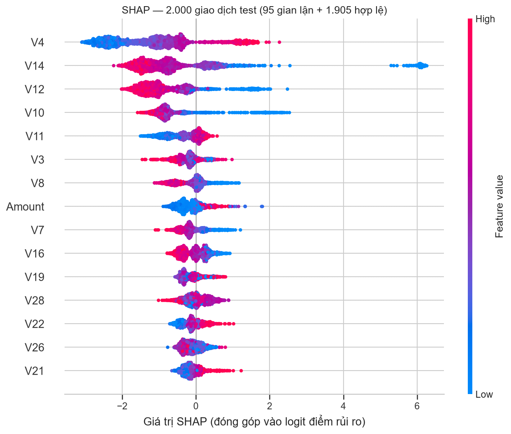

| Hạng SHAP | Đặc trưng | mean\|SHAP\| | Tỷ trọng | Hạng theo Cohen's d | Hạng theo Cliff's δ |
|---|---|---|---|---|---|
| 1 | V4 | 1,39 | 14,7% | 9 | 2 |
| 2 | V14 | 1,02 | 10,7% | 2 | 1 |
| 3 | V12 | 0,99 | 10,5% | 3 | 3 |
| 4 | V10 | 0,85 | 8,9% | 4 | 5 |
| 5 | V11 | 0,40 | 4,2% | 8 | 4 |
| 6 | V3 | 0,31 | 3,3% | 6 | 6 |
| 7 | V8 | 0,29 | 3,0% | 17 | 18 |

- **Năm đặc trưng V4, V14, V12, V10, V11 chiếm 49% tổng mean|SHAP|.** `Amount` đứng hạng 8 (2,9%), giờ
  trong ngày (`hour_sin` + `hour_cos`) 2,8%. Riêng trong lớp gian lận, V14 đứng đầu. (Mô hình có trọng số
  lớp của bản trước: V14 dẫn đầu với 15,8%, `Amount` hạng 19.)
- **SHAP và thống kê đơn biến chỉ đồng thuận vừa phải:** tương quan hạng Spearman với Cohen's d 0,40,
  với Cliff's δ 0,46, với hệ số Logistic Regression 0,47.
- **V17 — hạng 1 theo Cohen's d — xếp cuối (31/31) theo SHAP.** Nó tách hai lớp rất tốt khi đứng một mình
  (mục 3), nhưng thừa thông tin khi mô hình đã có V14, V12, V10. Một đặc trưng mạnh đơn biến không nhất
  thiết quan trọng trong mô hình nhiều biến — đây là câu trả lời cho câu hỏi mục 3 để ngỏ.

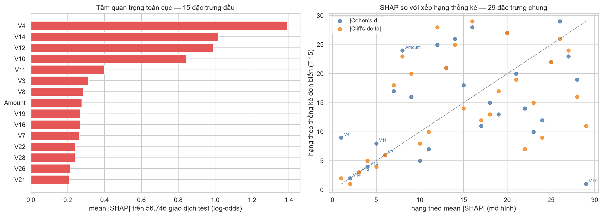

### 9.2 Phân tích lỗi

Tại ngưỡng mặc định, trên tập kiểm thử: 72 TP, 3 FP, 23 FN.

**Bỏ lọt (FN) là giới hạn của đặc trưng, không phải của ngưỡng.** 13/23 vụ bỏ lọt có điểm dưới 0,001 —
mô hình gần như chắc chắn chúng hợp lệ; trung vị điểm của FN là 0,00028. **61% vụ bỏ lọt có cả 5 đặc
trưng chính nằm trong khoảng [P1, P99] của lớp hợp lệ**, so với 1,4% ở các vụ bắt được. Trung vị V14:
TP −7,21, FN −0,93, giao dịch hợp lệ 0,06 — vụ bị lọt trông giống giao dịch hợp lệ. Không ngưỡng hợp lý
nào bắt được chúng mà không kéo theo hàng nghìn cảnh báo giả (mục 8.3, dòng recall ≥ 90%: 1.645 cảnh báo
giả). Trung vị `Amount` của FN chỉ 3,76 EUR, so với 31,99 ở các vụ bắt được.

**Cảnh báo giả (FP) mang chữ ký của gian lận.** Ở ngưỡng mặc định chỉ có 3 cảnh báo giả, và cả ba có V14,
V10, V12 đẩy điểm lên mạnh (trung vị V14 của chúng −6,80 — nằm giữa vùng gian lận); điểm trung vị 0,48. Một
trong ba là giao dịch có `Amount` lớn nhất bộ dữ liệu (25.691,16 EUR). Giao dịch hợp lệ điểm cao nhất (0,998)
có thể là bất thường thật hoặc nhãn sai — dữ liệu không phân biệt được.

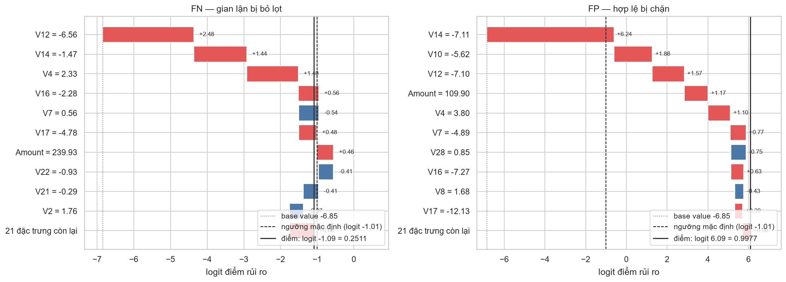

**Giới hạn của mọi diễn giải ở đây:** V1–V28 là thành phần chính sau PCA, ẩn danh hoá. SHAP chỉ nói được
"V14 đẩy điểm rủi ro lên", **không** nói được "vì giao dịch diễn ra ở nước ngoài" hay bất kỳ nguyên nhân
nghiệp vụ nào. Gán ý nghĩa nghiệp vụ cho V1–V28 là sai sự thật.

---

## 10. Ứng dụng demo

Mô hình được đóng gói thành một hệ thống chấm điểm và thẩm định cho hai vai: người phân tích (xem hàng
đợi, quyết định từng giao dịch) và người quản lý rủi ro (chọn ngưỡng, xem hiệu năng).

### 10.1 Kiến trúc

```
Trình duyệt ──► web (nginx, cổng 3000) ──► tệp tĩnh: giao diện Next.js + TypeScript
                         │ /api/…
                         ▼
                 api (FastAPI, cổng 8000) ──► nạp hiện vật lúc khởi động (chỉ đọc):
                         │                    model.joblib, metrics.json, threshold.json,
                         │                    oof_scores.npz, test_set.parquet, sample_pool.json
                         ▼
                 db (PostgreSQL 16): transactions, reviews, settings
```

- **Một lệnh dựng cả hệ thống:** `docker compose up --build`. Thứ tự khởi động: PostgreSQL khỏe → API
  dựng lược đồ (Alembic) và nạp mô hình → giao diện. Khởi động lạnh 13,7–14,9 giây, ấm 11,1–11,5 giây.
- **Không lệch giữa huấn luyện và phục vụ:** API sinh đặc trưng bằng cùng `build_features` với notebook,
  và lúc khởi động chấm lại một phần tập kiểm thử để chắc rằng mô hình cho đúng điểm đã lưu; lệch thì
  từ chối phục vụ.
- **Ngưỡng là cấu hình:** điểm rủi ro lưu vào cơ sở dữ liệu; quyết định và dải rủi ro tính lại từ ngưỡng
  hiện hành mỗi lần trả về. Ngưỡng do người dùng đặt gắn với đúng phiên bản mô hình lúc đặt.
- **Bảo mật ở mức demo:** không có đăng nhập (ngoài phạm vi); vì vậy mọi cổng mặc định chỉ mở trên
  `127.0.0.1`.

### 10.2 Bốn màn hình

**Hàng đợi thẩm định** — giao dịch vượt ngưỡng, sắp theo điểm giảm dần, kèm đề xuất (thẩm định / chặn).
Nạp dữ liệu bằng tải CSV, thư viện mẫu, hoặc phát lại ngày 2.

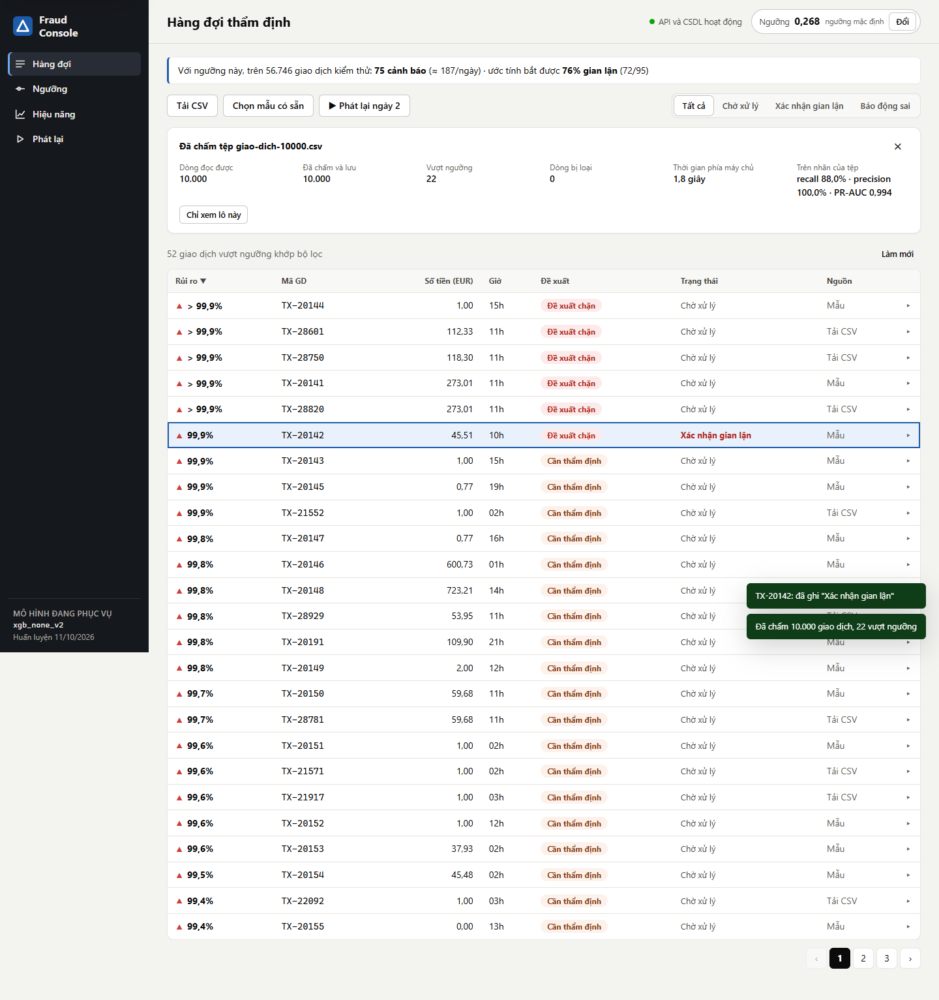

**Chi tiết giao dịch** — điểm, vị trí so với ngưỡng, biểu đồ thác nước SHAP (5 yếu tố đẩy lên, 3 yếu tố
kéo xuống). Nhãn thật chỉ hiện **sau** khi người thẩm định quyết định, để không dẫn dắt; chú thích cố
định nhắc rằng V1–V28 không mang nghĩa nghiệp vụ.

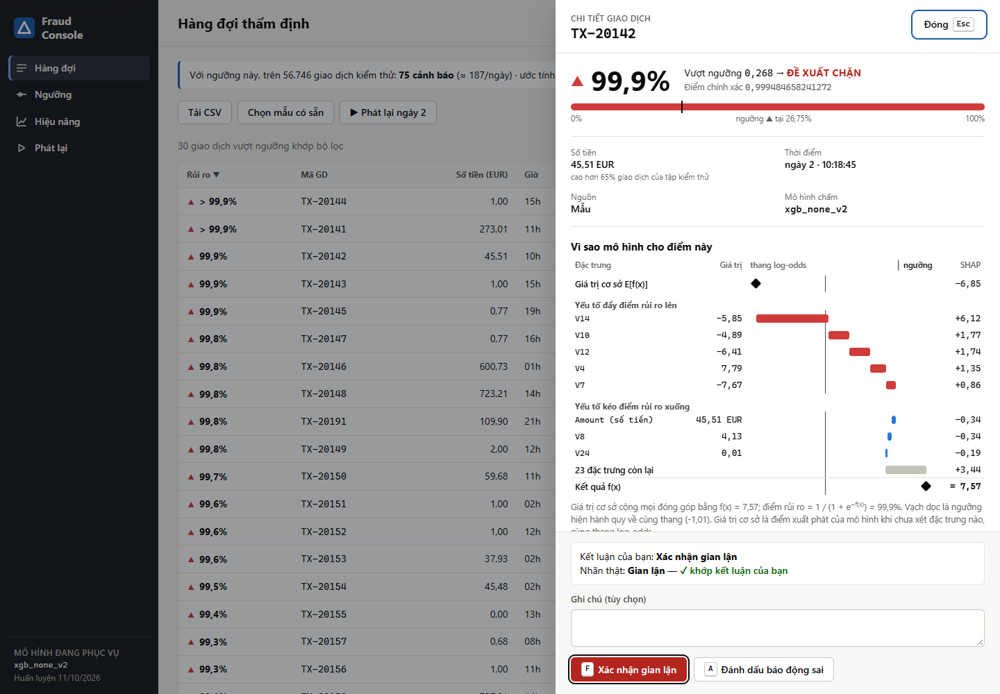

**Cấu hình ngưỡng** — thanh trượt theo thang log; mọi chỉ số (cảnh báo/ngày, gian lận bắt được,
precision, chi phí) tính lại ngay trong trình duyệt **trên điểm chọn ngưỡng** — điểm forward-chaining của
tập huấn luyện, gửi xuống dạng nhị phân đã sắp — không trên tập kiểm thử, vì kéo thanh trượt là đang chọn
ngưỡng (ML-08). Một dòng chỉ đọc cho kết quả của ngưỡng đang áp dụng trên tập kiểm thử. Đổi tham số chi phí
thì máy chủ tìm lại ngưỡng tối ưu trên cùng bộ điểm; ràng buộc ngân sách điền sẵn theo chính sách mặc định.
Hình dưới (chụp 2026-10-11, mô hình `xgb_none_v2`): chi phí bỏ lọt 600 EUR với ngân sách 150 cảnh báo/ngày —
hệ thống báo ràng buộc đang chặn nghiệm (không có nó, ngưỡng tối ưu là 0,0035).

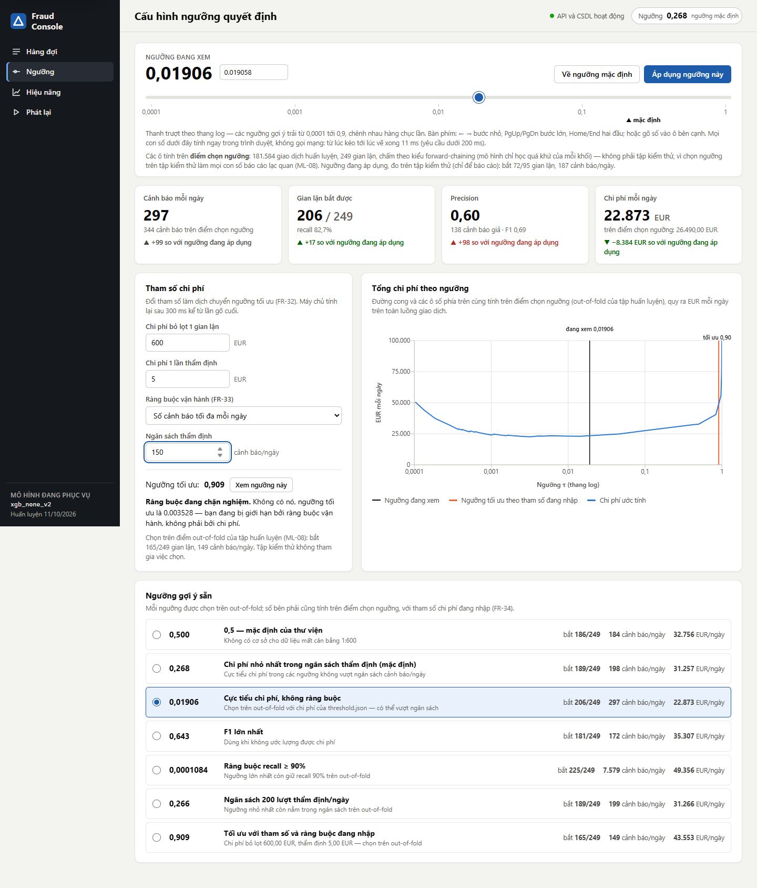

**Hiệu năng mô hình** và **phát lại** — chỉ số kèm khoảng tin cậy, đường PR/ROC, bảng so sánh chiến
lược; chế độ phát lại cho giao dịch ngày 2 "chảy" theo đồng hồ mô phỏng, mô hình chấm từng mẻ khi
giao dịch tới giờ. Màn hình hiệu năng có thêm thẻ **theo dõi vận hành** (`GET /monitoring`): với các giao
dịch mô hình hiện hành đã chấm, theo từng khoảng 6 giờ của dữ liệu, so tỷ lệ cảnh báo (quy ra mỗi ngày),
precision theo kết luận thẩm định và recall theo nhãn với kỳ vọng ước lượng trên điểm chọn ngưỡng; khoảng
nào lệch quá dao động mẫu (KTC Wilson 95%) thì được đánh dấu — tín hiệu để chọn lại ngưỡng.

### 10.3 Nghiệm thu

| Mã | Tiêu chí | Kết quả |
|---|---|---|
| AC-A1 | Tải CSV 10.000 dòng, chấm xong dưới 30 giây | 1,9–2,0 giây (đo lại 2026-10-11 bằng `scripts/ui/flow.js`); 3,1 giây tới lúc giao diện hiện kết quả (2026-10-02) |
| AC-A2 | Hàng đợi sắp đúng theo điểm | Đạt |
| AC-A3 | Kéo thanh trượt cập nhật dưới 200 ms | Lâu nhất 44–68 ms qua 2 lượt trên điểm chọn ngưỡng (2026-10-11; trước review 43–131 ms) |
| AC-A4 | 5 yếu tố dương và 3 yếu tố âm | Đạt **khi mô hình có đủ**: 77% giao dịch điểm thấp có ít hơn 5 đặc trưng đẩy điểm lên; hệ thống không mượn một đóng góp âm để cho đủ 5 |
| AC-A5 | Đổi chi phí làm dịch ngưỡng tối ưu | c_FN 115,94 → 600 EUR: τ tối ưu không ràng buộc 0,0191 → 0,0035 trên điểm chọn ngưỡng (`tests/test_api.py`); với ngân sách 200/ngày ngưỡng giữ 0,2675 — ràng buộc chặn nghiệm |
| AC-A6 | Phát lại 3 phút không lỗi | 185 giây, 1.605 giao dịch, 0 lỗi |
| AC-A7 | Kết luận thẩm định còn sau khởi động lại | Đạt |
| AC-A8 | `docker compose up` trên máy sạch | Đạt trên bản sao sạch của repo — **cùng máy vật lý**, chưa thử trên máy thứ hai |
| AC-A9 | Điều hướng bằng bàn phím | 24/24 bước; Lighthouse Accessibility 100 |
| AC-A10 | Đầu vào sai trả đúng mã lỗi, không sập | 13 loại đầu vào sai, đúng mã HTTP và mã lỗi |

Chấm một giao dịch (`/score`): p95 16,8 ms phía máy chủ, 26,4 ms tính cả HTTP (yêu cầu < 50 ms). 406 ca
kiểm thử tự động xanh (2026-10-11), gồm kiểm thử chống rò rỉ — cả quét mã lẫn kiểm thử canary theo hành vi —,
đối chiếu phép tính ngưỡng giữa trình duyệt và Python tới từng bit (kể cả đường nhị phân của điểm chọn
ngưỡng), và đối chiếu SHAP của API với explainer của notebook tới từng bit.

---

## 11. Hạn chế và hướng mở rộng

### 11.1 Hạn chế của dữ liệu

1. **V1–V28 là thành phần chính sau PCA, không diễn giải được.** Mọi kết luận về đặc trưng (mục 3, 9)
   dừng ở mức "V14 quan trọng"; không suy ra được nguyên nhân nghiệp vụ, không thiết kế được đặc trưng
   mới từ hiểu biết nghiệp vụ, và không kiểm được mô hình có học điều gì vô lý hay không.
2. **Dữ liệu chỉ trải trong hai ngày của tháng 9/2013**, tại châu Âu. Không đại diện cho mùa vụ, cho thị
   trường khác, hay cho các kiểu gian lận xuất hiện sau đó. Ngay giữa hai ngày đã có dịch chuyển: ngưỡng
   chọn bằng CV ngẫu nhiên trên ngày 1 cho precision 0,365 ở ngày 2, so với 0,862 khi chia ngẫu nhiên (mục 7.3);
   ngưỡng chọn bằng forward-chaining ước tính tải sát hơn nhưng vẫn lệch (mục 8.2).
3. **Chỉ 492 mẫu dương (95 trong tập kiểm thử) làm khoảng tin cậy rất rộng.** Khoảng tin cậy 95% của
   PR-AUC rộng 0,15 (0,747–0,900), của recall tại ngưỡng mặc định rộng 0,17 (0,674–0,842). Cận dưới của cả
   hai dưới tiêu chí 0,75; nhiều so sánh giữa các cấu hình không kết luận được (mục 5, 6.3, 7.1).
4. **Hai điều bộ dữ liệu không ghi** mà đồ án phải quy ước: đơn vị tiền (EUR) và giờ bắt đầu của `Time`
   (00:00) — mục 1.4.
5. **Nhãn có sẵn tại thời điểm chấm.** Trong thực tế nhãn gian lận chỉ có sau điều tra, có độ trễ; đánh
   giá ở đây không mô phỏng độ trễ đó.

### 11.2 Hạn chế của phương pháp

- **Chi phí và ngân sách thẩm định là giả định chưa được nghiệp vụ xác nhận.** Dạng hàm chi phí quyết định
  độ lớn và độ chắc chắn của khoản tiết kiệm khi hạ ngưỡng (mục 8.5); ngân sách quyết định ngưỡng mặc định
  và việc AC-M2 đạt hay không (mục 8.2, 8.3).
- **Đánh giá chính dùng cách chia ngẫu nhiên.** Ngưỡng đã được chọn trên điểm forward-chaining theo thời gian,
  nhưng PR-AUC và các bảng chính vẫn đo trên tập kiểm thử chia ngẫu nhiên; cách chia theo thời gian sát
  triển khai hơn và cho kết quả thấp hơn.
- **Quy tắc chọn cấu hình được đề xuất sau khi đã thấy bảng 20 tổ hợp** (dù trước khi chạy CV lặp, lưới theo
  mức, và không nhìn tập kiểm thử) — không hoàn toàn "đặt trước" theo nghĩa chặt.
- **Điểm rủi ro không phải xác suất ở hai đầu** (mục 8.7).
- **Theo dõi sau áp dụng mới ở mức so với kỳ vọng**: chưa có cảnh báo tự động, chưa tự chọn lại ngưỡng, và
  recall ngoài đời cần nhãn đến trễ.
- **Tái lập mới kiểm trên một máy**; huấn luyện lại trên máy khác số lõi có thể lệch nhẹ (mục 7.5).

### 11.3 Hướng mở rộng

- **Chi phí theo số tiền trong hệ thống:** cho phép chọn ngưỡng theo hàm chi phí `Amount` của từng giao
  dịch (đã có trong `src/threshold.py`), hoặc quyết định theo tổn thất kỳ vọng từng giao dịch sau khi
  hiệu chỉnh xác suất.
- **Hiệu chỉnh xác suất** (isotonic trên out-of-fold) để điểm đọc được như xác suất.
- **Theo dõi dịch chuyển đầy đủ hơn:** hệ thống đã so tỷ lệ cảnh báo và precision thẩm định với kỳ vọng
  (API-16); bước tiếp là PSI của phân bố điểm, cảnh báo tự động, và chọn lại ngưỡng trên cửa sổ nhãn thẩm định
  gần nhất (bảng `reviews`).
- **Đánh giá theo thời gian làm mặc định** khi có dữ liệu dài hơn hai ngày.
- **Đặc trưng hành vi theo thẻ** (tần suất, số tiền so với lịch sử của chính chủ thẻ) — không làm được
  với bộ dữ liệu này vì không có mã thẻ.

---

## 12. Kết luận

1. Ở tỷ lệ 1 : 600, **accuracy vô nghĩa** và ROC-AUC che mất khác biệt; PR-AUC kèm khoảng tin cậy mới
   phân biệt được mô hình. Accuracy thậm chí xếp hạng ngược hai mô hình cơ sở.
2. Trong 20 tổ hợp, **mô hình quyết định nhiều hơn chiến lược xử lý mất cân bằng**. So ở cùng mức cân bằng
   và tính cả phương sai huấn luyện, phần lớn khác biệt giữa trọng số lớp và SMOTE là do mức cân bằng; với
   XGBoost không chiến lược nào hơn không xử lý, nên quy tắc đặt trước chọn **XGBoost không xử lý mất cân
   bằng**. SMOTE + Tomek không thêm gì; undersampling nhanh nhưng kém ở mọi mức.
3. Mô hình cuối đạt **PR-AUC 0,828 [0,747; 0,900]** trên tập kiểm thử; tại ngưỡng mặc định **recall 0,758
   [0,674; 0,842]** với 187 cảnh báo/ngày — đạt tiêu chí theo ước lượng điểm, sát nút; khi chia theo thời
   gian PR-AUC còn 0,773.
4. **Chọn ngưỡng là trọng tâm của bài toán, và kết luận phụ thuộc giả định nghiệp vụ.** Dưới chi phí cố định,
   hạ ngưỡng 0,5 → τ\* = 0,0191 tiết kiệm rõ (722 EUR trên tập kiểm thử) và τ\* vững trong dải tỷ lệ
   15 : 1 – 75 : 1; tính theo số tiền, lợi thế chỉ còn là xu hướng. Đáy chi phí phẳng nằm ngoài ngân sách
   thẩm định, nên **năng lực thẩm định quyết định ngưỡng mặc định**; và ngưỡng phải chọn trên dữ liệu mô phỏng
   tương lai (forward-chaining), rồi theo dõi sau khi áp dụng.
5. Vụ bỏ lọt là **giới hạn của đặc trưng**: 61% trông giống giao dịch hợp lệ trên cả 5 đặc trưng quan trọng
   nhất. Học có giám sát thắng rõ autoencoder (0,828 so với 0,329).
6. Ngưỡng được tách khỏi mô hình thành cấu hình của một hệ thống chạy được, nơi người dùng thấy ngay cái
   giá của mỗi lựa chọn ngưỡng — ước lượng trên điểm chọn ngưỡng, không trên tập kiểm thử — và theo dõi được
   nó sau khi áp dụng.

---

## Tài liệu tham khảo

1. A. Dal Pozzolo, O. Caelen, R. A. Johnson, G. Bontempi. *Calibrating Probability with Undersampling for
   Unbalanced Classification.* IEEE Symposium on Computational Intelligence and Data Mining (CIDM), 2015.
   Dữ liệu: Machine Learning Group — ULB, *Credit Card Fraud Detection*, Kaggle,
   <https://www.kaggle.com/datasets/mlg-ulb/creditcardfraud>, giấy phép Database Contents License (DbCL) v1.0.
2. T. Saito, M. Rehmsmeier. *The Precision-Recall Plot Is More Informative than the ROC Plot When
   Evaluating Binary Classifiers on Imbalanced Datasets.* PLoS ONE 10(3), 2015.
3. N. V. Chawla, K. W. Bowyer, L. O. Hall, W. P. Kegelmeyer. *SMOTE: Synthetic Minority Over-sampling
   Technique.* Journal of Artificial Intelligence Research 16, 2002.
4. I. Tomek. *Two Modifications of CNN.* IEEE Transactions on Systems, Man, and Cybernetics 6(11), 1976.
5. T. Chen, C. Guestrin. *XGBoost: A Scalable Tree Boosting System.* KDD 2016.
6. G. Lemaître, F. Nogueira, C. K. Aridas. *Imbalanced-learn: A Python Toolbox to Tackle the Curse of
   Imbalanced Datasets in Machine Learning.* Journal of Machine Learning Research 18, 2017.
7. H. B. Mann, D. R. Whitney. *On a Test of Whether One of Two Random Variables Is Stochastically Larger
   than the Other.* Annals of Mathematical Statistics 18(1), 1947.
8. Y. Benjamini, Y. Hochberg. *Controlling the False Discovery Rate: A Practical and Powerful Approach to
   Multiple Testing.* Journal of the Royal Statistical Society B 57(1), 1995.
9. N. Cliff. *Dominance Statistics: Ordinal Analyses to Answer Ordinal Questions.* Psychological
   Bulletin 114(3), 1993.
10. B. Efron, R. J. Tibshirani. *An Introduction to the Bootstrap.* Chapman & Hall, 1993.
11. C. Elkan. *The Foundations of Cost-Sensitive Learning.* IJCAI 2001.
12. E. B. Wilson. *Probable Inference, the Law of Succession, and Statistical Inference.* Journal of the
    American Statistical Association 22, 1927.
13. B. Zadrozny, C. Elkan. *Transforming Classifier Scores into Accurate Multiclass Probability
    Estimates.* KDD 2002.
14. S. M. Lundberg, S.-I. Lee. *A Unified Approach to Interpreting Model Predictions.* NeurIPS 2017.
15. S. M. Lundberg và cộng sự. *From Local Explanations to Global Understanding with Explainable AI for
    Trees.* Nature Machine Intelligence 2, 2020.
16. F. Pedregosa và cộng sự. *Scikit-learn: Machine Learning in Python.* Journal of Machine Learning
    Research 12, 2011.
17. C. Nadeau, Y. Bengio. *Inference for the Generalization Error.* Machine Learning 52(3), 2003.

---

## Phụ lục

### A. Đối chiếu tiêu chí nghiệm thu phần mô hình và tài liệu

| Mã | Tiêu chí | Kết quả | Ở đâu |
|---|---|---|---|
| AC-M1 | PR-AUC test ≥ 0,75 | 0,828 [0,747; 0,900] — đạt theo ước lượng điểm | 7.2 |
| AC-M2 | Recall ≥ 0,75 tại ngưỡng đề xuất | 0,758 [0,674; 0,842] tại ngưỡng mặc định, 187 cảnh báo/ngày — đạt theo ước lượng điểm, sát nút, có điều kiện (giả định chi phí và ngân sách; ngày mới ~0,70) | 7.2, 8.3 |
| AC-M3 | Đủ 20 tổ hợp | 20/20, thêm 48 tổ hợp ở cùng mức cân bằng | 6.2, 6.4 |
| AC-M4 | Không rò rỉ | 7/7 điểm kiểm thành kiểm thử tự động, thêm kiểm thử canary; không gian lận nào trùng gần đúng giữa hai tập | 4.3 |
| AC-M5 | Tái lập, PR-AUC lệch < 0,001 | Lệch 0 (lần xuất `xgb_none_v2`) | 7.5 |
| AC-M6 | Khoảng tin cậy cho chỉ số chính | Mọi chỉ số chính | 7.2, 8.3 |
| AC-M7 | Hai cách chia tập | Ba cách chia, có nhóm đối chứng | 7.3 |
| AC-M8 | Độ nhạy theo tỷ lệ chi phí | 5 : 1 → 100 : 1 | 8.4 |
| AC-D1 | Trả lời "vì sao chọn ngưỡng này" bằng lập luận chi phí | Có, kèm giới hạn | 8.8 |
| AC-D2 | Nêu hạn chế: PCA, hai ngày, 492 mẫu dương | Có | 11.1 |
| AC-D3 | README chạy lại từ đầu | `README.md`, mục "Chạy lại từ đầu trên máy sạch" | — |
| AC-D4 | Biểu đồ có tiêu đề, nhãn trục, đơn vị | Có | Mọi hình |
| AC-D5 | Nguồn dữ liệu và giấy phép DbCL v1.0 | Có | 1.2, tài liệu tham khảo [1] |

### B. Tái lập kết quả

| Bước | Lệnh hoặc notebook | Sinh ra |
|---|---|---|
| Tải dữ liệu | `python scripts/download_data.py --mirror` | `data/creditcard.csv`, tự kiểm toàn vẹn |
| EDA, thống kê | `notebooks/01_eda`, `02_statistics` | `reports/figures/01_*`, `02_*`, `feature_ranking.csv` |
| Mô hình cơ sở | `notebooks/03_baseline` | `data/test_set.parquet`, `baseline_results.csv` |
| Lưới 20 tổ hợp | `python scripts/run_grid.py` | `grid_results.csv` (≈ 46 phút) |
| Lưới theo mức, CV lặp | `python scripts/run_ratio_grid.py`, `python scripts/run_repeated_cv.py`, rồi `notebooks/04_imbalance_strategies` (§5.8 chọn cấu hình cuối, khớp `src/config.py`) | `ratio_grid.csv`, `repeated_cv.csv`, `repeated_cv_tests.csv` (≈ 86 + 81 phút) |
| Tinh chỉnh, tập kiểm thử | `python scripts/run_search.py`, rồi `notebooks/05_advanced_models` | `search_results.csv`, `final_test_metrics.csv`, `split_comparison.csv`, `final_choice.json` |
| Ngưỡng, chi phí | `notebooks/06_threshold_and_cost` | `threshold_comparison.csv`, `cost_sensitivity.csv`, `amount_cost_*.csv`, `block_threshold.csv`, `calibration.csv`, `acceptance.csv`, `threshold_protocol.csv` |
| Autoencoder, SHAP | `notebooks/06b_autoencoder`, `07_explainability` | `autoencoder_comparison.csv`, `shap_ranking.csv`, `error_analysis.csv` |
| Hiện vật cho API | `notebooks/08_export_artifacts` | `models/*`, `data/sample_pool.json` |
| Kiểm tra tái lập | `python scripts/check_reproducibility.py` | `reproducibility.csv` (≈ 47 phút) |
| Hệ thống | `docker compose up --build` | http://localhost:3000 |

Môi trường: Python 3.12; phiên bản thư viện ghim trong `requirements.txt` trùng với lúc xuất hiện vật
(numpy 2.5.3, pandas 3.0.5, scikit-learn 1.9.1, imbalanced-learn 0.14.2, xgboost 3.4.1, shap 0.52.0).

### C. Ánh xạ với chương trình học

| Chương | Vận dụng trong đồ án |
|---|---|
| Ch.1 | Quy trình khoa học dữ liệu từ dữ liệu thô tới hệ thống chạy được |
| Ch.2 — PCA | Đọc hiểu V1–V28 là thành phần chính; không chạy PCA lần nữa (mục 2, 3) |
| Ch.3 — EDA | Phân bố `Amount`/`Time`, tương quan, t-SNE (mục 2) |
| Ch.4 — Xác suất, thống kê | Mất cân bằng cực đoan, Precision/Recall/PR-AUC, kiểm định Mann–Whitney, BH, bootstrap (mục 3, 4) |
| Ch.5 — Mô hình tuyến tính, cây | Logistic Regression, Decision Tree (mục 5) |
| Ch.6 — Ensemble, mất cân bằng | Random Forest, XGBoost, SMOTE, trọng số lớp, chọn ngưỡng, học theo chi phí (mục 6, 8) |
| Ch.8 — Học sâu (tùy chọn) | Autoencoder phát hiện bất thường (mục 7.4) |
